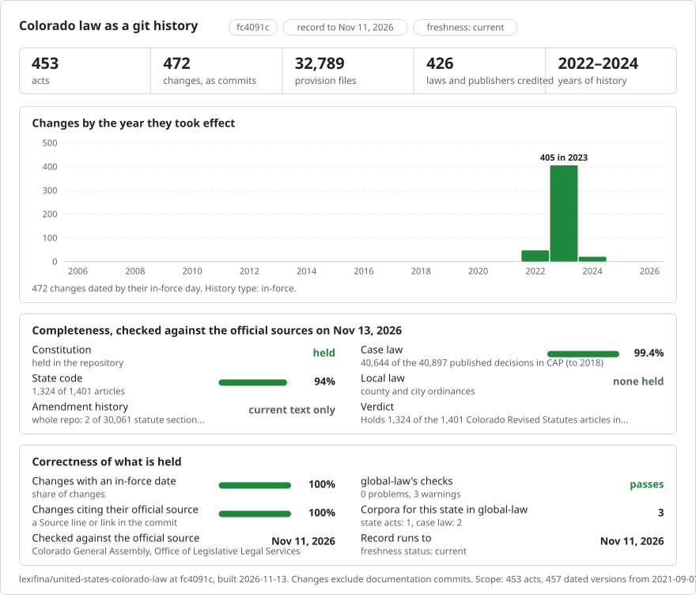

# Colorado: law history in git

<picture>
<source media="(prefers-color-scheme: dark)" srcset="data/effort-dark.svg">

</picture>

Part of [lexifina/global-law](https://github.com/lexifina/global-law), one git history for every country's law: this is the law of Colorado, United States, which global-law reads at `united-states/colorado/acts/`.

The Constitution of the State of Colorado and the Colorado Revised Statutes as a git repository: one file per section, one paragraph per line, so `git blame` works line by line. It follows the shared design of [lexifina/global-law](https://github.com/lexifina/global-law).

**What is in it now**

| Folder | Act | Versions | History |
| --- | --- | ---: | --- |
| `constitution/` | Constitution of the State of Colorado (354 units) | 1 | As printed in the Colorado Revised Statutes 2022, dated 10 August 2022 (oldest version available) |
| `title-01/` | Colorado Revised Statutes, Title 1: Elections (748 sections) | 1 | As printed in the Colorado Revised Statutes 2022, dated 10 August 2022 (oldest version available) |
| `title-02/` | Colorado Revised Statutes, Title 2: Legislative (229 sections) | 1 | As printed in the Colorado Revised Statutes 2022, dated 10 August 2022 (oldest version available) |
| `title-03/` | Colorado Revised Statutes, Title 3: United States (41 sections) | 1 | As printed in the Colorado Revised Statutes 2022; latest source-noted change effective 7 September 2021 (oldest version available) |
| `title-04/` | Colorado Revised Statutes, Title 4: Uniform Commercial Code (646 sections) | 1 | As printed in the Colorado Revised Statutes 2022, dated 10 August 2022 (oldest version available) |
| `title-05/` | Colorado Revised Statutes, Title 5: Consumer Credit Code (394 sections) | 1 | As printed in the Colorado Revised Statutes 2022, dated 10 August 2022 (oldest version available) |
| `title-06/` | Colorado Revised Statutes, Title 6: Consumer and Commercial Affairs (331 sections) | 1 | As printed in the Colorado Revised Statutes 2022, dated 10 August 2022 (oldest version available) |
| `title-07/` | Colorado Revised Statutes, Title 7: Corporations and Associations (1047 sections) | 1 | As printed in the Colorado Revised Statutes 2022, dated 10 August 2022 (oldest version available) |
| `title-08/` | Colorado Revised Statutes, Title 8: Labor and Industry (877 sections) | 1 | As printed in the Colorado Revised Statutes 2022, dated 10 August 2022 (oldest version available) |
| `title-09/` | Colorado Revised Statutes, Title 9: Safety - Industrial and Commercial (98 sections) | 1 | As printed in the Colorado Revised Statutes 2022, dated 10 August 2022 (oldest version available) |
| `title-10/` | Colorado Revised Statutes, Title 10: Insurance (1232 sections) | 1 | As printed in the Colorado Revised Statutes 2022, dated 10 August 2022 (oldest version available) |
| `title-11/` | Colorado Revised Statutes, Title 11: Financial Institutions (657 sections) | 1 | As printed in the Colorado Revised Statutes 2022, dated 10 August 2022 (oldest version available) |
| `title-12/` | Colorado Revised Statutes, Title 12: Professions and Occupations (1132 sections) | 1 | As printed in the Colorado Revised Statutes 2022, dated 10 August 2022 (oldest version available) |
| `title-13/` | Colorado Revised Statutes, Title 13: Courts and Court Procedure (1140 sections) | 1 | As printed in the Colorado Revised Statutes 2022, dated 10 August 2022 (oldest version available) |
| `title-14/` | Colorado Revised Statutes, Title 14: Domestic Matters (308 sections) | 1 | As printed in the Colorado Revised Statutes 2022, dated 10 August 2022 (oldest version available) |
| `title-15/` | Colorado Revised Statutes, Title 15: Probate, Trusts, and Fiduciaries (1034 sections) | 1 | As printed in the Colorado Revised Statutes 2022, dated 10 August 2022 (oldest version available) |
| `title-16/` | Colorado Revised Statutes, Title 16: Criminal Proceedings (494 sections) | 1 | As printed in the Colorado Revised Statutes 2022, dated 10 August 2022 (oldest version available; section 16-8.5-103 restored by correction) |
| `title-17/` | Colorado Revised Statutes, Title 17: Corrections (248 sections) | 1 | As printed in the Colorado Revised Statutes 2022, dated 10 August 2022 (oldest version available) |
| `title-18/` | Colorado Revised Statutes, Title 18: Criminal Code (850 sections) | 1 | As printed in the Colorado Revised Statutes 2022, dated 10 August 2022 (oldest version available) |
| `title-19/` | Colorado Revised Statutes, Title 19: Children's Code (374 sections) | 1 | As printed in the Colorado Revised Statutes 2022, dated 10 August 2022 (oldest version available) |
| `title-20/` | Colorado Revised Statutes, Title 20: District Attorneys (31 sections) | 1 | As printed in the Colorado Revised Statutes 2022, dated 10 August 2022 (oldest version available) |
| `title-21/` | Colorado Revised Statutes, Title 21: State Public Defender (15 sections) | 1 | As printed in the Colorado Revised Statutes 2022, dated 10 August 2022 (oldest version available) |
| `title-22/` | Colorado Revised Statutes, Title 22: Education (1104 sections) | 1 | As printed in the Colorado Revised Statutes 2022, dated 10 August 2022 (oldest version available) |
| `title-23/` | Colorado Revised Statutes, Title 23: Postsecondary Education (963 sections) | 1 | As printed in the Colorado Revised Statutes 2022, dated 10 August 2022 (oldest version available) |
| `title-24/` | Colorado Revised Statutes, Title 24: Government - State (2866 sections) | 1 | As printed in the Colorado Revised Statutes 2022, dated 10 August 2022 (oldest version available) |
| `title-25/` | Colorado Revised Statutes, Title 25: Public Health and Environment (1473 sections) | 1 | As printed in the Colorado Revised Statutes 2022, dated 10 August 2022 (oldest version available) |
| `title-25-5/` | Colorado Revised Statutes, Title 25.5: Health Care Policy and Financing (382 sections) | 1 | As printed in the Colorado Revised Statutes 2022, dated 10 August 2022 (oldest version available) |
| `title-26/` | Colorado Revised Statutes, Title 26: Human Services Code (427 sections) | 1 | As printed in the Colorado Revised Statutes 2022, dated 10 August 2022 (oldest version available) |
| `title-26-5/` | Colorado Revised Statutes, Title 26.5: Early Childhood Programs and Services (163 sections) | 1 | As printed in the Colorado Revised Statutes 2022, dated 10 August 2022 (oldest version available) |
| `title-27/` | Colorado Revised Statutes, Title 27: Behavioral Health (276 sections) | 1 | As printed in the Colorado Revised Statutes 2022, dated 10 August 2022 (oldest version available) |
| `title-28/` | Colorado Revised Statutes, Title 28: Military and Veterans (310 sections) | 1 | As printed in the Colorado Revised Statutes 2022, dated 10 August 2022 (oldest version available) |
| `title-29/` | Colorado Revised Statutes, Title 29: Government - Local (542 sections) | 1 | As printed in the Colorado Revised Statutes 2022, dated 10 August 2022 (oldest version available) |
| `title-30/` | Colorado Revised Statutes, Title 30: Government - County (746 sections) | 1 | As printed in the Colorado Revised Statutes 2022, dated 10 August 2022 (oldest version available) |
| `title-31/` | Colorado Revised Statutes, Title 31: Government - Municipal (1025 sections) | 1 | As printed in the Colorado Revised Statutes 2022, dated 10 August 2022 (oldest version available) |
| `title-32/` | Colorado Revised Statutes, Title 32: Special Districts (773 sections) | 1 | As printed in the Colorado Revised Statutes 2022, dated 10 August 2022 (oldest version available) |
| `title-33/` | Colorado Revised Statutes, Title 33: Parks and Wildlife (315 sections) | 1 | As printed in the Colorado Revised Statutes 2022, dated 10 August 2022 (oldest version available) |
| `title-34/` | Colorado Revised Statutes, Title 34: Mineral Resources (305 sections) | 1 | As printed in the Colorado Revised Statutes 2022, dated 10 August 2022 (oldest version available) |
| `title-35/` | Colorado Revised Statutes, Title 35: Agriculture (1021 sections) | 1 | As printed in the Colorado Revised Statutes 2022, dated 10 August 2022 (oldest version available) |
| `title-36/` | Colorado Revised Statutes, Title 36: Natural Resources - General (158 sections) | 1 | As printed in the Colorado Revised Statutes 2022, dated 10 August 2022 (oldest version available) |
| `title-37/` | Colorado Revised Statutes, Title 37: Water and Irrigation (1164 sections) | 1 | As printed in the Colorado Revised Statutes 2022, dated 10 August 2022 (oldest version available) |
| `title-38/` | Colorado Revised Statutes, Title 38: Property - Real and Personal (1103 sections) | 1 | As printed in the Colorado Revised Statutes 2022, dated 10 August 2022 (oldest version available) |
| `title-39/` | Colorado Revised Statutes, Title 39: Taxation (907 sections) | 1 | As printed in the Colorado Revised Statutes 2022, dated 10 August 2022 (oldest version available) |
| `title-40/` | Colorado Revised Statutes, Title 40: Utilities (480 sections) | 1 | As printed in the Colorado Revised Statutes 2022, dated 10 August 2022 (oldest version available) |
| `title-41/` | Colorado Revised Statutes, Title 41: Aeronautics: Aircraft and Airports (46 sections) | 1 | As printed in the Colorado Revised Statutes 2022, dated 10 August 2022 (oldest version available) |
| `title-42/` | Colorado Revised Statutes, Title 42: Vehicles and Traffic (721 sections) | 1 | As printed in the Colorado Revised Statutes 2022, dated 10 August 2022 (oldest version available) |
| `title-43/` | Colorado Revised Statutes, Title 43: Transportation (402 sections) | 1 | As printed in the Colorado Revised Statutes 2022, dated 10 August 2022 (oldest version available) |
| `title-44/` | Colorado Revised Statutes, Title 44: Revenue - Regulation of Activities (463 sections) | 2 | 2022 edition baseline and SB 23-019, chapter 2 of the 2023 advance legislative service, effective 3 March 2023 |

The Constitution and CRS title records contain 30,415 units, including the Title 44 amendment by SB 23-019. A further 441 separate as-enacted 2023 session laws contain 1,920 units. In total, this record contains 488 acts and 32,335 units. The official 2023 regular-session listing names 474 chapters: 441 are included and 33 remain held for date, text or image review. Other sessions and regulations are not included.

## Where the text comes from

The Office of Legislative Legal Services (OLLS) of the Colorado General Assembly publishes the Colorado Revised Statutes. This record uses Public.Resource.Org’s mirror of the official OLLS releases on the Internet Archive, item [`gov.co.crs.bulk`](https://archive.org/details/gov.co.crs.bulk), release `r83.2023.06`. Public.Resource.Org describes the item as "bulk data releases of the Colorado Revised Statutes ... These are edicts of government and are thus the property of the people and not subject to copyright. This law is your law." and marks it with the Public Domain Mark 1.0.

The Constitution of the State of Colorado is taken from the same release (the Colorado part of its constitution file; the Declaration of Independence and the United States Constitution printed with it are not used). Each section is taken from the paragraphs OLLS marks "Statute text": the section number and catchline, and its text. Left out:

- the source note (OLLS's "History" paragraph naming the session laws), and all annotations (editor's notes, cross references, case annotations);
- bracketed "[Editor's note: ...]" lines inside the statute text and catchlines;
- repealed sections (printed with no statute text);
- sections not in force on 10 August 2022 (see Dates), and sections printed in two versions both in force that day. Each title's commit names how many.

No annotation, case note, editor's note or other vendor material is included. The text is a text-layer source (no OCR): every section's letters and digits were compared with a second, independent reading of the same file, with no differences.

## Dates

- The CRS title files in release r83.2023.06 contain the 2022 edition, through the 2022 regular session. The release also contains the separate 2023 advance legislative service used for the session-law records below.
- The 2022 title snapshots use **10 August 2022**, the day the 2022 session's acts without a safety clause took effect (90 days after the General Assembly adjourned on 11 May 2022), except Title 3, whose latest source-noted change took effect **7 September 2021**. The snapshots are credited to the publisher as "oldest version available".
- Title 44 also records SB 23-019, approved **3 March 2023** with a safety clause, as a later version changing sections 44-20-104 and 44-20-404.
- A section is left out when it was not yet in force that day: its editor's note gives a later effective date, its source note credits a change with a later effective date (the edition prints such text ahead of time), or a 2022 change takes effect on a governor's proclamation. Of two printed versions, the one "effective until" a later day is used.

## What it does not show

- CRS title history before the 2022 edition, and consolidated later title text beyond the recorded Title 44 amendment. The separate as-enacted session laws below retain their amendment instructions; they do not supply reconstructed consolidated title text. Earlier OLLS releases (2020 to 2022) are in the same Internet Archive item.
- The source notes, annotations and editor's notes; the sections left out as above.
- Nothing here is an official publication or legal advice. For anything that matters, read the official text.

## How it is checked

- Every unit is read back from git on its day and compared with the corpus (`tools/check_repo.py`; results in `REPRODUCE.md`).
- Each source file is identified by its sha256, in `data/versions.json`.

## What "author" means

The Constitution and 2022 CRS title baselines are attributed to the publisher, the Office of Legislative Legal Services, as the oldest versions available. The Title 44 amendment and separate as-enacted session laws are attributed to the identified enacting laws. The committer is always Lexifina.

## 2023 session laws as enacted

This record additionally includes 441 separate as-enacted session laws from the 2023 regular session. The first 242 records use the OLLS advance legislative service; 198 later chapters and one previously held first-250 chapter use the official General Assembly chapter PDFs. These records preserve enacted amendment instructions, including deleted wording as strikethrough. The later chapters are complete single-file text units, with source paragraph blocks retained. They do not supply consolidated later CRS title text. Admitted commencement clauses agree with the official chapter listing; standard referendum conditions are retained in the text. Acts with unresolved staged or conditional commencement remain held. No retrieval-day dates are used. 33 chapters remain held for date, text or image review.

| Folder | Act | Versions | History |
| --- | --- | ---: | --- |
| `session-2023-ch-001/` | Concerning the enactment of the Colorado Revised Statutes 2022 as the positive and statutory law of the state of Colorado. | 1 | As enacted; effective 2023-02-24 |
| `session-2023-ch-002/` | Concerning consumer protection for Coloradans purchasing vehicles from out-of-state online retailers. | 1 | As enacted; effective 2023-03-03 |
| `session-2023-ch-003/` | Concerning adjustments to school funding for the 2022-23 budget year, and, in connection therewith, reducing an appropriation. | 1 | As enacted; effective 2023-03-03 |
| `session-2023-ch-004/` | Concerning authorizing the department of health care policy and financing to distribute money to the Denver health and hospital authority, and, in connection therewith, making an appropriation. | 1 | As enacted; effective 2023-03-03 |
| `session-2023-ch-005/` | Concerning transfers from the general fund for capital construction. | 1 | As enacted; effective 2023-03-03 |
| `session-2023-ch-006/` | Concerning the authority of a licensed psychologist to prescribe psychotropic medication for the treatment of mental health disorders. | 1 | As enacted; effective 2023-08-07 |
| `session-2023-ch-007/` | Concerning the information technology capital appropriation process for information technology projects submitted to the general assembly by certain state entities. | 1 | As enacted; effective 2023-03-03 |
| `session-2023-ch-008/` | Concerning extending the contract deadline for the independent study of House Bill 22-1326, and, in connection therewith, extending a related existing appropriation. | 1 | As enacted; effective 2023-03-03 |
| `session-2023-ch-009/` | Concerning persons with whom the office of alternate defense counsel may contract. | 1 | As enacted; effective 2023-08-07 |
| `session-2023-ch-010/` | Concerning the transfer of money from the general fund to the Colorado economic development fund. | 1 | As enacted; effective 2023-03-06 |
| `session-2023-ch-011/` | Concerning the appropriation of money from the severance tax operational fund to the wildfire mitigation capacity development fund, and, in connection therewith, making an appropriation. | 1 | As enacted; effective 2023-03-06 |
| `session-2023-ch-012/` | Concerning changes to the new energy improvement program, and, in connection therewith, adding resiliency improvements and water efficiency improvements to the program, modifying the new energy improvement district's notice requirements, and removing the district's hearing requirement. | 1 | As enacted; effective 2023-08-07 |
| `session-2023-ch-013/` | Concerning a requirement that staffing agencies perform a CAPS check when providing employees who will work with at-risk adults. | 1 | As enacted; effective 2024-01-01 |
| `session-2023-ch-014/` | Concerning the water resources and agriculture review committee. | 1 | As enacted; effective 2023-08-07 |
| `session-2023-ch-015/` | Concerning measures to expand postconviction DNA testing. | 1 | As enacted; effective 2023-10-01 |
| `session-2023-ch-016/` | Concerning the authority to accept and expend gifts, grants, and donations, and, in connection therewith, authorizing the division of veterans affairs to expend gifts, grants, and donations in support of the western slope military veterans' cemetery, authorizing the department of public safety to accept and expend gifts, grants, and donations in support of its purposes, and creating the department of public safety gifts, grants, and donations fund. | 1 | As enacted; effective 2023-03-10 |
| `session-2023-ch-017/` | Concerning leave from employment for state military service. | 1 | As enacted; effective 2023-03-10 |
| `session-2023-ch-018/` | Concerning the enactment of the "Interstate Teacher Mobility Compact". | 1 | As enacted; effective 2023-08-07 |
| `session-2023-ch-019/` | Concerning a requirement that motor vehicle drivers take certain actions to mitigate the risk their vehicles present to stationary vehicles on the road. | 1 | As enacted; effective 2023-08-07 |
| `session-2023-ch-020/` | Concerning the safety of children and youth through required background checks on adults when a child or youth is placed out of the home with kin, including relatives. | 1 | As enacted; effective 2023-08-07 |
| `session-2023-ch-021/` | Concerning the compensation of civil defense workers. | 1 | As enacted; effective 2023-03-17 |
| `session-2023-ch-022/` | Concerning the dollar amount of a special district contract that requires notice for bids. | 1 | As enacted; effective 2023-08-07 |
| `session-2023-ch-023/` | Concerning crisis services information on student identification cards. | 1 | As enacted; effective 2023-03-17 |
| `session-2023-ch-024/` | Concerning modifications to the Colorado agricultural future loan program, and, in connection therewith, modifying the eligibility requirements for the program and eliminating the repeal date for the loan program. | 1 | As enacted; effective 2023-08-07 |
| `session-2023-ch-025/` | Concerning CPR training for high school students. | 1 | As enacted; effective 2023-08-07 |
| `session-2023-ch-026/` | Concerning extending the length of an employment contract for a non-tenure-track appointment. | 1 | As enacted; effective 2023-08-07 |
| `session-2023-ch-027/` | Concerning the continuation of the EPIC (evidence-based practices implementation for capacity) advisory board, and, in connection therewith, implementing the recommendation in the 2022 sunset report by the department of regulatory agencies to repeal the advisory board. | 1 | As enacted; effective 2023-08-07 |
| `session-2023-ch-028/` | Concerning the calculation of full-time employment for teachers at higher education institutions for purposes of the federal public loan forgiveness program. | 1 | As enacted; effective 2023-03-23 |
| `session-2023-ch-029/` | Concerning criminalizing unlawfully pointing a laser device at an aircraft. | 1 | As enacted; effective 2023-07-01 |
| `session-2023-ch-030/` | Concerning the "Uniform Community Property Disposition at Death Act". | 1 | As enacted; effective 2023-07-01 |
| `session-2023-ch-031/` | Concerning yielding to larger vehicles in roundabouts. | 1 | As enacted; effective 2023-10-01 |
| `session-2023-ch-032/` | Concerning the state licensing authority's ability to act regarding the movement of marijuana in certain circumstances to protect the public. | 1 | As enacted; effective 2023-08-07 |
| `session-2023-ch-033/` | Concerning the continuation of high cost support mechanism funding for rural telecommunications providers, and, in connection therewith, aligning the repeal date of such high cost support mechanism funding with the sunset repeal date of the high cost support mechanism. | 1 | As enacted; effective 2023-08-07 |
| `session-2023-ch-034/` | Concerning authorizing the board of the fire and police pension association to provide noncompounding cost of living adjustments. | 1 | As enacted; effective 2023-08-07 |
| `session-2023-ch-035/` | Concerning the repeal of infrequently used tax expenditures. | 1 | As enacted; effective 2023-08-07 |
| `session-2023-ch-036/` | Concerning vehicle value protection agreements. | 1 | As enacted; effective 2023-08-07 |
| `session-2023-ch-037/` | Concerning preparation of a skilled workforce for the changing nature of work. | 1 | As enacted; effective 2023-03-23 |
| `session-2023-ch-038/` | Concerning the modification of the salary categorization of locally elected officers in specified counties. | 1 | As enacted; effective 2023-08-07 |
| `session-2023-ch-039/` | Concerning juveniles ordered by a court to be detained in an adult facility while awaiting trial. | 1 | As enacted; effective 2023-03-23 |
| `session-2023-ch-040/` | Concerning the calculation of a covered individual's average weekly wage for paid family and medical leave benefits. | 1 | As enacted; effective 2023-03-23 |
| `session-2023-ch-041/` | Concerning updates regarding Prader-Willi syndrome. | 1 | As enacted; effective 2023-03-31 |
| `session-2023-ch-042/` | Concerning the authority of history Colorado to dispose of three properties, and, in connection therewith, authorizing the disposal of the real properties known as the McFarlane House in Central City, the Pearce-McAllister Cottage in Denver, and the Pueblo Museum Support Center in Pueblo. | 1 | As enacted; effective 2023-03-31 |
| `session-2023-ch-043/` | Concerning mandatory provisions in home warranty service contracts, and, in connection therewith, requiring a home warranty service contract to include terms allowing a homeowner to replace any of certain gas-fueled devices with a device that operates on electricity. | 1 | As enacted; effective 2023-08-07 |
| `session-2023-ch-044/` | Concerning the requirement that businesses licensed to sell powersports vehicles have a principal place of business. | 1 | As enacted; effective 2023-08-07 |
| `session-2023-ch-045/` | Concerning a requirement that the state controller promulgate fiscal rules governing advance payment for the purchase of state agricultural products by a charitable food organization using state grant money. | 1 | As enacted; effective 2023-08-07 |
| `session-2023-ch-046/` | Concerning harmonization of the unauthorized insurance premium tax rate with the surplus lines insurance premium tax rate. | 1 | As enacted; effective 2024-01-01 |
| `session-2023-ch-047/` | Concerning the modernization of the process to change groundwater well owner contact information. | 1 | As enacted; effective 2023-08-07 |
| `session-2023-ch-048/` | Concerning the notice requirements of employers regarding income tax credits, and, in connection therewith, requiring employers to notify employees of the availability of the federal earned income tax credit, the state earned income tax credit, the federal child tax credit, and the state child tax credit. | 1 | As enacted; effective 2023-08-07 |
| `session-2023-ch-049/` | Concerning a change to the definition of "child-occupied facility" as it relates to lead-based paint abatement. | 1 | As enacted; effective 2023-03-31 |
| `session-2023-ch-050/` | Concerning prohibiting the inclusion of certain terms in a broker engagement contract. | 1 | As enacted; effective 2023-08-07 |
| `session-2023-ch-051/` | Concerning warranty reimbursements made by a motor vehicle manufacturer to motor vehicle dealers. | 1 | As enacted; effective 2023-08-07 |
| `session-2023-ch-052/` | Concerning transparency for metropolitan districts. | 1 | As enacted; effective 2023-08-07 |
| `session-2023-ch-053/` | Concerning the removal of the duty of county treasurers to be ex officio district treasurers for special purpose districts providing drainage and irrigation services. | 1 | As enacted; effective 2024-01-01 |
| `session-2023-ch-054/` | Concerning modifications to the operations of a public hospital board of trustees created by a board of county commissioners. | 1 | As enacted; effective 2023-08-07 |
| `session-2023-ch-055/` | Concerning a municipal priority lien that a county treasurer is required to accept for collection if a municipality follows a specified procedure. | 1 | As enacted; effective 2023-08-07 |
| `session-2023-ch-056/` | Concerning expanding financial assistance for educator programs. | 1 | As enacted; effective 2023-04-10 |
| `session-2023-ch-057/` | Concerning an exemption for mental health professionals from requirements to report information about individuals with a sexually transmitted infection to public health entities. | 1 | As enacted; effective 2023-08-07 |
| `session-2023-ch-058/` | Concerning permitting higher education staff to take a sabbatical. | 1 | As enacted; effective 2023-08-07 |
| `session-2023-ch-059/` | Concerning insurance contracts for health-care services that involve electronic payments to a health-care provider, and, in connection therewith, making an appropriation. | 1 | As enacted; effective 2023-08-07 |
| `session-2023-ch-060/` | Concerning modernization of the public airport authority act. | 1 | As enacted; effective 2023-08-07 |
| `session-2023-ch-061/` | Concerning requirements for solicitations related to the secretary of state. | 1 | As enacted; effective 2023-08-07 |
| `session-2023-ch-062/` | Concerning policies relating to in-state tuition classification at state-supported institutions of higher education. | 1 | As enacted; effective 2023-04-11 |
| `session-2023-ch-063/` | Concerning a requirement that certain persons label disposable wipes. | 1 | As enacted; effective 2023-08-07 |
| `session-2023-ch-064/` | Concerning requirements regarding the language used in certain insurance documents. | 1 | As enacted; effective 2024-01-01 |
| `session-2023-ch-065/` | Concerning requirements for affidavits of support related to eligibility for public benefits in Colorado. | 1 | As enacted; effective 2023-08-07 |
| `session-2023-ch-066/` | Concerning awarding earned time to nonviolent offenders who complete an accredited higher education program. | 1 | As enacted; effective 2023-08-07 |
| `session-2023-ch-067/` | Concerning changes to child welfare proceedings. | 1 | As enacted; effective 2023-08-07 |
| `session-2023-ch-068/` | Concerning protections for accessing reproductive health care. | 1 | As enacted; effective 2023-04-14 |
| `session-2023-ch-069/` | Concerning increasing access to reproductive health-care services, and, in connection therewith, making an appropriation. | 1 | As enacted; effective 2023-04-14 |
| `session-2023-ch-070/` | Concerning policies to make punishable deceptive actions regarding pregnancy-related services. | 1 | As enacted; effective 2023-04-14 |
| `session-2023-ch-071/` | Concerning updates to the Colorado state apprenticeship resource directory. | 1 | As enacted; effective 2023-08-07 |
| `session-2023-ch-072/` | Concerning the transfer of money from the state employee reserve fund to the general fund to fund monthly housing stipends for department of corrections staff. | 1 | As enacted; effective 2023-04-17 |
| `session-2023-ch-073/` | Concerning the repeal of the cap on the amount of money the department of education may expend on costs incurred in implementing the school transformation grant program, and, in connection therewith, making an appropriation. | 1 | As enacted; effective 2023-04-17 |
| `session-2023-ch-074/` | Concerning the annual report the department of health care policy and financing submits to the joint budget committee concerning the medicaid provider rate review process. | 1 | As enacted; effective 2023-04-17 |
| `session-2023-ch-075/` | Concerning policies to be established by the Colorado commission on higher education related to postgraduate student exchange programs. | 1 | As enacted; effective 2023-08-07 |
| `session-2023-ch-076/` | Concerning the use of higher education specialty education services funding for the school of medicine partnership operating on the campus of Colorado state university. | 1 | As enacted; effective 2023-04-17 |
| `session-2023-ch-077/` | Concerning the hourly rate compensation for attorneys who contract with state agencies to provide legal representation. | 1 | As enacted; effective 2023-08-07 |
| `session-2023-ch-078/` | Concerning state assistance to counties affected by the twenty-third judicial district, and, in connection therewith, making an appropriation. | 1 | As enacted; effective 2023-04-17 |
| `session-2023-ch-079/` | Concerning the ability of the division of labor standards and statistics in the department of labor and employment to disburse money in the wage theft enforcement fund to employees after an employer fails to make payments determined to be owed to the employees, and, in connection therewith, making an appropriation. | 1 | As enacted; effective 2023-04-17 |
| `session-2023-ch-080/` | Concerning a merit system for county employees who provide employment services that are paid for with federal funds pursuant to the federal "Wagner-Peyser Act". | 1 | As enacted; effective 2023-08-07 |
| `session-2023-ch-081/` | Concerning the creation of the electric vehicle service equipment fund, and, in connection therewith, making an appropriation. | 1 | As enacted; effective 2023-04-17 |
| `session-2023-ch-082/` | Concerning the transfer of money from the hazardous substance site response fund to the hazardous substance response fund. | 1 | As enacted; effective 2023-04-17 |
| `session-2023-ch-084/` | Concerning the authority of a metropolitan district to levy a sales tax with voter approval for the purpose of providing parks or recreational facilities or programs. | 1 | As enacted; effective 2023-08-07 |
| `session-2023-ch-085/` | Concerning measures to stabilize net metering credits calculated for an electric retail utility's purchase of electric output from a community solar garden. | 1 | As enacted; effective 2023-08-07 |
| `session-2023-ch-086/` | Concerning the "Uniform Unregulated Child Custody Transfer Act". | 1 | As enacted; effective 2023-04-17 |
| `session-2023-ch-087/` | Concerning procedures relating to the replacement of elected officials. | 1 | As enacted; effective 2023-08-07 |
| `session-2023-ch-088/` | Concerning services to support students eligible to enroll in facility schools, and, in connection therewith, making and reducing an appropriation. | 1 | As enacted; effective 2023-04-20 |
| `session-2023-ch-089/` | Concerning the funding of the healthy school meals for all program, and, in connection therewith, creating the healthy school meals for all program general fund exempt account, allowing expenditures in excess of appropriations for the program, clarifying how the program should be accounted for in the annual general appropriations bill, and making an appropriation. | 1 | As enacted; effective 2023-04-20 |
| `session-2023-ch-090/` | Concerning removing copayment requirement for certain medicaid services, and, in connection therewith, making an appropriation. | 1 | As enacted; effective 2023-04-20 |
| `session-2023-ch-091/` | Concerning extending the transitional jobs program. | 1 | As enacted; effective 2023-08-07 |
| `session-2023-ch-092/` | Concerning clarifications to the requirements that the court conduct a bond hearing within forty-eight hours after an individual is placed in jail. | 1 | As enacted; effective 2023-10-01 |
| `session-2023-ch-093/` | Concerning prohibiting corporal punishment of children in certain public settings. | 1 | As enacted; effective 2023-04-20 |
| `session-2023-ch-094/` | Concerning funding to the department of early childhood for the Colorado universal preschool program. | 1 | As enacted; effective 2023-08-07 |
| `session-2023-ch-095/` | Concerning no longer requiring the fee collected for the background checks for child abuse or neglect to support the costs associated with the appeals process for a person who is found responsible in a confirmed report of child abuse or neglect. | 1 | As enacted; effective 2023-04-20 |
| `session-2023-ch-096/` | Concerning the creation of the office for administrative services for independent agencies in the judicial department, and, in connection therewith, making and reducing appropriations. | 1 | As enacted; effective 2023-04-20 |
| `session-2023-ch-097/` | Concerning the authority of the department of law to use litigation management funds for unanticipated state legal needs. | 1 | As enacted; effective 2023-04-20 |
| `session-2023-ch-098/` | Concerning a transfer from the severance tax operational fund to the water plan implementation cash fund. | 1 | As enacted; effective 2023-04-20 |
| `session-2023-ch-099/` | Concerning transfers from the general fund to the capital construction fund. | 1 | As enacted; effective 2023-04-20 |
| `session-2023-ch-100/` | Concerning updates to language in relevant Colorado statutes related to ensuring technology accessibility to persons with disabilities. | 1 | As enacted; effective 2023-04-20 |
| `session-2023-ch-101/` | Concerning a transfer to the revenue loss restoration cash fund. | 1 | As enacted; effective 2023-04-20 |
| `session-2023-ch-102/` | Concerning transfers to the state emergency reserve for the 2023-24 state fiscal year. | 1 | As enacted; effective 2023-04-20 |
| `session-2023-ch-103/` | Concerning the maximum uncommitted reserve that may be retained in the agricultural products inspection cash fund. | 1 | As enacted; effective 2023-08-07 |
| `session-2023-ch-104/` | Concerning the cessation of advance payment of premiums for state employee family and medical leave insurance coverage, and, in connection therewith, transferring money from the family and medical leave insurance fund back to the revenue loss restoration cash fund. | 1 | As enacted; effective 2023-04-24 |
| `session-2023-ch-105/` | Concerning registration of fleet vehicles that are part of rental vehicle fleets, and, in connection therewith, making an appropriation. | 1 | As enacted; effective 2024-01-01 |
| `session-2023-ch-106/` | Concerning authorization to use money in the small communities water and wastewater grant fund to provide the state funds for water projects for which a state match is required to qualify for federal funds for the projects. | 1 | As enacted; effective 2023-04-25 |
| `session-2023-ch-107/` | Concerning a requirement that an agricultural equipment manufacturer facilitate the repair of its equipment by providing certain other persons with the resources needed to repair the manufacturer's agricultural equipment. | 1 | As enacted; effective 2024-01-01 |
| `session-2023-ch-108/` | Concerning modifications to the agricultural workforce development program. | 1 | As enacted; effective 2023-04-25 |
| `session-2023-ch-109/` | Concerning fees a dairy plant is required to pay to the department of public health and environment. | 1 | As enacted; effective 2023-07-01 |
| `session-2023-ch-110/` | Concerning extension of charter school applications. | 1 | As enacted; effective 2023-08-07 |
| `session-2023-ch-111/` | Concerning a requirement that electric load-serving entities periodically report about the adequacy of their electric resources, and, in connection therewith, making an appropriation. | 1 | As enacted; effective 2023-08-07 |
| `session-2023-ch-112/` | Concerning the continuation of special education services for a student in foster care when the student moves. | 1 | As enacted; effective 2023-04-25 |
| `session-2023-ch-113/` | Concerning opportunities for youth involvement in the review of the state's education standards, and, in connection therewith, making an appropriation. | 1 | As enacted; effective 2023-08-07 |
| `session-2023-ch-114/` | Concerning an expansion of a physician assistant's ability to practice, and, in connection therewith, changing the relationship between a physician assistant and a physician or podiatrist from supervision to collaboration. | 1 | As enacted; effective 2023-08-07 |
| `session-2023-ch-115/` | Concerning measures to improve services for students who use substances, and, in connection therewith, making an appropriation. | 1 | As enacted; effective 2023-08-07 |
| `session-2023-ch-116/` | Concerning mandatory annual training by safe2tell for school resource officer training. | 1 | As enacted; effective 2023-04-27 |
| `session-2023-ch-117/` | Concerning student leaders institute modernization, and, in connection therewith, making and reducing an appropriation. | 1 | As enacted; effective 2023-07-01 |
| `session-2023-ch-118/` | Concerning the temporary suspension of certain statutory requirements for medical assistance programs. | 1 | As enacted; effective 2023-04-27 |
| `session-2023-ch-119/` | Concerning the office of the statewide behavioral health court liaison, and, in connection therewith, making and reducing appropriations. | 1 | As enacted; effective 2023-04-27 |
| `session-2023-ch-120/` | Concerning the creation of the office of school safety, and, in connection therewith, requiring the director of the office of school safety to appoint a grants manager, creating a crisis response unit within the office of school safety, specifying that the office of school safety has oversight over the school safety resource center, specifying that the school access for emergency response grant program is administered by the office of school safety, creating a youth violence grant program administered by the office, and making an appropriation. | 1 | As enacted; effective 2023-04-27 |
| `session-2023-ch-121/` | Concerning measures related to seeking federal authorization for certain immigrants to possess firearms to be a peace officer. | 1 | As enacted; effective 2023-08-07 |
| `session-2023-ch-122/` | Concerning gun violence victims' access to the judicial system. | 1 | As enacted; effective 2023-10-01 |
| `session-2023-ch-123/` | Concerning increasing the legal age to purchase a firearm to twenty-one years of age, with limited exceptions. | 1 | As enacted; effective 2023-08-07 |
| `session-2023-ch-124/` | Concerning extreme risk protection orders, and, in connection therewith, making an appropriation. | 1 | As enacted; effective 2023-04-28 |
| `session-2023-ch-125/` | Concerning establishing a minimum three-day waiting period prior to the delivery of a purchased firearm. | 1 | As enacted; effective 2023-10-01 |
| `session-2023-ch-126/` | Concerning continuing human trafficking prevention training, and, in connection therewith, implementing the recommendations contained in the 2022 sunset report by the department of regulatory agencies. | 1 | As enacted; effective 2023-08-07 |
| `session-2023-ch-127/` | Concerning the continuation of the sexual misconduct advisory committee, and, in connection therewith, implementing the recommendations in the 2022 sunset report by the department of regulatory agencies. | 1 | As enacted; effective 2023-08-07 |
| `session-2023-ch-128/` | Concerning the continuation of the regulation of the custom processing of meat animals, and, in connection therewith, implementing the recommendations in the 2022 sunset report by the department of regulatory agencies. | 1 | As enacted; effective 2023-08-07 |
| `session-2023-ch-129/` | Concerning the continuation of the veterans one-stop center in Grand Junction, and, in connection therewith, implementing the recommendations in the 2022 sunset report by the department of regulatory agencies. | 1 | As enacted; effective 2023-08-07 |
| `session-2023-ch-130/` | Concerning a 2023-24 state fiscal year transfer from the severance tax operational fund to the capital construction fund for use by state-supported institutions of higher education in energy impacted counties, and, in connection therewith, making an appropriation. | 1 | As enacted; effective 2023-04-28 |
| `session-2023-ch-132/` | Concerning support for transit, and, in connection therewith, increasing the flexibility of the ozone season transit grant program and increasing opportunities for transit agency participation in regional transportation planning. | 1 | As enacted; effective 2023-04-28 |
| `session-2023-ch-133/` | Concerning medicaid prior authorization requests for a step-therapy exception and, in connection therewith, making an appropriation. | 1 | As enacted; effective 2023-05-01 |
| `session-2023-ch-134/` | Concerning the operation of automated pharmacy dispensing systems. | 1 | As enacted; effective 2023-08-07 |
| `session-2023-ch-135/` | Concerning the timely issuance of a certified death certificate. | 1 | As enacted; effective 2023-08-07 |
| `session-2023-ch-136/` | Concerning the enactment of the 2022 amendments to the "Uniform Commercial Code". | 1 | As enacted; effective 2023-08-07 |
| `session-2023-ch-137/` | Concerning the continuation of the issuance of certain tax information to a taxpayer by the department of revenue, and, in connection therewith, implementing the recommendations contained in the 2022 sunset report by the department of regulatory agencies for the issuance of private letter rulings and information letters by the department of revenue and making an appropriation. | 1 | As enacted; effective 2023-08-07 |
| `session-2023-ch-138/` | Concerning changes to the state's payroll system to codify current pay periods for state employees. | 1 | As enacted; effective 2023-08-07 |
| `session-2023-ch-139/` | Concerning the elimination of the requirement that a local government obtain voter approval to provide certain communications services. | 1 | As enacted; effective 2023-05-01 |
| `session-2023-ch-140/` | Concerning the continuation of the noxious weed advisory committee, and, in connection therewith, implementing the recommendation contained in the 2022 sunset report by the department of regulatory agencies. | 1 | As enacted; effective 2023-08-07 |
| `session-2023-ch-141/` | Concerning unemployment compensation, and, in connection therewith, reducing employer premium rates; creating support surcharge rates; and adjusting the allocations of employer premiums and support surcharge payments to the unemployment compensation fund, the employment support fund, the employment and training technology fund, and the benefit recovery fund to comply with federal law. | 1 | As enacted; effective 2023-05-01 |
| `session-2023-ch-142/` | Concerning the taxation of tobacco products. | 1 | As enacted; effective 2024-01-01 |
| `session-2023-ch-143/` | Concerning a prohibition against requiring compensation to a health-care staffing agency if a contracted health-care facility hires the health-care staffing agency's employee as a permanent employee of the health-care facility. | 1 | As enacted; effective 2023-05-01 |
| `session-2023-ch-144/` | Concerning persons who report emergency overdose events in good faith. | 1 | As enacted; effective 2023-05-01 |
| `session-2023-ch-145/` | Concerning the discharge of a client from a recovery residence. | 1 | As enacted; effective 2023-08-07 |
| `session-2023-ch-146/` | Concerning employment of certain school-based therapists. | 1 | As enacted; effective 2023-05-04 |
| `session-2023-ch-147/` | Concerning the requirements to operate a motorboat in this state. | 1 | As enacted; effective 2024-06-01 |
| `session-2023-ch-148/` | Concerning increasing access to pharmacy services. | 1 | As enacted; effective 2023-08-07 |
| `session-2023-ch-149/` | Concerning the wearing of traditional Native American regalia at graduation ceremonies. | 1 | As enacted; effective 2023-05-04 |
| `session-2023-ch-150/` | Concerning adopting federal regulations to the "Indian Child Welfare Act of 1978" as state law. | 1 | As enacted; effective 2023-05-04 |
| `session-2023-ch-151/` | Concerning tenant screening documentation for residential leases. | 1 | As enacted; effective 2023-08-07 |
| `session-2023-ch-152/` | Concerning increasing consumer protections in various medical transactions. | 1 | As enacted; effective 2023-05-04 |
| `session-2023-ch-154/` | Concerning prescription drugs for the treatment of chronic pain. | 1 | As enacted; effective 2023-05-04 |
| `session-2023-ch-155/` | 2023 chapter 155 (House Bill 23-1218) | 1 | As enacted; effective 2023-08-07 |
| `session-2023-ch-156/` | Concerning changes to the hospital community benefit, and, in connection therewith, making an appropriation. | 1 | As enacted; effective 2023-08-07 |
| `session-2023-ch-157/` | Concerning seeking federal authorization for medicaid reimbursement for services provided by a community health worker, and, in connection therewith, making an appropriation. | 1 | As enacted; effective 2023-08-07 |
| `session-2023-ch-158/` | Concerning prescription drug benefits contract term requirements, and, in connection therewith, making an appropriation. | 1 | As enacted; effective 2023-08-07 |
| `session-2023-ch-159/` | Concerning changes to the "Colorado Standardized Health Benefit Plan Act". | 1 | As enacted; effective 2023-05-10 |
| `session-2023-ch-160/` | Concerning the enforcement of requirements imposed on pharmacy benefit managers, and, in connection therewith, making an appropriation. | 1 | As enacted; effective 2023-08-07 |
| `session-2023-ch-161/` | Concerning access to publicly funded vaccines. | 1 | As enacted; effective 2023-05-10 |
| `session-2023-ch-162/` | Concerning the prescription drug affordability board, and, in connection therewith, modifying the affordability review process, allowing the board to establish upper payment limits for an additional number of prescription drugs, clarifying which board functions are subject to judicial review, authorizing an individual to request an independent external review of a denial of a request for benefits for a prescription drug that has been withdrawn from sale or distribution in the state, and extending the repeal date of the board. | 1 | As enacted; effective 2023-08-07 |
| `session-2023-ch-163/` | Concerning the public utilities commission's regulation of energy utilities, and, in connection therewith, making an appropriation. | 1 | As enacted; effective 2023-08-07 |
| `session-2023-ch-164/` | Concerning the streamlined solar permitting and inspection grant program, and, in connection therewith, making an appropriation. | 1 | As enacted; effective 2023-08-07 |
| `session-2023-ch-165/` | Concerning measures to promote reductions in greenhouse gas emissions in Colorado, and, in connection therewith, making an appropriation. | 1 | As enacted; effective 2023-08-07 |
| `session-2023-ch-166/` | Concerning the implementation of measures to advance thermal energy service. | 1 | As enacted; effective 2023-08-07 |
| `session-2023-ch-167/` | Concerning tax policy that advances decarbonization, and, in connection therewith, extending tax credits for the purchase or lease of electric vehicles; creating tax credits for industrial facilities to implement greenhouse gas emissions reduction improvements, for expenditures made in connection with geothermal energy projects, for production of geothermal electricity generation, for the deployment of heat pump technology, for retail sales of electric bicycles, and for construction of sustainable aviation fuel production facilities; creating a temporary specific ownership tax rate reduction on a portion of the sale of electric medium-and heavy-duty trucks; temporarily decreasing the severance tax credit for oil and gas production, requiring the revenue that is attributable to the decrease be deposited in the decarbonization tax credits administration cash fund, and creating the cash fund; and making an appropriation. | 1 | As enacted; effective 2023-05-11 |
| `session-2023-ch-168/` | 2023 chapter 168 (House Bill 23-1174) | 1 | As enacted; effective 2023-08-07 |
| `session-2023-ch-169/` | Concerning the conditions covered under the warranty of habitability for residential premises, and, in connection therewith, specifying a landlord's requirements to remediate a residential premises that is damaged due to an environmental public health event, expanding what constitutes retaliation by a landlord, and describing situations in which a tenant may terminate a lease after the premises has been damaged due to an environmental public health event. | 1 | As enacted; effective 2023-05-12 |
| `session-2023-ch-170/` | Concerning fair access to insurance coverage for persons unable to obtain insurance coverage for their real property. | 1 | As enacted; effective 2023-08-07 |
| `session-2023-ch-171/` | Concerning a sales and use tax exemption for construction and building materials used for repairing and rebuilding residential structures damaged or destroyed by a declared wildfire disaster in 2020, 2021, or 2022, and, in connection therewith, making an appropriation. | 1 | As enacted; effective 2023-05-12 |
| `session-2023-ch-172/` | Concerning measures to expand the forestry workforce, and, in connection therewith, directing the Colorado state forest service to develop educational materials for high school students about career opportunities in forestry and wildfire mitigation; creating a timber, forest health, and wildfire mitigation industries workforce development program to help fund internships in those industries; allocating general fund money to the wildfire mitigation capacity development fund; authorizing the expansion and creation of forestry programs; directing the state board for community colleges and occupational education to administer a program to recruit wildland fire prevention and mitigation educators; and making an appropriation. | 1 | As enacted; effective 2023-05-12 |
| `session-2023-ch-173/` | Concerning resources for fire investigations to enhance public safety, and, in connection therewith, prioritizing funding for wildland fire investigations and making an appropriation. | 1 | As enacted; effective 2023-05-12 |
| `session-2023-ch-174/` | Concerning the establishment of a wildfire resiliency code board, and, in connection therewith, requiring the wildfire resiliency code board to adopt model codes, requiring governing bodies with jurisdiction in an area within the wildland-urban interface to adopt codes that meet or exceed the standards set forth in the model codes, and making an appropriation. | 1 | As enacted; effective 2023-05-12 |
| `session-2023-ch-175/` | Concerning the creation of the wildfire resilient homes grant program, and, in connection therewith, making an appropriation. | 1 | As enacted; effective 2023-08-07 |
| `session-2023-ch-176/` | Concerning evacuation and clearance time modeling in wildfire risk areas of the state, and, in connection therewith, making an appropriation. | 1 | As enacted; effective 2023-05-12 |
| `session-2023-ch-177/` | Concerning inclusive language access in local emergency situations, and, in connection therewith, making an appropriation. | 1 | As enacted; effective 2023-05-12 |
| `session-2023-ch-178/` | Concerning state funding to finance the purchase of a firefighting aircraft to respond to wildfires. | 1 | As enacted; effective 2023-05-12 |
| `session-2023-ch-179/` | Concerning the enforcement of safety requirements for intrastate motor vehicle carriers, and, in connection therewith, making an appropriation. | 1 | As enacted; effective 2023-08-07 |
| `session-2023-ch-180/` | Concerning the continuation of the defense counsel on first appearance grant program, and, in connection therewith, implementing the recommendations in the 2022 sunset report by the department of regulatory agencies and making an appropriation. | 1 | As enacted; effective 2023-08-07 |
| `session-2023-ch-181/` | Concerning implementation of the committee on legal services' recommendations in connection with legislative review of state agencies' rules. | 1 | As enacted; effective 2023-05-12 |
| `session-2023-ch-182/` | Concerning the correction of a defective date reference to properly reflect the legislative intent that agricultural equipment that is used in any controlled environment agricultural facility be exempt from the property taxation for only five years. | 1 | As enacted; effective 2023-08-07 |
| `session-2023-ch-184/` | Concerning creation of a teacher degree apprenticeship program as an alternative route to teacher licensure, and, in connection therewith, making an appropriation. | 1 | As enacted; effective 2023-08-07 |
| `session-2023-ch-185/` | Concerning updates to the Colorado state forest service seedling tree nursery, and, in connection therewith, making an appropriation. | 1 | As enacted; effective 2023-08-07 |
| `session-2023-ch-186/` | Concerning creation of a family and community intervener program to support children experiencing deafblindness, and, in connection therewith, making an appropriation. | 1 | As enacted; effective 2023-08-07 |
| `session-2023-ch-187/` | Concerning the distribution of stop the bleed materials to schools, and, in connection therewith, making an appropriation. | 1 | As enacted; effective 2023-05-15 |
| `session-2023-ch-188/` | Concerning funding for special education services, and, in connection therewith, making an appropriation. | 1 | As enacted; effective 2023-05-15 |
| `session-2023-ch-189/` | Concerning the financing of public schools, and, in connection therewith, making an appropriation. | 1 | As enacted; effective 2023-05-15 |
| `session-2023-ch-190/` | Concerning improving mathematics outcomes in pre-kindergarten through twelfth grade education, and, in connection therewith, making an appropriation. | 1 | As enacted; effective 2023-05-15 |
| `session-2023-ch-191/` | Concerning measures to reduce family separation caused by a parent's detention, and, in connection therewith, making an appropriation. | 1 | As enacted; effective 2024-01-01 |
| `session-2023-ch-192/` | Concerning the advisement of rights during a custodial investigation. | 1 | As enacted; effective 2023-07-01 |
| `session-2023-ch-193/` | Concerning relief for crime victims whose motor vehicles have been towed because of the crime, and, in connection therewith, requiring the transportation legislation review committee study the issue and make legislative recommendations. | 1 | As enacted; effective 2023-08-07 |
| `session-2023-ch-194/` | Concerning the bridge and tunnel enterprise, and, in connection therewith, expanding the scope of the enterprise's powers to include the completion of preventative maintenance bridge projects and allowing the enterprise to repair, reconstruct, replace, and maintain a fair-rated bridge under certain circumstances. | 1 | As enacted; effective 2023-08-07 |
| `session-2023-ch-195/` | Concerning protections in the event of an insurance company failure. | 1 | As enacted; effective 2023-05-15 |
| `session-2023-ch-196/` | Concerning a study regarding workforce transitions to other industries, and, in connection therewith, making an appropriation. | 1 | As enacted; effective 2023-08-07 |
| `session-2023-ch-197/` | Concerning the creation of a navigator program to promote apprenticeships to high school students, and, in connection therewith, making an appropriation. | 1 | As enacted; effective 2023-08-07 |
| `session-2023-ch-198/` | Concerning changes to the career development success program, and, in connection therewith, making an appropriation. | 1 | As enacted; effective 2023-08-07 |
| `session-2023-ch-199/` | Concerning measures to support the in-demand career workforce, and, in connection therewith, making an appropriation. | 1 | As enacted; effective 2023-05-16 |
| `session-2023-ch-200/` | Concerning a scholarship program for Colorado high school graduates that prioritizes awards for students pursuing high-priority postsecondary pathways, and, in connection therewith, making an appropriation. | 1 | As enacted; effective 2023-08-07 |
| `session-2023-ch-201/` | Concerning a program to provide mental health services for veterans, and, in connection therewith, making an appropriation. | 1 | As enacted; effective 2023-05-16 |
| `session-2023-ch-203/` | Concerning the creation of a task force to report on measures to improve school transportation, and, in connection therewith, making an appropriation. | 1 | As enacted; effective 2023-05-16 |
| `session-2023-ch-204/` | Concerning the continuation of the health equity commission, and, in connection therewith, implementing the recommendation contained in the 2022 sunset report by the department of regulatory agencies. | 1 | As enacted; effective 2023-08-07 |
| `session-2023-ch-205/` | Concerning issues related to juvenile competency to proceed, and, in connection therewith, making an appropriation. | 1 | As enacted; effective 2023-08-07 |
| `session-2023-ch-206/` | Concerning implementation updates to the behavioral health administration, and, in connection therewith making and reducing an appropriation. | 1 | As enacted; effective 2023-05-16 |
| `session-2023-ch-208/` | Concerning a study regarding diversion of organic materials from landfills. | 1 | As enacted; effective 2023-05-17 |
| `session-2023-ch-209/` | Concerning standards for products represented as compostable in the state, and, in connection therewith, making an appropriation. | 1 | As enacted; effective 2023-08-07 |
| `session-2023-ch-210/` | Concerning a requirement that the commissioner of agriculture designate neonicotinoid pesticides as limited-use pesticides. | 1 | As enacted; effective 2023-08-07 |
| `session-2023-ch-211/` | Concerning changes to the advanced industry acceleration programs. | 1 | As enacted; effective 2023-08-07 |
| `session-2023-ch-213/` | Concerning the continuation of the offender reentry grant program, and, in connection therewith, implementing the recommendations in the department of regulatory agencies' 2022 sunset report. | 1 | As enacted; effective 2023-08-07 |
| `session-2023-ch-214/` | Concerning the continuation of the community crime victims grant program, and, in connection therewith, implementing the recommendations of the 2022 sunset report on the community crime victims grant program by the department of regulatory agencies. | 1 | As enacted; effective 2023-08-07 |
| `session-2023-ch-215/` | Concerning the ability of certain alcohol beverage license holders to participate in festivals for alcohol beverage retail activity. | 1 | As enacted; effective 2023-06-01 |
| `session-2023-ch-216/` | Concerning water quality regulation in the state, and, in connection therewith, transferring fee-setting authority to the water quality control commission and modifying the membership of the commission. | 1 | As enacted; effective 2023-05-17 |
| `session-2023-ch-217/` | Concerning clarification of the scope of the authority of the division of housing to spend money for certain types of grants. | 1 | As enacted; effective 2023-05-17 |
| `session-2023-ch-218/` | Concerning opportunities for voluntary emission reductions in agriculture, and, in connection therewith, making an appropriation. | 1 | As enacted; effective 2023-08-07 |
| `session-2023-ch-219/` | Concerning the creation of the biochar in oil and gas well plugging working advisory group to make recommendations for the development of a pilot program to study the use of biochar in the plugging of oil and gas wells, and, in connection therewith, making an appropriation. | 1 | As enacted; effective 2023-05-18 |
| `session-2023-ch-220/` | Concerning fees paid to the public utilities commission by operators of transportation services in the state, and, in connection therewith, requiring the public utilities commission to establish fees administratively. | 1 | As enacted; effective 2023-05-18 |
| `session-2023-ch-221/` | Concerning narrowing admissibility standards for juvenile statements to protect the voluntariness of such statements, and, in connection therewith, making an appropriation. | 1 | As enacted; effective 2023-08-07 |
| `session-2023-ch-222/` | Concerning the authority of the commissioner of agriculture to act in instances involving the health of livestock. | 1 | As enacted; effective 2023-05-18 |
| `session-2023-ch-223/` | Concerning providing funding to local governments to support access to state-owned outdoor recreational areas, and, in connection therewith, making an appropriation. | 1 | As enacted; effective 2023-08-07 |
| `session-2023-ch-224/` | Concerning measures designed to encourage the use of nontoxic bullets for hunting, and, in connection therewith, making an appropriation. | 1 | As enacted; effective 2023-08-07 |
| `session-2023-ch-225/` | Concerning efforts to remediate risks associated with certain closed landfills, and, in connection therewith, creating the closed landfill remediation grant program, and making an appropriation. | 1 | As enacted; effective 2023-08-07 |
| `session-2023-ch-226/` | Concerning managing wild horses, and, in connection therewith, authorizing the creation of an entity to support management of wild horse herds in Colorado, seeking long-term solutions for horses removed from the wild range, and making an appropriation. | 1 | As enacted; effective 2023-05-20 |
| `session-2023-ch-227/` | Concerning tax incentives to maximize investments in semiconductor and advanced manufacturing in Colorado, and, in connection therewith, authorizing the economic development commission to approve refund certificates for certain income tax credits, creating a semiconductor manufacturing zone program, modifying the Colorado job growth incentive tax credit for semiconductor and advanced manufacturing, creating an advanced industries task force, and making an appropriation. | 1 | As enacted; effective 2023-05-20 |
| `session-2023-ch-228/` | Concerning the creation of the rural opportunity office in the office of economic development, and, in connection therewith, making an appropriation. | 1 | As enacted; effective 2023-08-07 |
| `session-2023-ch-229/` | Concerning a requirement that the Colorado energy office conduct studies to assess advanced energy solutions in rural Colorado, and, in connection therewith, making an appropriation. | 1 | As enacted; effective 2023-08-07 |
| `session-2023-ch-230/` | Concerning the creation of the Colorado river drought task force, and, in connection therewith, making an appropriation. | 1 | As enacted; effective 2023-05-20 |
| `session-2023-ch-231/` | Concerning the creation of a "Born to Be Wild" special license plate to raise funds for nonlethal means of mitigating conflict with gray wolves, and, in connection therewith, making an appropriation. | 1 | As enacted; effective 2023-08-07 |
| `session-2023-ch-232/` | Concerning access to behavioral health services for medicaid recipients under twenty-one years of age. | 1 | As enacted; effective 2023-08-07 |
| `session-2023-ch-233/` | Concerning changes to the process for a person serving a criminal sentence in Colorado for a conviction in another state to participate in a private treatment program. | 1 | As enacted; effective 2023-08-07 |
| `session-2023-ch-234/` | Concerning additional functions of the public-private collaboration unit for public projects that provide housing, and, in connection therewith, making an appropriation. | 1 | As enacted; effective 2023-05-20 |
| `session-2023-ch-235/` | Concerning energy and carbon management regulation in Colorado, and, in connection therewith, changing the name of the oil and gas conservation commission to the energy and carbon management commission, broadening the commission's regulatory authority to include the regulation of certain geothermal resource operations and intrastate underground natural gas storage facilities, and making an appropriation. | 1 | As enacted; effective 2023-07-01 |
| `session-2023-ch-236/` | Concerning carbon management, and, in connection therewith, ensuring that carbon management projects are eligible for grants under the industrial and manufacturing operations clean air grant program and providing for the creation of a carbon management roadmap. | 1 | As enacted; effective 2023-08-07 |
| `session-2023-ch-237/` | Concerning measures to advance the use of clean hydrogen in the state, and, in connection therewith, making an appropriation. | 1 | As enacted; effective 2023-08-07 |
| `session-2023-ch-238/` | Concerning the creation of a special license plate to commemorate the stegosaurus as the Colorado state fossil, and, in connection therewith, making an appropriation. | 1 | As enacted; effective 2023-08-07 |
| `session-2023-ch-239/` | Concerning a statewide teacher externship program to provide kindergarten through twelfth grade teachers work-based learning opportunities in specified disciplines, and, in connection therewith, making an appropriation. | 1 | As enacted; effective 2023-08-07 |
| `session-2023-ch-240/` | Concerning mechanisms to utilize federal funding under federal infrastructure-related acts, and, in connection therewith, making an appropriation. | 1 | As enacted; effective 2023-05-22 |
| `session-2023-ch-241/` | Concerning the income tax credit for a qualifying contribution to promote child care in the state, and, in connection therewith, continuing the credit for three years, requiring the department of revenue to develop recommendations for the expansion of the types of contributions that qualify for the credit, and making an appropriation. | 1 | As enacted; effective 2023-08-07 |
| `session-2023-ch-242/` | Concerning the deletion of children's identifying information from criminal justice records released to the public, and, in connection therewith, making an appropriation. | 1 | As enacted; effective 2023-08-07 |
| `session-2023-ch-243/` | Concerning family time for grandparents. | 1 | As enacted; effective 2023-08-07 |
| `session-2023-ch-244/` | Concerning the expansion of the tax credit for conversion costs for employee business ownership. | 1 | As enacted; effective 2023-08-07 |
| `session-2023-ch-245/` | Concerning energy efficiency, and, in connection therewith, requiring the state electrical board to adopt rules facilitating electric vehicle charging at multifamily buildings, limiting the ability of the state electrical board to prohibit the installation of electric vehicle charging stations, forbidding private prohibitions on electric vehicle charging and parking, requiring local governments to count certain spaces served by an electric vehicle charging station for minimum parking requirements, forbidding local governments from prohibiting the installation of electric vehicle charging stations, exempting electric vehicle chargers from business personal property tax, and authorizing electric vehicle charging systems along highway rights-of-way. | 1 | As enacted; effective 2023-05-23 |
| `session-2023-ch-246/` | Concerning alternatives in the criminal justice system for pregnant persons. | 1 | As enacted; effective 2023-08-07 |
| `session-2023-ch-247/` | Concerning labor requirements for energy sector construction, and, in connection therewith, making an appropriation. | 1 | As enacted; effective 2024-01-01 |
| `session-2023-ch-248/` | Concerning the provision of compensation to people who suffer damages because of gray wolf depredation, and, in connection therewith, making and reducing appropriations. | 1 | As enacted; effective 2023-05-23 |
| `session-2023-ch-249/` | Concerning natural medicine, and, in connection therewith, making an appropriation. | 1 | As enacted; effective 2023-07-01 |
| `session-2023-ch-251/` | CONCERNING UPDATES TO ADMINISTRATIVE STATUTES FOR SPECIFIC ADMINISTRATIVE ENTITIES THAT FOCUS ON HUMAN AND SOCIAL SERVICES. | 1 | As enacted; effective 2023-05-24; complete single-file act |
| `session-2023-ch-252/` | CONCERNING A PROHIBITION ON A REGULATOR IMPOSING DISCIPLINE AGAINST A PERSON BASED ON CERTAIN ACTIVITIES INVOLVING MARIJUANA. | 1 | As enacted; effective 2023-05-24; complete single-file act |
| `session-2023-ch-253/` | CONCERNING THE CREATION OF "JURY APPRECIATION DAY". | 1 | As enacted; effective 2023-08-07; complete single-file act |
| `session-2023-ch-254/` | CONCERNING A REQUIREMENT THAT CERTAIN PUBLIC BUILDINGS HAVE RESTROOMS WITH AMENITIES FOR ALL GENDERS, AND, IN CONNECTION THEREWITH, MAKING AN APPROPRIATION. | 1 | As enacted; effective 2023-08-07; complete single-file act |
| `session-2023-ch-255/` | CONCERNING THE CREATION OF TASK FORCES TO EXAMINE ISSUES AFFECTING CERTAIN HOMEOWNERS' RIGHTS, AND, IN CONNECTION THEREWITH, CREATING THE HOA HOMEOWNERS' RIGHTS TASK FORCE AND THE METROPOLITAN DISTRICT HOMEOWNERS' RIGHTS TASK FORCE, AND MAKING AN APPROPRIATION. | 1 | As enacted; effective 2023-05-24; complete single-file act |
| `session-2023-ch-256/` | CONCERNING CREATING A TASK FORCE TO STUDY THE STATEWIDE K-12 EDUCATION ACCOUNTABILITY SYSTEM IN ORDER TO ADDRESS RESOURCE INEQUITIES CONTRIBUTING TO STUDENT PERFORMANCE, AND, IN CONNECTION THEREWITH, MAKING AN APPROPRIATION. | 1 | As enacted; effective 2023-05-24; complete single-file act |
| `session-2023-ch-259/` | CONCERNING CHANGES TO PROPERTY TAX VALUATION PRACTICES, AND, IN CONNECTION THEREWITH, REQUIRING PROPERTY TAX ASSESSORS TO CONSIDER CERTAIN INFORMATION WHEN VALUING REAL PROPERTY, REQUIRING CERTAIN COUNTIES USE AN ALTERNATIVE PROTEST AND APPEAL PROCEDURE IN ANY YEAR OF GENERAL REASSESSMENT OF REAL PROPERTY THAT IS VALUED BIENNIALLY, AND CLARIFYING THAT DATA THAT A PROPERTY TAX ASSESSOR IS REQUIRED TO PROVIDE AT THE REQUEST OF A TAXPAYER MUST INCLUDE CERTAIN INFORMATION. | 1 | As enacted; effective 2023-08-07; complete single-file act |
| `session-2023-ch-260/` | CONCERNING CERTAIN LOW-INCOME HOUSING PROPERTY THAT IS DEEMED TO BE USED FOR A STRICTLY CHARITABLE PURPOSE, AND, IN CONNECTION THEREWITH, CLARIFYING AND EXPANDING THE PROPERTY TAX EXEMPTION FOR PROPERTY ACQUIRED BY NONPROFIT HOUSING PROVIDERS FOR A STRICTLY CHARITABLE LOW-INCOME HOUSING PURPOSE AND CREATING A PROPERTY TAX EXEMPTION FOR PROPERTY HELD BY COMMUNITY LAND TRUSTS OR NONPROFIT AFFORDABLE HOMEOWNERSHIP DEVELOPERS AND USED FOR A STRICTLY CHARITABLE PURPOSE. | 1 | As enacted; effective 2023-08-07; complete single-file act |
| `session-2023-ch-262/` | CONCERNING A REQUIREMENT TO OBTAIN A PATIENT'S INFORMED CONSENT BEFORE PERFORMING AN INTIMATE EXAMINATION OF THE PATIENT UNDER SPECIFIED CIRCUMSTANCES, AND, IN CONNECTION THEREWITH, MAKING AN APPROPRIATION. | 1 | As enacted; effective 2024-01-01; complete single-file act |
| `session-2023-ch-263/` | CONCERNING MEASURES TO PROVIDE ADDITIONAL ACCESS TO SERVICES FOR VICTIMS OF SEXUAL ASSAULT, AND, IN CONNECTION THEREWITH, MAKING AN APPROPRIATION. | 1 | As enacted; effective 2023-05-25; complete single-file act |
| `session-2023-ch-264/` | CONCERNING FUNDING FOR CRIME VICTIM SERVICES. | 1 | As enacted; effective 2023-05-25; complete single-file act |
| `session-2023-ch-265/` | CONCERNING THE CREATION OF A TASK FORCE TO STUDY VICTIM AND SURVIVOR AWARENESS AND RESPONSIVENESS TRAINING REQUIREMENTS FOR JUDICIAL PERSONNEL, AND, IN CONNECTION THEREWITH, MAKING AN APPROPRIATION. | 1 | As enacted; effective 2023-05-25; complete single-file act |
| `session-2023-ch-268/` | CONCERNING HEALTH INSURANCE COVERAGE FOR A PROSTHETIC DEVICE NECESSARY FOR A COVERED PERSON TO ENGAGE IN CERTAIN TYPES OF ACTIVITIES, AND, IN CONNECTION THEREWITH, MAKING AN APPROPRIATION. | 1 | As enacted; effective 2023-08-07; complete single-file act |
| `session-2023-ch-269/` | CONCERNING THE CREATION OF A TASK FORCE TO STUDY ISSUES RELATED TO THE RIGHTS OF COLORADANS WITH DISABILITIES, AND, IN CONNECTION THEREWITH, MAKING AN APPROPRIATION. | 1 | As enacted; effective 2023-05-25; complete single-file act |
| `session-2023-ch-271/` | CONCERNING CIVIL ACTION REMEDY PROVISIONS FOR CIVIL RIGHTS VIOLATIONS OF PERSONS WITH DISABILITIES. | 1 | As enacted; effective 2023-05-25; complete single-file act |
| `session-2023-ch-272/` | CONCERNING LEGAL REPRESENTATION IN DUE PROCESS COMPLAINT HEARINGS FOR THE PARENTS OF A STUDENT WHO MAY BE ELIGIBLE FOR SPECIAL EDUCATION SERVICES, AND, IN CONNECTION THEREWITH, MAKING AN APPROPRIATION. | 1 | As enacted; effective 2023-05-25; complete single-file act |
| `session-2023-ch-273/` | CONCERNING TRANSLATING INDIVIDUALIZED EDUCATION PROGRAMS FOR CHILDREN WHO MAY BE ELIGIBLE FOR SPECIAL EDUCATION SERVICES. | 1 | As enacted; effective 2023-08-07; complete single-file act |
| `session-2023-ch-274/` | CONCERNING ESTABLISHING THE DISORDERED EATING PREVENTION PROGRAM IN THE DEPARTMENT OF PUBLIC HEALTH AND ENVIRONMENT, AND, IN CONNECTION THEREWITH, MAKING AN APPROPRIATION. | 1 | As enacted; effective 2023-08-07; complete single-file act |
| `session-2023-ch-276/` | CONCERNING REQUIREMENTS FOR CONTRACEPTION INSURANCE COVERAGE THAT INCREASES CONSISTENT ACCESS TO THE CONTRACEPTION MOST SUITED TO THE INDIVIDUAL. | 1 | As enacted; effective 2023-08-07; complete single-file act |
| `session-2023-ch-277/` | CONCERNING LIMITATIONS ON HOSPITAL FACILITY FEES, AND, IN CONNECTION THEREWITH, MAKING AND REDUCING AN APPROPRIATION. | 1 | As enacted; effective 2023-05-30; complete single-file act |
| `session-2023-ch-278/` | CONCERNING NURSING FACILITY REIMBURSEMENT RATE SETTING, AND, IN CONNECTION THEREWITH, MAKING AN APPROPRIATION. | 1 | As enacted; effective 2023-05-30; complete single-file act |
| `session-2023-ch-279/` | CONCERNING MEASURES TO DETERMINE COVERAGE FOR DOULA SERVICES, AND, IN CONNECTION THEREWITH, MAKING AN APPROPRIATION. | 1 | As enacted; effective 2023-05-30; complete single-file act |
| `session-2023-ch-280/` | CONCERNING AN EXTENSION OF THE INCOME TAX CREDIT FOR RETROFITTING A RESIDENCE TO INCREASE THE RESIDENCE'S VISITABILITY. | 1 | As enacted; effective 2023-08-07; complete single-file act |
| `session-2023-ch-281/` | CONCERNING REQUIRING THE DEPARTMENT OF HEALTH CARE POLICY AND FINANCING TO ENGAGE IN A STAKEHOLDER PROCESS TO ADDRESS THE OVERSIGHT OF HOST HOME PROVIDERS, AND, IN CONNECTION THEREWITH, MAKING AN APPROPRIATION. | 1 | As enacted; effective 2023-05-30; complete single-file act |
| `session-2023-ch-283/` | CONCERNING A FEASIBILITY STUDY TO DETERMINE PATHWAYS TO BEHAVIORAL HEALTH CARE FOR PEOPLE WITH SERIOUS MENTAL ILLNESS, AND, IN CONNECTION THEREWITH, MAKING AN APPROPRIATION. | 1 | As enacted; effective 2023-05-30; complete single-file act |
| `session-2023-ch-285/` | CONCERNING ENVIRONMENTAL STANDARDS FOR CERTAIN PRODUCTS, AND, IN CONNECTION THEREWITH, MAKING AN APPROPRIATION. | 1 | As enacted; effective 2023-08-07; complete single-file act |
| `session-2023-ch-286/` | CONCERNING THE REGULATION OF CONSUMER LEGAL FUNDING TRANSACTIONS, AND, IN CONNECTION THEREWITH, AUTHORIZING THE ADMINISTRATOR OF THE "UNIFORM CONSUMER CREDIT CODE" TO ADOPT RULES REGULATING CREDITOR-IMPOSED CHARGES FOR CERTAIN CONSUMER CREDIT TRANSACTIONS THAT ARE SECURED BY A CONSUMER'S POTENTIAL PROCEEDS FROM A SETTLEMENT OR JUDGMENT OBTAINED IN AN ASSOCIATED LEGAL CLAIM. | 1 | As enacted; effective 2023-08-07; complete single-file act |
| `session-2023-ch-287/` | CONCERNING MEASURES TO IMPROVE OUTCOMES FOR YOUNG CHILDREN BY REPLACING JUSTICE INVOLVEMENT WITH COMMUNITY-BASED SERVICES, AND, IN CONNECTION THEREWITH, MAKING AN APPROPRIATION. | 1 | As enacted; effective 2023-08-07; complete single-file act |
| `session-2023-ch-288/` | CONCERNING THE CREATION OF THE URGENT INCIDENT RESPONSE FUND FOR THE PURPOSE OF REIMBURSING CERTAIN GOVERNMENTAL ENTITIES FOR THE COSTS OF RESPONDING TO URGENT INCIDENTS, AND, IN CONNECTION THEREWITH, MAKING AN APPROPRIATION. | 1 | As enacted; effective 2023-06-01; complete single-file act |
| `session-2023-ch-291/` | CONCERNING MEASURES PERMITTING PARTIES TO CERTAIN LEGAL RELATIONSHIPS TO SATISFY CERTAIN REQUIREMENTS WITHOUT HAVING TO APPEAR IN PERSON. | 1 | As enacted; effective 2023-08-07; complete single-file act |
| `session-2023-ch-292/` | CONCERNING THE ABILITY OF A LICENSED RETAIL MARIJUANA STORE TO SELL RETAIL MARIJUANA TO A PERSON WHO IS NOT PHYSICALLY PRESENT ON THE STORE'S LICENSED PREMISES. | 1 | As enacted; effective 2023-08-07; complete single-file act |
| `session-2023-ch-293/` | CONCERNING THE TRANSFER OF THE COLORADO REFUGEE SERVICES PROGRAM FROM THE DEPARTMENT OF HUMAN SERVICES TO THE OFFICE OF NEW AMERICANS IN THE DEPARTMENT OF LABOR AND EMPLOYMENT, AND, IN CONNECTION THEREWITH, MAKING AN APPROPRIATION. | 1 | As enacted; effective 2024-10-01; complete single-file act |
| `session-2023-ch-294/` | CONCERNING MODIFICATIONS TO THE PROPERTY TAX DEFERRAL PROGRAM. | 1 | As enacted; effective 2023-08-07; complete single-file act |
| `session-2023-ch-295/` | CONCERNING THE REQUIREMENT THAT A STORE USE FEES COLLECTED FROM SINGLE-USE BAGS TO PURCHASE CERTAIN ITEMS FOR THE STORE. | 1 | As enacted; effective 2023-06-01; complete single-file act |
| `session-2023-ch-296/` | CONCERNING PROCEDURES FOR EXPULSION HEARING OFFICERS, AND, IN CONNECTION THEREWITH, MAKING AN APPROPRIATION. | 1 | As enacted; effective 2023-06-01; complete single-file act |
| `session-2023-ch-299/` | CONCERNING THE REVIEW OF PAYMENTS MADE BY THE DEPARTMENT OF HEALTH CARE POLICY AND FINANCING TO PROVIDERS, AND, IN CONNECTION THEREWITH, MAKING AN APPROPRIATION. | 1 | As enacted; effective 2023-06-01; complete single-file act |
| `session-2023-ch-300/` | CONCERNING THE DATE UPON WHICH THE DEPARTMENT OF PUBLIC HEALTH AND ENVIRONMENT MUST BEGIN PROVIDING REIMBURSEMENTS TO CERTAIN PUBLIC SCHOOLS FOR COSTS ASSOCIATED WITH TESTING THE LEAD CONTENT OF DRINKING WATER. | 1 | As enacted; effective 2023-06-01; complete single-file act |
| `session-2023-ch-301/` | CONCERNING THE JUSTICE REINVESTMENT CRIME PREVENTION INITIATIVE, AND, IN CONNECTION THEREWITH, MAKING AN APPROPRIATION. | 1 | As enacted; effective 2023-06-01; complete single-file act |
| `session-2023-ch-302/` | CONCERNING EXTENDING CONTINUOUS ELIGIBILITY MEDICAL COVERAGE FOR CERTAIN INDIVIDUALS, AND, IN CONNECTION THEREWITH, SEEKING FEDERAL AUTHORIZATION AND MAKING AN APPROPRIATION. | 1 | As enacted; effective 2023-06-01; complete single-file act |
| `session-2023-ch-304/` | CONCERNING THE PROGRAM TO PROVIDE THE CONTINUATION OF HEALTH BENEFITS FOR DEPENDENTS OF CERTAIN LOCAL GOVERNMENT PUBLIC SAFETY EMPLOYEES WHO DIE IN A WORK-RELATED DEATH, AND, IN CONNECTION THEREWITH, MAKING AN APPROPRIATION. | 1 | As enacted; effective 2023-06-01; complete single-file act |
| `session-2023-ch-305/` | CONCERNING HOSPITAL MEDICAL PRICE TRANSPARENCY. | 1 | As enacted; effective 2023-08-07; complete single-file act |
| `session-2023-ch-306/` | CONCERNING TRANSPARENCY REQUIREMENTS FOR HOSPITALS, AND, IN CONNECTION THEREWITH, CREATING MORE TIMELY SUBMISSIONS OF DATA; PROVIDING INSIGHTS INTO TRANSFERS OF CASH AND PROFITS AND RESERVES, INCLUDING THOSE LEAVING COLORADO; REPORTING ON ALL INFORMATION RECEIVED; REPORTING INFORMATION BY EACH HOSPITAL IN ADDITION TO HEALTH SYSTEMS; DISCLOSING EXECUTIVE COMPENSATION, INCLUDING COMPENSATED INCENTIVES; REPORTING MERGERS AND ACQUISITIONS OF HOSPITALS AND PHYSICIANS; REPORTING INVESTMENTS IN CAPITAL EQUIPMENT AND CONSTRUCTION; AND MAKING AN APPROPRIATION. | 1 | As enacted; effective 2023-08-07; complete single-file act |
| `session-2023-ch-307/` | CONCERNING VICTIM NOTIFICATION MATTERS RELATED TO CRIMINAL PROCEEDINGS. | 1 | As enacted; effective 2023-08-07; complete single-file act |
| `session-2023-ch-308/` | CONCERNING THE CODIFICATION OF THE COLORADO ACCESS TO JUSTICE COMMISSION. | 1 | As enacted; effective 2023-08-07; complete single-file act |
| `session-2023-ch-310/` | CONCERNING FUNDING FOR AUTO THEFT PREVENTION PROGRAMS, AND, IN CONNECTION THEREWITH, MAKING AN APPROPRIATION. | 1 | As enacted; effective 2023-06-02; complete single-file act |
| `session-2023-ch-312/` | CONCERNING ENHANCING ADULT EDUCATION IN COLORADO, AND, IN CONNECTION THEREWITH, MAKING AN APPROPRIATION. | 1 | As enacted; effective 2023-06-02; complete single-file act |
| `session-2023-ch-313/` | CONCERNING THE ADDITION OF QUALIFYING USES OF PAID SICK LEAVE, AND, IN CONNECTION THEREWITH, MAKING AN APPROPRIATION. | 1 | As enacted; effective 2023-08-07; complete single-file act |
| `session-2023-ch-314/` | CONCERNING THE CREATION OF THE "IN GOD WE TRUST" LICENSE PLATE, AND, IN CONNECTION THEREWITH, MAKING AN APPROPRIATION. | 1 | As enacted; effective 2023-08-07; complete single-file act |
| `session-2023-ch-315/` | CONCERNING ADDRESSING DISPROPORTIONATE DISCIPLINE IN PUBLIC SCHOOLS, AND, IN CONNECTION THEREWITH, MAKING AN APPROPRIATION. | 1 | As enacted; effective 2023-08-07; complete single-file act |
| `session-2023-ch-317/` | CONCERNING THE OPERATION OF THE MIDDLE-INCOME HOUSING AUTHORITY, AND, IN CONNECTION THEREWITH, ADDING MEMBERS TO THE BOARD OF DIRECTORS, EXPANDING THE POWER OF THE AUTHORITY TO ENTER INTO PUBLIC-PRIVATE PARTNERSHIPS, AND MAKING AN APPROPRIATION. | 1 | As enacted; effective 2023-06-02; complete single-file act |
| `session-2023-ch-318/` | CONCERNING UPDATES TO THE VETERINARY EDUCATION LOAN REPAYMENT PROGRAM. | 1 | As enacted; effective 2023-08-07; complete single-file act |
| `session-2023-ch-319/` | CONCERNING THE REGISTRATION EXEMPTION FOR SPECIAL MOBILE MACHINERY, AND, IN CONNECTION THEREWITH, ELIMINATING THE REQUIREMENT THAT AN OWNER OF SUCH MACHINERY REGULARLY HAVE AT LEAST ONE THOUSAND ITEMS OF SUCH MACHINERY IN THE STATE TO OBTAIN A REGISTRATION EXEMPT CERTIFICATE FOR THE MACHINERY AND MAKING AN APPROPRIATION. | 1 | As enacted; effective 2023-08-07; complete single-file act |
| `session-2023-ch-321/` | CONCERNING THE DUTIES OF THE OFFICE OF LIAISON FOR MISSING AND MURDERED INDIGENOUS RELATIVES, AND, IN CONNECTION THEREWITH, MAKING AN APPROPRIATION. | 1 | As enacted; effective 2023-06-02; complete single-file act |
| `session-2023-ch-322/` | CONCERNING A REQUIREMENT THAT THE STATE MAKE A DIRECT DISTRIBUTION TO THE PUBLIC EMPLOYEES' RETIREMENT ASSOCIATION IN ADDITION TO A PREVIOUS ADDITIONAL DIRECT DISTRIBUTION TO RECOMPENSE THE ASSOCIATION FOR THE CANCELLATION OF THE JULY 1, 2020, DIRECT DISTRIBUTION. | 1 | As enacted; effective 2023-06-02; complete single-file act |
| `session-2023-ch-323/` | CONCERNING REQUIRED DISCLOSURES OF AGE-RELATED INFORMATION ON JOB APPLICATIONS, AND, IN CONNECTION THEREWITH, MAKING AN APPROPRIATION. | 1 | As enacted; effective 2023-08-07; complete single-file act |
| `session-2023-ch-324/` | CONCERNING A RECIDIVISM REDUCTION PROGRAM FOR PERSONS SENTENCED TO THE DEPARTMENT OF CORRECTIONS FACILITATED BY PROGRAM PARTICIPANTS IN PARTNERSHIP WITH DEPARTMENT OF CORRECTIONS STAFF, AND, IN CONNECTION THEREWITH, MAKING AN APPROPRIATION. | 1 | As enacted; effective 2023-06-02; complete single-file act |
| `session-2023-ch-325/` | CONCERNING THE CONTINUATION OF THE COLORADO YOUTH ADVISORY COUNCIL, AND, IN CONNECTION THEREWITH, MAKING AN APPROPRIATION. | 1 | As enacted; effective 2023-06-02; complete single-file act |
| `session-2023-ch-328/` | CONCERNING THE CONTINUATION OF THE COLORADO FOOD SYSTEMS ADVISORY COUNCIL, AND, IN CONNECTION THEREWITH, EXTENDING THE SUNSET DATE BY THREE YEARS AND MAKING AN APPROPRIATION. | 1 | As enacted; effective 2023-08-07; complete single-file act |
| `session-2023-ch-329/` | CONCERNING THE CONTINUATION OF THE REGULATION OF RACING, AND, IN CONNECTION THEREWITH, CONTINUING THE DIVISION OF RACING EVENTS IN THE DEPARTMENT OF REVENUE, CONTINUING THE ACTIVITIES OF THE COLORADO RACING COMMISSION, AND IMPLEMENTING RECOMMENDATIONS CONTAINED IN THE 2022 SUNSET REPORT BY THE DEPARTMENT OF REGULATORY AGENCIES. | 1 | As enacted; effective 2023-08-07; complete single-file act |
| `session-2023-ch-331/` | CONCERNING THE USE OF TAX INCREMENT FINANCING BY DOWNTOWN DEVELOPMENT AUTHORITIES. | 1 | As enacted; effective 2023-08-07; complete single-file act |
| `session-2023-ch-332/` | CONCERNING INSURANCE CARRIER REQUIREMENTS FOR HEALTH COVERAGE PLANS, AND, IN CONNECTION THEREWITH, MAKING AN APPROPRIATION. | 1 | As enacted; effective 2023-08-07; complete single-file act |
| `session-2023-ch-333/` | CONCERNING METHANE SEEPAGE IN THE RATON BASIN OF COLORADO, AND, IN CONNECTION THEREWITH, REQUIRING THE COLORADO OIL AND GAS CONSERVATION COMMISSION TO COMPLETE A STUDY AND MAKING AN APPROPRIATION. | 1 | As enacted; effective 2023-08-07; complete single-file act |
| `session-2023-ch-334/` | CONCERNING CONSOLIDATING DUTIES UNDER THE AUTHORIZATION PROCESS FOR COLORADO EDUCATOR PREPARATION PROGRAMS FROM THE DEPARTMENT OF HIGHER EDUCATION TO THE DEPARTMENT OF EDUCATION, AND, IN CONNECTION THEREWITH, MAKING AN APPROPRIATION. | 1 | As enacted; effective 2023-08-07; complete single-file act |
| `session-2023-ch-335/` | CONCERNING THE ESTABLISHMENT OF LUNAR NEW YEAR DAY AS AN OBSERVED STATE HOLIDAY. | 1 | As enacted; effective 2023-08-07; complete single-file act |
| `session-2023-ch-336/` | CONCERNING CREATING A BONUS PAYMENT PROGRAM TO INCENTIVIZE COLORADO PRESCHOOL PROVIDERS TO PARTICIPATE IN THE COLORADO UNIVERSAL PRESCHOOL PROGRAM, AND, IN CONNECTION THEREWITH, MAKING AN APPROPRIATION. | 1 | As enacted; effective 2023-06-02; complete single-file act |
| `session-2023-ch-337/` | CONCERNING THE REFERRAL OF A BALLOT ISSUE RELATED TO THE UNDERESTIMATION OF REVENUE FROM THE TAXES ON PRODUCTS THAT CONTAIN NICOTINE IN A REQUIRED NOTICE TO VOTERS, AND, IN CONNECTION THEREWITH, REFERRING A BALLOT ISSUE TO THE VOTERS TO ALLOW THE STATE TO RETAIN AND SPEND STATE REVENUES THAT WOULD OTHERWISE NEED TO BE REFUNDED FOR EXCEEDING THE ESTIMATE IN THE BALLOT INFORMATION BOOKLET ANALYSIS FOR PROPOSITION EE AND TO ALLOW THE STATE TO MAINTAIN THE TAX RATES ON CIGARETTES, TOBACCO PRODUCTS, AND NICOTINE PRODUCTS ESTABLISHED IN PROPOSITION EE THAT WOULD OTHERWISE NEED TO BE DECREASED. | 1 | As enacted; effective 2023-06-02; complete single-file act |
| `session-2023-ch-338/` | CONCERNING TAX POLICIES RELATED TO THE ACCESSIBILITY OF FOOD, AND, IN CONNECTION THEREWITH, REQUIRING ADDITIONS TO COLORADO TAXABLE INCOME IN AMOUNTS EQUAL TO THE BUSINESS MEALS FEDERAL ITEMIZED DEDUCTION, CREATING A TAX CREDIT TO SUPPORT THE SMALL BUSINESS RECOVERY AND RESILIENCE GRANT PROGRAM, PROVIDING FUNDING FOR HEALTHY EATING PROGRAM INCENTIVES, AND MAKING AN APPROPRIATION. | 1 | As enacted; effective 2023-08-07; complete single-file act |
| `session-2023-ch-340/` | CONCERNING PERMITTING A RETAIL ESTABLISHMENT TO SERVE COMPLIMENTARY ALCOHOL BEVERAGES AT A PLACE OF BUSINESS, AND, IN CONNECTION THEREWITH, MAKING AN APPROPRIATION. | 1 | As enacted; effective 2023-08-07; complete single-file act |
| `session-2023-ch-341/` | CONCERNING CHANGES TO MONETARY PENALTIES FOR THE OFFENSE OF CRUELTY TO ANIMALS FOR WORKING ANIMALS THAT ARE USED IN CONNECTION WITH GOVERNMENTAL ENTITIES. | 1 | As enacted; effective 2023-06-02; complete single-file act |
| `session-2023-ch-342/` | CONCERNING A STUDY REGARDING THE ECONOMIC IMPACT OF THE ELIMINATION OF LARGE-CAPACITY GROUNDWATER WITHDRAWAL WITHIN THE REPUBLICAN RIVER BASIN, AND, IN CONNECTION THEREWITH, REQUIRING THE COLORADO WATER CENTER TO CONDUCT THE STUDY AND REPORT ITS FINDINGS AND CONCLUSIONS TO CERTAIN LEGISLATIVE COMMITTEES AND MAKING AN APPROPRIATION. | 1 | As enacted; effective 2023-06-03; complete single-file act |
| `session-2023-ch-343/` | CONCERNING ALLOWING CERTAIN PUBLIC HOSPITALS TO IMPROVE ACCESS TO HEALTH CARE THROUGH COLLABORATION, AND, IN CONNECTION THEREWITH, MAKING AN APPROPRIATION. | 1 | As enacted; effective 2023-08-07; complete single-file act |
| `session-2023-ch-344/` | CONCERNING IMPROVING OLDER COLORADANS' ACCESS TO TRAINED GERIATRIC SPECIALIST HEALTH-CARE PROVIDERS, AND, IN CONNECTION THEREWITH, MAKING AN APPROPRIATION. | 1 | As enacted; effective 2023-06-05; complete single-file act |
| `session-2023-ch-346/` | CONCERNING CREATION OF THE COLORADO FOSTERING SUCCESS VOUCHER PROGRAM TO ASSIST FOSTER YOUTH, AND, IN CONNECTION THEREWITH, MAKING AN APPROPRIATION. | 1 | As enacted; effective 2023-06-05; complete single-file act |
| `session-2023-ch-348/` | CONCERNING TEMPORARY REDUCTIONS IN PROPERTY TAXES DUE. | 1 | As enacted; effective 2023-08-07; complete single-file act |
| `session-2023-ch-349/` | CONCERNING THE CONTINUATION OF THE SEX OFFENDER MANAGEMENT BOARD, AND, IN CONNECTION THEREWITH, IMPLEMENTING THE RECOMMENDATIONS CONTAINED IN THE 2022 SUNSET REPORT BY THE DEPARTMENT OF REGULATORY AGENCIES AND MAKING AN APPROPRIATION. | 1 | As enacted; effective 2023-06-05; complete single-file act |
| `session-2023-ch-350/` | CONCERNING THE CONTINUATION OF THE "PESTICIDE APPLICATORS' ACT", AND, IN CONNECTION THEREWITH, IMPLEMENTING RECOMMENDATIONS CONTAINED IN THE 2022 SUNSET REPORT BY THE DEPARTMENT OF REGULATORY AGENCIES REGARDING THE ACT, AND MAKING AN APPROPRIATION. | 1 | As enacted; effective 2023-08-07; complete single-file act |
| `session-2023-ch-352/` | CONCERNING THE VERIFICATION OF CLEAN ENERGY PLANS TO ENSURE THAT THE PLANS ACHIEVE THE STATE'S GREENHOUSE GAS EMISSION REDUCTION TARGETS, AND, IN CONNECTION THEREWITH, MAKING AN APPROPRIATION. | 1 | As enacted; effective 2023-06-05; complete single-file act |
| `session-2023-ch-355/` | CONCERNING THE AUTHORITY OF THE OFFICE OF THE INSPECTOR GENERAL IN THE DEPARTMENT OF CORRECTIONS TO APPREHEND FUGITIVES. | 1 | As enacted; effective 2023-08-07; complete single-file act |
| `session-2023-ch-357/` | CONCERNING MODIFICATIONS TO CERTAIN TAX STATUTES TO CORRECT DEFECTIVE CROSS REFERENCES. | 1 | As enacted; effective 2023-08-07; complete single-file act |
| `session-2023-ch-358/` | CONCERNING THE CREATION OF A SEABEES LICENSE PLATE TO HONOR THE SEABEES TRADITION, AND, IN CONNECTION THEREWITH, MAKING AN APPROPRIATION. | 1 | As enacted; effective 2023-08-07; complete single-file act |
| `session-2023-ch-359/` | CONCERNING THE ESTABLISHMENT OF THE DIVISION OF CIVIL PROTECTIONS AND RIGHTS IN THE DEPARTMENT OF LAW. | 1 | As enacted; effective 2023-08-07; complete single-file act |
| `session-2023-ch-360/` | CONCERNING CONSUMER PROTECTION IN CERTAIN CREDIT TRANSACTIONS. | 1 | As enacted; effective 2023-08-07; complete single-file act |
| `session-2023-ch-361/` | CONCERNING A REQUIREMENT THAT THE ATTORNEY GENERAL REPRESENT THE DEPARTMENT OF REVENUE IN ALL DRIVER'S LICENSE AND STATE IDENTIFICATION CARD APPEALS, AND, IN CONNECTION THEREWITH, MAKING AN APPROPRIATION. | 1 | As enacted; effective 2023-08-07; complete single-file act |
| `session-2023-ch-362/` | CONCERNING THE CREATION OF THE DIRECT CARE WORKFORCE STABILIZATION BOARD TO DEVELOP RECOMMENDATIONS REGARDING DIRECT CARE WORKERS, AND, IN CONNECTION THEREWITH, MAKING AN APPROPRIATION. | 1 | As enacted; effective 2023-08-07; complete single-file act |
| `session-2023-ch-363/` | CONCERNING THE CREATION OF THE "SIXTH THROUGH TWELFTH GRADE MENTAL HEALTH SCREENING ACT", AND, IN CONNECTION THEREWITH, MAKING AN APPROPRIATION. | 1 | As enacted; effective 2023-06-05; complete single-file act |
| `session-2023-ch-364/` | CONCERNING MEASURES TO REGULATE THE USE OF RESTRICTIVE PRACTICES ON INDIVIDUALS IN CORRECTIONAL FACILITIES, AND, IN CONNECTION THEREWITH, MAKING AN APPROPRIATION. | 1 | As enacted; effective 2023-06-05; complete single-file act |
| `session-2023-ch-365/` | CONCERNING IMPROVEMENTS TO THE ELECTRONIC SALES AND USE TAX SIMPLIFICATION SYSTEM, AND, IN CONNECTION THEREWITH, MAKING AN APPROPRIATION. | 1 | As enacted; effective 2023-08-07; complete single-file act |
| `session-2023-ch-366/` | CONCERNING JUDICIAL DISCIPLINE, AND, IN CONNECTION THEREWITH, ENSURING COMPLAINANT RIGHTS IN JUDICIAL DISCIPLINE PROCEEDINGS AND MAKING AN APPROPRIATION. | 1 | As enacted; effective 2023-08-07; complete single-file act |
| `session-2023-ch-367/` | CONCERNING MEASURES TO INCREASE FAMILY RESILIENCY THROUGH PROVIDING GREATER SUPPORTS AND PROTECTIONS FOR CHILDREN PLACED WITH KIN, INCLUDING RELATIVES, AND, IN CONNECTION THEREWITH, MAKING AN APPROPRIATION. | 1 | As enacted; effective 2023-08-07; complete single-file act |
| `session-2023-ch-368/` | CONCERNING DELINEATOR POSTS ON A TWO-LANE STATE HIGHWAY. | 1 | As enacted; effective 2023-08-07; complete single-file act |
| `session-2023-ch-369/` | CONCERNING MODERNIZING RECORD KEEPING BY THE STATE ARCHIVES. | 1 | As enacted; effective 2023-08-07; complete single-file act |
| `session-2023-ch-370/` | CONCERNING WORKERS' COMPENSATION, AND, IN CONNECTION THEREWITH, INCREASING THE DURATION OF BENEFITS BASED ON MENTAL IMPAIRMENT, REMOVING THE AUTHORITY TO PETITION OVER ARTIFICIAL DEVICES, ALLOWING AN EMPLOYEE TO REQUEST A HEARING ON THE LOSS OF TOTAL TEMPORARY DISABILITY BENEFITS UNDER CERTAIN CIRCUMSTANCES, UPDATING PROVISIONS RELATED TO INDEPENDENT MEDICAL EXAMINATIONS, INCREASING THE AMOUNT OF ATTORNEY FEES THAT ARE PRESUMED UNREASONABLE, AND MAKING AN APPROPRIATION. | 1 | As enacted; effective 2023-08-07; complete single-file act |
| `session-2023-ch-371/` | CONCERNING THE CONTINUATION OF THE INCOME TAX DEDUCTION FOR MILITARY RETIREMENT BENEFITS. | 1 | As enacted; effective 2023-08-07; complete single-file act |
| `session-2023-ch-373/` | CONCERNING THE HIGH-VISIBILITY ALCOHOL AND DRUG IMPAIRED DRIVING ENFORCEMENT PROGRAM. | 1 | As enacted; effective 2023-06-05; complete single-file act |
| `session-2023-ch-376/` | CONCERNING WATER QUALITY IN MOBILE HOME PARKS, AND, IN CONNECTION THEREWITH, MAKING AN APPROPRIATION. | 1 | As enacted; effective 2023-06-05; complete single-file act |
| `session-2023-ch-377/` | CONCERNING EFFORTS TO PROMOTE CLINICAL STABILIZATION FOR YOUTH INVOLVED IN THE BEHAVIORAL HEALTH SYSTEM, AND, IN CONNECTION THEREWITH, MAKING AN APPROPRIATION. | 1 | As enacted; effective 2023-06-05; complete single-file act |
| `session-2023-ch-378/` | CONCERNING THE USE OF SOCIAL MEDIA ADMINISTERED BY AN ELECTED OFFICIAL THAT IS NOT SUPPORTED BY GOVERNMENT RESOURCES, AND, IN CONNECTION THEREWITH, ALLOWING AN ELECTED OFFICIAL TO RESTRICT OR BAR AN INDIVIDUAL FROM USING THE SOCIAL MEDIA ADMINISTERED BY THE ELECTED OFFICIAL FOR ANY REASON INCLUDING ATTEMPTING TO CHILL THE SPEECH OF ANOTHER INDIVIDUAL. | 1 | As enacted; effective 2023-06-05; complete single-file act |
| `session-2023-ch-379/` | CONCERNING THE RESTRUCTURING OF THE PERFORMANCE-BASED INCENTIVE FOR FILM PRODUCTION IN COLORADO, AND, IN CONNECTION THEREWITH, REDUCING AN APPROPRIATION. | 1 | As enacted; effective 2023-08-07; complete single-file act |
| `session-2023-ch-380/` | CONCERNING A COUNTY'S REGULATORY AUTHORITY RELATED TO SHORT-TERM RENTALS OF LODGING UNITS. | 1 | As enacted; effective 2023-08-07; complete single-file act |
| `session-2023-ch-381/` | CONCERNING MODIFICATIONS TO THE AFFORDABLE HOUSING PROGRAMS CREATED BY THE VOTERS' APPROVAL OF PROPOSITION 123. | 1 | As enacted; effective 2023-06-05; complete single-file act |
| `session-2023-ch-383/` | CONCERNING THE FUNDING OF COLORADO WATER CONSERVATION BOARD PROJECTS, AND, IN CONNECTION THEREWITH, MAKING AN APPROPRIATION. | 1 | As enacted; effective 2023-06-05; complete single-file act |
| `session-2023-ch-384/` | CONCERNING ACTIVITIES THAT RESTORE THE ENVIRONMENTAL HEALTH OF NATURAL STREAM SYSTEMS WITHOUT ADMINISTRATION. | 1 | As enacted; effective 2023-08-07; complete single-file act |
| `session-2023-ch-385/` | CONCERNING AN APPROPRIATION FOR SPECIES CONSERVATION TRUST FUND PROJECTS. | 1 | As enacted; effective 2023-06-05; complete single-file act |
| `session-2023-ch-386/` | CONCERNING THE CLASSIFICATION OF CERTAIN EMPLOYEES OF THE DIVISION OF PARKS AND WILDLIFE WHO ARE CERTIFIED BY THE PEACE OFFICERS STANDARDS AND TRAINING BOARD AS STATE TROOPERS FOR THE PURPOSE OF DETERMINING PUBLIC EMPLOYEES' RETIREMENT ASSOCIATION SERVICE RETIREMENT ELIGIBILITY AND BENEFITS, AND, IN CONNECTION THEREWITH, MAKING AN APPROPRIATION. | 1 | As enacted; effective 2023-06-06; complete single-file act |
| `session-2023-ch-387/` | CONCERNING A COLORADO DEPARTMENT OF EDUCATION PARTNERSHIP WITH A NONPROFIT ENTITY TO CREATE A PROGRAM FOR ADULT EDUCATION, AND, IN CONNECTION THEREWITH, MAKING AN APPROPRIATION. | 1 | As enacted; effective 2023-06-06; complete single-file act |
| `session-2023-ch-388/` | CONCERNING THE CREATION OF A PROGRAM TO PROVIDE HIGHER EDUCATION FINANCIAL ASSISTANCE TO STUDENTS WHO PERFORM YOUTH MENTORSHIP, AND, IN CONNECTION THEREWITH, MAKING AN APPROPRIATION. | 1 | As enacted; effective 2023-08-07; complete single-file act |
| `session-2023-ch-390/` | CONCERNING PROTECTIONS FOR STUDENTS AGAINST DISCRIMINATORY PRACTICES AT SCHOOL. | 1 | As enacted; effective 2023-08-07; complete single-file act |
| `session-2023-ch-391/` | CONCERNING THE PENALTY FOR COMMITTING ANY OF CERTAIN OFFENSES INVOLVING THE OPERATION OF A COMMERCIAL VEHICLE. | 1 | As enacted; effective 2023-06-06; complete single-file act |
| `session-2023-ch-392/` | CONCERNING AN OFFENDER'S ELIGIBILITY FOR RELEASE FROM CONFINEMENT. | 1 | As enacted; effective 2023-06-06; complete single-file act |
| `session-2023-ch-393/` | CONCERNING PUBLIC EMPLOYEES' WORKPLACE PROTECTION FROM EMPLOYER RETALIATION, AND, IN CONNECTION THEREWITH, MAKING AN APPROPRIATION. | 1 | As enacted; effective 2023-08-07; complete single-file act |
| `session-2023-ch-394/` | CONCERNING REQUIREMENTS FOR PRESCRIPTION DRUG COVERAGE FOR SERIOUS MENTAL ILLNESS, AND, IN CONNECTION THEREWITH, MAKING AN APPROPRIATION. | 1 | As enacted; effective 2023-08-07; complete single-file act |
| `session-2023-ch-395/` | CONCERNING ENTRY INTO A DWELLING BY A PEACE OFFICER. | 1 | As enacted; effective 2023-06-06; complete single-file act |
| `session-2023-ch-396/` | CONCERNING A LOAN FROM THE GENERAL FUND TO THE NATURAL DISASTER MITIGATION ENTERPRISE TO DEFRAY EXPENSES INCURRED BEFORE THE RECEIPT OF FEE REVENUE OR REVENUE BOND PROCEEDS. | 1 | As enacted; effective 2023-06-06; complete single-file act |
| `session-2023-ch-397/` | CONCERNING A WATER QUALITY FEE TO BE PAID FOR ADMISSION TO CHATFIELD STATE PARK, AND, IN CONNECTION THEREWITH, REQUIRING THE DIVISION OF PARKS AND WILDLIFE TO COLLECT THE FEE AND TRANSFER THE AMOUNT OF THE FEE TO THE CHATFIELD WATERSHED AUTHORITY. | 1 | As enacted; effective 2023-08-07; complete single-file act |
| `session-2023-ch-398/` | CONCERNING THE PROVISION OF INFORMATION REGARDING THE TEN-YEAR TRANSPORTATION PLAN. | 1 | As enacted; effective 2023-09-01; complete single-file act |
| `session-2023-ch-400/` | CONCERNING A MODIFICATION TO THE REQUIREMENT THAT A PORTION OF EVERY CAPITAL CONSTRUCTION APPROPRIATION BE ALLOCATED FOR THE ACQUISITION OF WORKS OF ART. | 1 | As enacted; effective 2023-06-06; complete single-file act |
| `session-2023-ch-401/` | CONCERNING MEASURES TO PROTECT COMMUNITIES FROM POLLUTION, AND, IN CONNECTION THEREWITH, MAKING AN APPROPRIATION. | 1 | As enacted; effective 2023-06-06; complete single-file act |
| `session-2023-ch-403/` | CONCERNING A JOINT LEGISLATIVE COMMITTEE MEETING ABOUT A DISASTER EMERGENCY DECLARATION BY THE GOVERNOR. | 1 | As enacted; effective 2023-06-06; complete single-file act |
| `session-2023-ch-404/` | CONCERNING THE MITIGATION OF CERTAIN TRANSPORTATION-RELATED ENVIRONMENTAL HAZARDS, AND, IN CONNECTION THEREWITH, CREATING THE FUELS IMPACT ENTERPRISE TO ADMINISTER PROGRAMS AND IMPOSE FEES THAT ARE RELATED TO THE TRANSPORTATION OF FUEL WITHIN THE STATE, MODIFYING THE FEE COLLECTED FOR THE DISTRIBUTION TO THE PERFLUOROALKYL AND POLYFLUOROALKYL SUBSTANCES CASH FUND, MODIFYING THE PETROLEUM STORAGE TANK FUND, ALLOWING THE COLORADO STATE PATROL TO CONFORM HAZARD MATERIALS ROUTING REGULATIONS TO TRANSPORTATION COMMISSION RULES, AND MAKING AN APPROPRIATION. | 1 | As enacted; effective 2023-08-07; complete single-file act |
| `session-2023-ch-405/` | CONCERNING A REQUIRED NOTICE OF LIMITED TRANSFERABILITY OF COLLEGE CREDITS FROM A NON-REGIONALLY-ACCREDITED HIGHER EDUCATION INSTITUTION. | 1 | As enacted; effective 2023-08-07; complete single-file act |
| `session-2023-ch-406/` | CONCERNING IMPROVING PUBLIC ACCESS TO GOVERNMENT RECORDS. | 1 | As enacted; effective 2023-08-07; complete single-file act |
| `session-2023-ch-407/` | CONCERNING COMPENSATION OF A STUDENT ATHLETE FOR USE OF THE STUDENT ATHLETE'S NAME, IMAGE, OR LIKENESS. | 1 | As enacted; effective 2023-08-07; complete single-file act |
| `session-2023-ch-408/` | CONCERNING INCREASES IN THE AMOUNT OF TRANSFERS FROM THE GENERAL FUND TO THE CAPITAL CONSTRUCTION FUND TO BE MADE ON JULY 1, 2023. | 1 | As enacted; effective 2023-06-06; complete single-file act |
| `session-2023-ch-409/` | CONCERNING THE EXPANSION OF THE AMERICA 250 - COLORADO 150 COMMISSION, AND, IN CONNECTION THEREWITH, MAKING AN APPROPRIATION. | 1 | As enacted; effective 2023-06-06; complete single-file act |
| `session-2023-ch-410/` | CONCERNING THE REQUIREMENT TO ACQUIRE EPINEPHRINE AUTO-INJECTORS FOR PLACEMENT AT INSTITUTIONS OF HIGHER EDUCATION. | 1 | As enacted; effective 2023-06-06; complete single-file act |
| `session-2023-ch-411/` | CONCERNING CHANGES TO THE COLORADO VETERANS' SERVICE-TO-CAREER PROGRAM. | 1 | As enacted; effective 2023-08-07; complete single-file act |
| `session-2023-ch-412/` | CONCERNING STATE CAPITAL ASSETS, AND, IN CONNECTION THEREWITH, DETERMINING OFFICE SPACE FOR THE LEGISLATIVE DEPARTMENT IN THE CAPITOL COMPLEX, SPECIFYING ADDITIONAL SOURCES OF FUNDING AND MODIFYING THE TIMING OF THE FUNDING FOR CERTAIN CAPITAL CONSTRUCTION PROJECTS FOR STATE-OWNED BUILDINGS, AND MAKING AN APPROPRIATION. | 1 | As enacted; effective 2023-06-06; complete single-file act |
| `session-2023-ch-413/` | CONCERNING RESTRICTIONS ON GOVERNMENTAL PARTICIPATION IN CIVIL IMMIGRATION DETENTION. | 1 | As enacted; effective 2023-08-07; complete single-file act |
| `session-2023-ch-414/` | CONCERNING EVICTION PROTECTIONS FOR RESIDENTIAL TENANTS WHO RECEIVE PUBLIC ASSISTANCE, AND, IN CONNECTION THEREWITH, MAKING AN APPROPRIATION. | 1 | As enacted; effective 2023-06-06; complete single-file act |
| `session-2023-ch-415/` | CONCERNING REMOTE PARTICIPATION IN A RESIDENTIAL EVICTION FILED IN COUNTY COURT, AND, IN CONNECTION THEREWITH, MAKING AN APPROPRIATION. | 1 | As enacted; effective 2024-01-01; complete single-file act |
| `session-2023-ch-416/` | CONCERNING PET ANIMAL OWNERSHIP IN HOUSING, AND, IN CONNECTION THEREWITH, PROHIBITING RESTRICTIONS ON DOG BREEDS FOR OBTAINING HOMEOWNER'S INSURANCE, PROVIDING FOR THE MANNER IN WHICH PET ANIMALS ARE HANDLED WHEN A WRIT OF RESTITUTION IS EXECUTED, LIMITING SECURITY DEPOSITS AND RENT FOR PET ANIMALS, AND EXCLUDING PET ANIMALS FROM PERSONAL PROPERTY LIENS. | 1 | As enacted; effective 2024-01-01; complete single-file act |
| `session-2023-ch-418/` | CONCERNING FALSE REPORTING OF AN EMERGENCY. | 1 | As enacted; effective 2023-06-07; complete single-file act |
| `session-2023-ch-420/` | CONCERNING THE COURT DATA-SHARING TASK FORCE, AND, IN CONNECTION THEREWITH, MAKING AN APPROPRIATION. | 1 | As enacted; effective 2023-06-07; complete single-file act |
| `session-2023-ch-421/` | CONCERNING THE COST OF COMMUNICATIONS SERVICES FOR PERSONS IN CUSTODY, AND, IN CONNECTION THEREWITH, MAKING AN APPROPRIATION. | 1 | As enacted; effective 2023-08-07; complete single-file act |
| `session-2023-ch-422/` | CONCERNING THE OFFENSE CLASSIFICATION FOR INDECENT EXPOSURE IN VIEW OF A MINOR, AND, IN CONNECTION THEREWITH, MAKING AN APPROPRIATION. | 1 | As enacted; effective 2023-06-07; complete single-file act |
| `session-2023-ch-424/` | CONCERNING THE CREATION OF THE COLORADO COMMODITY SUPPLEMENTAL FOOD GRANT PROGRAM, AND, IN CONNECTION THEREWITH, MAKING AN APPROPRIATION. | 1 | As enacted; effective 2023-06-07; complete single-file act |
| `session-2023-ch-426/` | CONCERNING A REQUIREMENT FOR REMOTE PUBLIC ACCESS TO OBSERVE CRIMINAL COURT PROCEEDINGS. | 1 | As enacted; effective 2023-09-01; complete single-file act |
| `session-2023-ch-427/` | CONCERNING THE CREATION OF ADDITIONAL PROTECTIONS IN THE CONSUMER CODE. | 1 | As enacted; effective 2023-06-07; complete single-file act |
| `session-2023-ch-429/` | CONCERNING IMPROVED OUTCOMES FOR PERSONS WITH BEHAVIORAL HEALTH DISORDERS. | 1 | As enacted; effective 2023-08-07; complete single-file act |
| `session-2023-ch-430/` | CONCERNING THE CREATION OF THE OFFICE OF THE JUDICIAL DISCIPLINE OMBUDSMAN, AND, IN CONNECTION THEREWITH, MAKING AN APPROPRIATION. | 1 | As enacted; effective 2023-06-07; complete single-file act |
| `session-2023-ch-431/` | CONCERNING MEASURES TO PROMOTE SAFETY IN THE DISTRIBUTION OF NATURAL GAS. | 1 | As enacted; effective 2023-06-07; complete single-file act |
| `session-2023-ch-432/` | CONCERNING A CORRECTION TO THE COLORADO REVISED STATUTES TO ENSURE THAT THE ATTORNEY GENERAL'S POWERS AND DUTIES INCLUDE CONCURRENT JURISDICTION WITH THE RELEVANT DISTRICT ATTORNEY OVER THE REGULATION OF ARCHITECTS. | 1 | As enacted; effective 2023-08-07; complete single-file act |
| `session-2023-ch-433/` | CONCERNING THE CREATION OF A TASK FORCE TO ESTABLISH SHARED GUIDANCE FOR ENTITIES TO UTILIZE IN PRIORITIZING GRANT MONEY TO ACHIEVE MAXIMUM IMPACT TO REDUCE NEGATIVE OUTCOMES FOR YOUTH, AND, IN CONNECTION THEREWITH, MAKING AN APPROPRIATION. | 1 | As enacted; effective 2023-06-07; complete single-file act |
| `session-2023-ch-434/` | CONCERNING TECHNICAL MODIFICATIONS TO THE DEPARTMENT OF EARLY CHILDHOOD. | 1 | As enacted; effective 2023-06-07; complete single-file act |
| `session-2023-ch-435/` | CONCERNING WATER USED IN OIL AND GAS OPERATIONS, AND, IN CONNECTION THEREWITH, MAKING AN APPROPRIATION. | 1 | As enacted; effective 2023-06-07; complete single-file act |
| `session-2023-ch-436/` | CONCERNING THE TRANSFER OF THE REGIONAL HEALTH CONNECTOR PROGRAM FROM THE UNIVERSITY OF COLORADO SCHOOL OF MEDICINE TO THE PREVENTION SERVICES DIVISION IN THE DEPARTMENT OF PUBLIC HEALTH AND ENVIRONMENT, AND, IN CONNECTION THEREWITH, MAKING AN APPROPRIATION. | 1 | As enacted; effective 2023-08-07; complete single-file act |
| `session-2023-ch-437/` | CONCERNING THE REPEAL OF OBSOLETE PROVISIONS IN TITLE 39 OF THE COLORADO REVISED STATUTES. | 1 | As enacted; effective 2023-08-07; complete single-file act |
| `session-2023-ch-438/` | CONCERNING A TASK FORCE TO STUDY CORPORATE OWNERSHIP OF HOUSING IN COLORADO, AND, IN CONNECTION THEREWITH, MAKING AN APPROPRIATION. | 1 | As enacted; effective 2023-08-07; complete single-file act |
| `session-2023-ch-439/` | CONCERNING ALLOWING A STUDENT TO RECEIVE AN ASSOCIATE DEGREE FROM THE COLORADO RE-ENGAGED INITIATIVE AFTER EARNING A CERTAIN NUMBER OF CREDIT HOURS FROM A DIFFERENT INSTITUTION. | 1 | As enacted; effective 2023-08-07; complete single-file act |
| `session-2023-ch-440/` | CONCERNING THE SUSPENSION OF A REVERSE MORTGAGE FROM THE REPAYMENT REQUIREMENT WHEN A FORCE MAJEURE RENDERS THE SUBJECT PROPERTY UNINHABITABLE AS A PRINCIPAL RESIDENCE. | 1 | As enacted; effective 2023-06-07; complete single-file act |
| `session-2023-ch-441/` | CONCERNING PROHIBITING A CORPORATION FROM ISSUING A SCRIP IN BEARER FORM UPON THE HOLDER SURRENDERING ENOUGH SCRIP TO EQUAL A FULL SHARE. | 1 | As enacted; effective 2023-08-07; complete single-file act |
| `session-2023-ch-442/` | CONCERNING ENHANCED SUPPORTS FOR YOUTH WHO ARE IN DETENTION, AND, IN CONNECTION THEREWITH, MAKING AN APPROPRIATION. | 1 | As enacted; effective 2023-06-07; complete single-file act |
| `session-2023-ch-443/` | CONCERNING MEASURES TO PROVIDE RESOURCES TO INCREASE PUBLIC SAFETY, AND, IN CONNECTION THEREWITH, EXTENDING RELATED EXISTING APPROPRIATIONS. | 1 | As enacted; effective 2023-06-07; complete single-file act |
| `session-2023-ch-444/` | CONCERNING THE REGULATION OF COMPOUNDS THAT ARE RELATED TO CANNABINOIDS, AND, IN CONNECTION THEREWITH, MAKING AN APPROPRIATION. | 1 | As enacted; effective 2023-06-07; complete single-file act |
| `session-2023-ch-445/` | CONCERNING THE ENLARGEMENT OF CERTAIN INCOME TAX CREDITS FOR LOW- AND MIDDLE-INCOME WORKING INDIVIDUALS OR FAMILIES, AND, IN CONNECTION THEREWITH, REDUCING STATE INCOME TAX REVENUE BY INCREASING THE EARNED INCOME TAX CREDIT AND RESTRUCTURING THE CHILD TAX CREDIT TO ALLOW ALL LOW-INCOME TAXPAYERS WITH INCOME BELOW CERTAIN THRESHOLDS TO CLAIM THE CREDIT. | 1 | As enacted; effective 2023-08-07; complete single-file act |
| `session-2023-ch-446/` | CONCERNING AN INCOME TAX CREDIT FOR EMPLOYER ASSISTANCE TO EMPLOYEES IN MAKING A HOME PURCHASE. | 1 | As enacted; effective 2023-08-07; complete single-file act |
| `session-2023-ch-447/` | CONCERNING THE AFFORDABILITY OF EPINEPHRINE AUTO-INJECTORS, AND, IN CONNECTION THEREWITH, MAKING AN APPROPRIATION. | 1 | As enacted; effective 2023-08-07; complete single-file act |
| `session-2023-ch-448/` | CONCERNING PREEMPTION OF LOCAL REGULATIONS LIMITING THE NUMBER OF BUILDING PERMITS ISSUED FOR DEVELOPMENT. | 1 | As enacted; effective 2023-08-07; complete single-file act |
| `session-2023-ch-449/` | CONCERNING THE PAYMENT OF THE EXPENSES OF THE LEGISLATIVE DEPARTMENT. | 1 | As enacted; effective 2023-04-17; complete single-file act |
| `session-2023-ch-297/` | CONCERNING THE ADOPTION OF THE 2023 RECOMMENDATIONS OF THE COLORADO COMMISSION ON CRIMINAL AND JUVENILE JUSTICE REGARDING ENHANCED SENTENCING. | 1 | As enacted; effective 2023-07-01; complete single-file act |
| `session-2023-ch-298/` | CONCERNING THE ADOPTION OF THE 2023 RECOMMENDATIONS OF THE COLORADO COMMISSION ON CRIMINAL AND JUVENILE JUSTICE REGARDING FELONY SENTENCING, AND, IN CONNECTION THEREWITH, MAKING AN APPROPRIATION. | 1 | As enacted; effective 2023-10-01; complete single-file act |
| `session-2023-ch-309/` | CONCERNING THE ADOPTION OF THE 2023 RECOMMENDATIONS OF THE COLORADO COMMISSION ON CRIMINAL AND JUVENILE JUSTICE REGARDING MOTOR VEHICLE OFFENSES COMMITTED BY A PERSON WHO IS NOT THE OWNER OF THE MOTOR VEHICLE, AND, IN CONNECTION THEREWITH, MAKING AN APPROPRIATION. | 1 | As enacted; effective 2023-07-01; complete single-file act |
| `session-2023-ch-316/` | CONCERNING THE DEFINITION OF SERIOUS BODILY INJURY IN SECTION 18-1-901, COLORADO REVISED STATUTES. | 1 | As enacted; effective 2023-07-01; complete single-file act |
| `session-2023-ch-428/` | CONCERNING CLARIFYING THAT WORKERS' COMPENSATION IS NOT THE EXCLUSIVE REMEDY FOR PERSONS AGGRIEVED BY VIOLATIONS OF THE "COLORADO YOUTH EMPLOYMENT OPPORTUNITY ACT OF 1971". | 1 | As enacted; effective 2023-07-01; complete single-file act |
| `session-2023-ch-207/` | CONCERNING REMOVING BARRIERS TO WATER-WISE LANDSCAPING IN COMMON INTEREST COMMUNITIES. | 1 | As enacted; effective 2023-08-07; complete single-file act |
| `session-2023-ch-267/` | CONCERNING THE JURISDICTION OF MUNICIPAL COURTS TO HEAR DOMESTIC VIOLENCE OFFENSES. | 1 | As enacted; effective 2024-01-01; complete single-file act |
| `session-2023-ch-289/` | CONCERNING MODIFICATIONS TO THE PERFORMANCE-BASED INCENTIVE FOR FILM PRODUCTION IN COLORADO, AND, IN CONNECTION THEREWITH, CLARIFYING THE DEFINITION OF "QUALIFIED LOCAL EXPENDITURE" FOR PAYMENTS TO PERSONAL SERVICE CORPORATIONS, REQUIRING PRODUCTION COMPANIES TO FILE INFORMATION INCOME TAX RETURNS REGARDING SUCH PAYMENTS, AND ELIMINATING THE WITHHOLDING EXEMPTION FOR PAYMENTS TO NONRESIDENTS WHO PERFORM SERVICES IN CONNECTION WITH A FILM PRODUCTION FOR LESS THAN ONE HUNDRED TWENTY DAYS IN A YEAR. | 1 | As enacted; effective 2023-08-07; complete single-file act |
| `session-2023-ch-320/` | CONCERNING RESTRICTIONS ON NONDISCLOSURE AGREEMENTS THAT AFFECT GOVERNMENT EMPLOYEES. | 1 | As enacted; effective 2023-08-07; complete single-file act |
| `session-2023-ch-326/` | CONCERNING PROPERTY USED TO ILLEGALLY MANUFACTURE DRUGS, AND, IN CONNECTION THEREWITH, MAKING AN APPROPRIATION. | 1 | As enacted; effective 2023-08-07; complete single-file act |
| `session-2023-ch-339/` | CONCERNING A PROHIBITION AGAINST WAGERING ON RACES OF GREYHOUNDS THAT ARE SIMULCAST FROM OUT-OF-STATE TRACKS AT WHICH THE RACES ARE CONDUCTED. | 1 | As enacted; effective 2024-10-01; complete single-file act |
| `session-2023-ch-347/` | CONCERNING THE IMPLEMENTATION OF MEASURES TO ENSURE EQUAL PAY FOR EQUAL WORK, AND, IN CONNECTION THEREWITH, MAKING AN APPROPRIATION. | 1 | As enacted; effective 2024-01-01; complete single-file act |
| `session-2023-ch-351/` | CONCERNING THE CALCULATION OF CONTRIBUTIONS TOWARD AN INSURED'S REQUIRED COST SHARING UNDER A HEALTH BENEFIT PLAN. | 1 | As enacted; effective 2023-08-07; complete single-file act |
| `session-2023-ch-353/` | CONCERNING PROCEDURES FOR THE ISSUANCE OF MARIJUANA LICENSES, AND, IN CONNECTION THEREWITH, CLARIFYING THAT THE STATE LICENSING AUTHORITY MAY REFUND LICENSING FEES WHEN AN APPLICATION IS DENIED AND ALLOWING APPLICANTS THE OPPORTUNITY TO RENEW A STATE LICENSE WHILE LOCAL JURISDICTION APPROVAL IS PENDING. | 1 | As enacted; effective 2023-08-07; complete single-file act |
| `session-2023-ch-356/` | CONCERNING INFORMATION ABOUT RADON IN RESIDENTIAL REAL PROPERTY TRANSACTIONS. | 1 | As enacted; effective 2023-08-07; complete single-file act |
| `session-2023-ch-372/` | CONCERNING PROHIBITING THE INCLUSION OF CERTAIN PROVISIONS IN WRITTEN RENTAL AGREEMENTS. | 1 | As enacted; effective 2023-08-07; complete single-file act |
| `session-2023-ch-374/` | CONCERNING THE INCLUSION OF CERTAIN ITEMS OF INFORMATION IN CONSUMER REPORTS, AND, IN CONNECTION THEREWITH, PROHIBITING THE REPORTING OF MEDICAL DEBT INFORMATION BY CONSUMER REPORTING AGENCIES, PROHIBITING DEBT COLLECTORS AND COLLECTION AGENCIES FROM FALSELY REPRESENTING THAT MEDICAL DEBT INFORMATION WILL BE INCLUDED IN A CONSUMER REPORT OR FAILING TO TIMELY DISCLOSE THAT, WITH CERTAIN EXCEPTIONS, MEDICAL DEBT WILL NOT BE INCLUDED IN A CONSUMER REPORT, AND, MAKING AN APPROPRIATION. | 1 | As enacted; effective 2023-08-07; complete single-file act |
| `session-2023-ch-382/` | CONCERNING INCREASED PENALTIES FOR SPEEDING VIOLATIONS ON HIGHWAYS WITH STEEP DOWNHILL GRADES, AND, IN CONNECTION THEREWITH, MAKING AN APPROPRIATION. | 1 | As enacted; effective 2024-01-01; complete single-file act |
| `session-2023-ch-389/` | CONCERNING PROTECTIONS FOR COLORADO WORKERS AGAINST DISCRIMINATORY EMPLOYMENT PRACTICES, AND, IN CONNECTION THEREWITH, MAKING AN APPROPRIATION. | 1 | As enacted; effective 2023-08-07; complete single-file act |
| `session-2023-ch-402/` | CONCERNING PROTECTIONS FOR RESIDENTIAL TENANTS, AND, IN CONNECTION THEREWITH, PROHIBITING A LANDLORD FROM CONSIDERING CERTAIN INFORMATION RELATING TO A PROSPECTIVE TENANT'S INCOME OR RENTAL HISTORY, ESTABLISHING A MAXIMUM AMOUNT THAT A LANDLORD CAN REQUIRE AS A SECURITY DEPOSIT, AND ALLOWING A TENANT TO ASSERT AS AN AFFIRMATIVE DEFENSE IN AN EVICTION PROCEEDING THAT A LANDLORD VIOLATED ANTI-DISCRIMINATORY HOUSING LAWS. | 1 | As enacted; effective 2023-08-07; complete single-file act |
| `session-2023-ch-417/` | CONCERNING REQUIREMENTS UNDER THE "FAIR CAMPAIGN PRACTICES ACT" FOR MUNICIPAL ELECTIONS. | 1 | As enacted; effective 2024-01-01; complete single-file act |
| `session-2023-ch-419/` | CONCERNING ENACTMENT OF THE "DUE PROCESS ASSET FORFEITURE ACT", AND, IN CONNECTION THEREWITH, MAKING AN APPROPRIATION. | 1 | As enacted; effective 2023-09-01; complete single-file act |
| `session-2023-ch-425/` | CONCERNING THE REGULATION OF GUARANTEED ASSET PROTECTION AGREEMENTS. | 1 | As enacted; effective 2024-01-01; complete single-file act |
| `session-2023-ch-450/` | CONCERNING A SUPPLEMENTAL APPROPRIATION TO THE DEPARTMENT OF AGRICULTURE. | 1 | As enacted; effective 2023-02-28; complete single-file act |
| `session-2023-ch-451/` | CONCERNING A SUPPLEMENTAL APPROPRIATION TO THE DEPARTMENT OF CORRECTIONS. | 1 | As enacted; effective 2023-02-28; complete single-file act |
| `session-2023-ch-452/` | CONCERNING A SUPPLEMENTAL APPROPRIATION TO THE DEPARTMENT OF EARLY CHILDHOOD. | 1 | As enacted; effective 2023-02-28; complete single-file act |
| `session-2023-ch-453/` | CONCERNING A SUPPLEMENTAL APPROPRIATION TO THE DEPARTMENT OF EDUCATION. | 1 | As enacted; effective 2023-02-28; complete single-file act |
| `session-2023-ch-456/` | CONCERNING A SUPPLEMENTAL APPROPRIATION TO THE DEPARTMENT OF HIGHER EDUCATION. | 1 | As enacted; effective 2023-02-28; complete single-file act |
| `session-2023-ch-458/` | CONCERNING A SUPPLEMENTAL APPROPRIATION TO THE JUDICIAL DEPARTMENT. | 1 | As enacted; effective 2023-02-28; complete single-file act |
| `session-2023-ch-459/` | CONCERNING A SUPPLEMENTAL APPROPRIATION TO THE DEPARTMENT OF LABOR AND EMPLOYMENT. | 1 | As enacted; effective 2023-02-28; complete single-file act |
| `session-2023-ch-460/` | CONCERNING A SUPPLEMENTAL APPROPRIATION TO THE DEPARTMENT OF LAW. | 1 | As enacted; effective 2023-02-28; complete single-file act |
| `session-2023-ch-461/` | CONCERNING A SUPPLEMENTAL APPROPRIATION TO THE DEPARTMENT OF LEGISLATURE. | 1 | As enacted; effective 2023-02-28; complete single-file act |
| `session-2023-ch-462/` | CONCERNING A SUPPLEMENTAL APPROPRIATION TO THE DEPARTMENT OF LOCAL AFFAIRS. | 1 | As enacted; effective 2023-03-03; complete single-file act |
| `session-2023-ch-463/` | CONCERNING A SUPPLEMENTAL APPROPRIATION TO THE DEPARTMENT OF MILITARY AND VETERANS AFFAIRS. | 1 | As enacted; effective 2023-02-28; complete single-file act |
| `session-2023-ch-465/` | CONCERNING A SUPPLEMENTAL APPROPRIATION TO THE DEPARTMENT OF PERSONNEL. | 1 | As enacted; effective 2023-02-28; complete single-file act |
| `session-2023-ch-468/` | CONCERNING A SUPPLEMENTAL APPROPRIATION TO THE DEPARTMENT OF REGULATORY AGENCIES. | 1 | As enacted; effective 2023-02-28; complete single-file act |
| `session-2023-ch-469/` | CONCERNING A SUPPLEMENTAL APPROPRIATION TO THE DEPARTMENT OF REVENUE. | 1 | As enacted; effective 2023-02-28; complete single-file act |
| `session-2023-ch-470/` | CONCERNING A SUPPLEMENTAL APPROPRIATION TO THE DEPARTMENT OF STATE. | 1 | As enacted; effective 2023-02-28; complete single-file act |
| `session-2023-ch-471/` | CONCERNING A SUPPLEMENTAL APPROPRIATION TO THE DEPARTMENT OF TRANSPORTATION. | 1 | As enacted; effective 2023-02-28; complete single-file act |
| `session-2023-ch-472/` | CONCERNING A SUPPLEMENTAL APPROPRIATION TO THE DEPARTMENT OF THE TREASURY. | 1 | As enacted; effective 2023-02-28; complete single-file act |

The additional chapter records preserve text-layer appropriation tables with their headings and columns. Source underlines and table rules remain distinguished from deleted wording. These records contain the complete enacted chapter, including its commencement and applicability clauses.

## Older as-enacted session laws

This record additionally contains 437 complete as-enacted chapters of the 2021 regular session, with deletion marks retained. The official listing has 504 chapters; 67 chapters remain held for date or text review. These records do not reconstruct older consolidated CRS titles. One source version commencing in 2027 is withdrawn from this historical batch and retained for future handling.

The operative PDF commencement clause prevails over conflicting catalog dates for chapters 198, 252 and 349: respectively 1 September 2021, 17 June 2021 and 1 October 2021.

| Folder | Act | Versions | History |
| --- | --- | ---: | --- |
| `session-2021-ch-001/` | CONCERNING AUTHORIZATION FOR REMOTE PARTICIPATION IN POLITICAL PARTY COMMITTEE MEETINGS. | 1 | As enacted; effective 2021-01-20 |
| `session-2021-ch-002/` | CONCERNING THE CONDUCT OF LEGISLATIVE PROCEEDINGS DURING A DECLARED DISASTER EMERGENCY. | 1 | As enacted; effective 2021-01-20 |
| `session-2021-ch-003/` | CONCERNING THE "COLORADO UNIFORM ELECTRONIC WILLS ACT". | 1 | As enacted; effective 2021-01-21 |
| `session-2021-ch-004/` | CONCERNING THE RECREATION AND REENACTMENT, WITH AMENDMENTS, OF THE "OCCUPATIONAL THERAPY PRACTICE ACT", AND, IN CONNECTION THEREWITH, REESTABLISHING THE LICENSING FUNCTIONS OF THE DIRECTOR OF THE DIVISION OF PROFESSIONS AND OCCUPATIONS IN THE DEPARTMENT OF REGULATORY AGENCIES REGARDING OCCUPATIONAL THERAPISTS AND OCCUPATIONAL THERAPY ASSISTANTS. | 1 | As enacted; effective 2021-01-21 |
| `session-2021-ch-005/` | CONCERNING REDUCTIONS TO CERTAIN TAXPAYERS' STATE INCOME TAX LIABILITY RELATED TO STATE TAX LAW CHANGES MADE IN 2020, AND, IN CONNECTION THEREWITH, MAKING AN APPROPRIATION. | 1 | As enacted; effective 2021-01-21 |
| `session-2021-ch-006/` | CONCERNING MODIFICATIONS TO PROGRAMS ENACTED TO PROVIDE RELIEF TO CERTAIN BUSINESSES IMPACTED BY SEVERE CAPACITY RESTRICTIONS DUE TO THE COVID-19 PANDEMIC. | 1 | As enacted; effective 2021-01-21 |
| `session-2021-ch-007/` | CONCERNING MODIFICATION OF THE LIMITATIONS ON CERTAIN DEBT COLLECTION ACTIONS ENACTED IN SENATE BILL 20-211. | 1 | As enacted; effective 2021-01-21 |
| `session-2021-ch-008/` | CONCERNING THE AUTHORITY OF THE AURARIA BOARD TO MAKE BOND PAYMENTS FROM SOURCES OTHER THAN THE REVENUES GENERATED BY THE AUXILIARY FACILITY ON BEHALF OF WHICH SUCH BONDS ARE ISSUED, AND, IN CONNECTION THEREWITH, MAKING AN APPROPRIATION. | 1 | As enacted; effective 2021-03-12 |
| `session-2021-ch-011/` | CONCERNING FUNDING FOR THE SAFE REVITALIZATION OF COLORADO'S MAIN STREETS. | 1 | As enacted; effective 2021-03-19 |
| `session-2021-ch-013/` | CONCERNING THE MODIFICATION OF THE REQUIREMENT FOR THE FISCAL YEAR 2021-22 THAT THE ANNUAL APPROPRIATIONS FOR STUDENT FINANCIAL ASSISTANCE FOR HIGHER EDUCATION INCREASE BY AT LEAST THE SAME PERCENTAGE AS THE AGGREGATE PERCENTAGE INCREASE OF ALL GENERAL FUND APPROPRIATIONS TO INSTITUTIONS OF HIGHER EDUCATION. | 1 | As enacted; effective 2021-03-21 |
| `session-2021-ch-014/` | CONCERNING THE AUTHORITY OF ASSESSORS TO MAIL ABBREVIATED NOTICES OF VALUATION ON A POSTCARD FOR PROPERTY TAX PURPOSES. | 1 | As enacted; effective 2021-03-21 |
| `session-2021-ch-015/` | CONCERNING THE DISCLOSURE OF INFORMATION RELATED TO THE GASOLINE AND SPECIAL FUELS TAX. | 1 | As enacted; effective 2021-09-07 |
| `session-2021-ch-016/` | CONCERNING A 2020-21 STATE FISCAL YEAR TRANSFER FROM THE GENERAL FUND TO THE CAPITAL CONSTRUCTION FUND FOR INCREASED ACCESS AT CERTAIN STATE PARKS, AND, IN CONNECTION THEREWITH, MAKING AN APPROPRIATION. | 1 | As enacted; effective 2021-03-21 |
| `session-2021-ch-017/` | CONCERNING STATE FUNDING OF FIREFIGHTING AIRCRAFT TO RESPOND TO WILDFIRES. | 1 | As enacted; effective 2021-03-21 |
| `session-2021-ch-018/` | CONCERNING TRANSFERS FROM THE GENERAL FUND TO CASH FUNDS TO BE USED TO ADDRESS WILDLAND FIRES, AND, IN CONNECTION THEREWITH, MAKING AN APPROPRIATION. | 1 | As enacted; effective 2021-03-21 |
| `session-2021-ch-019/` | CONCERNING THE CREATION OF A PROGRAM TO SUPPORT ENTREPRENEURS IN THE MARIJUANA INDUSTRY. | 1 | As enacted; effective 2021-03-21 |
| `session-2021-ch-020/` | CONCERNING THE ENACTMENT OF THE COLORADO REVISED STATUTES 2020 AS THE POSITIVE AND STATUTORY LAW OF THE STATE OF COLORADO. | 1 | As enacted; effective 2021-03-25 |
| `session-2021-ch-021/` | CONCERNING THE RENEWAL OF A SMALL GROUP HEALTH BENEFIT PLAN ISSUED TO AN EMPLOYER THAT NO LONGER MEETS THE DEFINITION OF SMALL EMPLOYER AFTER THE SMALL GROUP PLAN WAS FIRST ISSUED. | 1 | As enacted; effective 2021-09-07 |
| `session-2021-ch-022/` | CONCERNING RECOGNITION OF THE THIRTIETH DAY OF MARCH AS A COMMEMORATIVE STATE HOLIDAY, AND, IN CONNECTION THEREWITH, DESIGNATING THE THIRTIETH DAY OF MARCH AS "WELCOME HOME VIETNAM VETERANS DAY". | 1 | As enacted; effective 2021-03-30 |
| `session-2021-ch-023/` | CONCERNING THE AUTHORITY OF A BOARD OF COUNTY COMMISSIONERS TO REQUIRE THE REGISTRATION OF BUSINESSES. | 1 | As enacted; effective 2021-09-07 |
| `session-2021-ch-024/` | CONCERNING A CLARIFICATION UNDER THE COLORADO OPEN MEETINGS LAW OF THE REQUIREMENTS GOVERNING COMMUNICATION BY ELECTRONIC MAIL THAT DOES NOT RELATE TO THE SUBSTANCE OF PUBLIC BUSINESS. | 1 | As enacted; effective 2021-09-07 |
| `session-2021-ch-025/` | CONCERNING THE MODIFICATION ON APPEAL OF PROPERTY VALUATION SET BY THE COUNTY BOARD OF EQUALIZATION. | 1 | As enacted; effective 2021-04-07 |
| `session-2021-ch-026/` | CONCERNING REPLACING THE TERM "ILLEGAL ALIEN" WITH "WORKER WITHOUT AUTHORIZATION" AS IT RELATES TO PUBLIC CONTRACTS FOR SERVICES. | 1 | As enacted; effective 2021-09-07 |
| `session-2021-ch-027/` | CONCERNING A HOUSING ASSISTANCE EXCEPTION TO THE REQUIREMENT TO VERIFY LAWFUL PRESENCE IN THE UNITED STATES FOR PUBLIC BENEFITS. | 1 | As enacted; effective 2021-04-15 |
| `session-2021-ch-028/` | CONCERNING CHANGING THE STATUTE OF LIMITATIONS APPLICABLE TO CIVIL ACTIONS ALLEGING SEXUAL MISCONDUCT FOR WHICH THE STATUTE OF LIMITATIONS HAS NOT YET RUN AS OF JANUARY 1, 2022. | 1 | As enacted; effective 2022-01-01 |
| `session-2021-ch-029/` | CONCERNING MEASURES TO CREATE OPPORTUNITIES FOR PERSONS WHO ACQUIRE EXPERIENCE IN WILDLAND FIRE SERVICES THROUGH THE INMATE DISASTER RELIEF PROGRAM. | 1 | As enacted; effective 2021-04-15 |
| `session-2021-ch-030/` | CONCERNING THE CONTINUATION OF THE WORKERS' COMPENSATION CLASSIFICATION APPEALS BOARD, AND, IN CONNECTION THEREWITH, IMPLEMENTING RECOMMENDATIONS CONTAINED IN THE 2020 SUNSET REPORT BY THE DEPARTMENT OF REGULATORY AGENCIES. | 1 | As enacted; effective 2021-04-15 |
| `session-2021-ch-031/` | CONCERNING THE CONTINUATION OF SPECIFIC DENTAL HYGIENIST FUNCTIONS, AND, IN CONNECTION THEREWITH, IMPLEMENTING THE RECOMMENDATIONS CONTAINED IN THE 2020 SUNSET REPORT BY THE DEPARTMENT OF REGULATORY AGENCIES. | 1 | As enacted; effective 2021-09-01 |
| `session-2021-ch-032/` | CONCERNING MODIFICATIONS TO THE "REVISED UNIFORM UNCLAIMED PROPERTY ACT". | 1 | As enacted; effective 2021-04-15 |
| `session-2021-ch-033/` | CONCERNING THE BULK PURCHASE OF OPIATE ANTAGONISTS PURSUANT TO A STANDING ORDER. | 1 | As enacted; effective 2021-04-15 |
| `session-2021-ch-034/` | CONCERNING THE COMPETITIVE SOLICITATION METHOD USED BY THE STATEWIDE INTERNET PORTAL AUTHORITY TO CONTRACT FOR A STATEWIDE PORTAL INTEGRATOR. | 1 | As enacted; effective 2021-04-15 |
| `session-2021-ch-035/` | CONCERNING AN INCREASE IN THE AGGREGATE AMOUNT OF QUALIFIED CHARTER SCHOOL BONDS FOR WHICH THE GENERAL ASSEMBLY MAY APPROPRIATE MONEY TO RESTORE DEBT SERVICE RESERVE REQUIREMENTS. | 1 | As enacted; effective 2021-09-07 |
| `session-2021-ch-036/` | CONCERNING THE OFFICE OF THE STATE ARCHITECT'S AUTHORITY TO EXECUTE LEASES ON BEHALF OF THE STATE FOR PRIVATELY OWNED PROPERTY. | 1 | As enacted; effective 2021-04-15 |
| `session-2021-ch-037/` | CONCERNING NOTIFICATION BY LEGISLATIVE STAFF TO MEMBERS OF THE GENERAL ASSEMBLY REGARDING RULES ADOPTED AS A RESULT OF LEGISLATION. | 1 | As enacted; effective 2021-09-07 |
| `session-2021-ch-038/` | CONCERNING THE RESPONSIBILITY OF AN INDIVIDUAL FIREARM OWNER TO REPORT A MISSING FIREARM. | 1 | As enacted; effective 2021-09-07 |
| `session-2021-ch-039/` | CONCERNING MEASURES TO SECURE FIREARMS TO PREVENT USE BY PERSONS NOT LAWFULLY PERMITTED TO POSSESS FIREARMS. | 1 | As enacted; effective 2021-07-01 |
| `session-2021-ch-040/` | CONCERNING ADDITIONAL MEANS BY WHICH CREDIT FOR REINSURANCE MAY BE ALLOWED TO A DOMESTIC CEDING INSURER. | 1 | As enacted; effective 2021-09-07 |
| `session-2021-ch-041/` | CONCERNING AN EXPANSION OF THE ABILITY TO CONDUCT BUSINESS ACTIVITIES ELECTRONICALLY. | 1 | As enacted; effective 2021-04-19 |
| `session-2021-ch-042/` | CONCERNING THE ELIGIBILITY OF DISCHARGED LGBT VETERANS FOR SPECIFIED STATE BENEFITS. | 1 | As enacted; effective 2021-11-11 |
| `session-2021-ch-043/` | CONCERNING EQUAL ACCESS TO SERVICES RELATED TO OUT-OF-HOME PLACEMENTS. | 1 | As enacted; effective 2021-04-19 |
| `session-2021-ch-044/` | CONCERNING CARPOOLING SERVICE INTERNET APPLICATIONS, AND, IN CONNECTION THEREWITH, REQUIRING THAT APPLICATION OWNERS OR OPERATORS REGISTER WITH THE DEPARTMENT OF TRANSPORTATION. | 1 | As enacted; effective 2021-04-19 |
| `session-2021-ch-045/` | CONCERNING EXPANDING THE COMMUNITY TRANSITION SPECIALIST PROGRAM. | 1 | As enacted; effective 2021-04-20 |
| `session-2021-ch-046/` | CONCERNING CONCURRENT LEGISLATIVE JURISDICTION OVER REAL PROPERTY CONSTITUTING THE UNITED STATES ARMY PUEBLO CHEMICAL DEPOT. | 1 | As enacted; effective 2021-09-07 |
| `session-2021-ch-047/` | CONCERNING THE REPEAL OF STATUTES RELATED TO THE OBSOLETE CAPITOL DOME RESTORATION FUND. | 1 | As enacted; effective 2021-09-07 |
| `session-2021-ch-048/` | CONCERNING RECOMMENDATIONS FROM THE COLORADO BEHAVIORAL HEALTH TASK FORCE, AND, IN CONNECTION THEREWITH, ESTABLISHING A BEHAVIORAL HEALTH ADMINISTRATION. | 1 | As enacted; effective 2021-04-22 |
| `session-2021-ch-049/` | CONCERNING LOWERING THE SUICIDE RATE BY ENHANCING CARE FOR PERSONS AFFECTED BY SUICIDE, AND, IN CONNECTION THEREWITH, BROADENING COLORADO'S FOCUS TO INCLUDE SUICIDE PREVENTION, INTERVENTION, AND POSTVENTION. | 1 | As enacted; effective 2021-09-07 |
| `session-2021-ch-050/` | CONCERNING THE AUTHORITY OF LOCAL GOVERNMENTS TO PROHIBIT THE OPERATION OF MOTOR VEHICLES UPON ROUGHED-IN ROADS WHEN NECESSARY FOR THE PROTECTION OF THE PUBLIC. | 1 | As enacted; effective 2021-09-07 |
| `session-2021-ch-051/` | CONCERNING THE VALUATION OF PROPERTY RELATED TO RENEWABLE ENERGY FOR PURPOSES OF THE PROPERTY TAX. | 1 | As enacted; effective 2021-09-07 |
| `session-2021-ch-052/` | CONCERNING THE INCLUSION OF PUMPED HYDROELECTRIC ENERGY GENERATION IN THE DEFINITION OF "ELIGIBLE ENERGY RESOURCES" FOR PURPOSES OF MEETING COLORADO'S RENEWABLE ENERGY STANDARD. | 1 | As enacted; effective 2021-09-07 |
| `session-2021-ch-053/` | CONCERNING THE EXTENSION OF THE PERIOD OF TIME THAT VOLUNTARY CONTRIBUTIONS THAT ARE SET TO EXPIRE IN 2021 WILL APPEAR ON THE STATE INDIVIDUAL TAX RETURN FORM. | 1 | As enacted; effective 2021-09-07 |
| `session-2021-ch-054/` | CONCERNING THE ELIMINATION OF OBSOLETE PROVISIONS OF THE CHILD CARE CONTRIBUTION STATE INCOME TAX CREDIT. | 1 | As enacted; effective 2021-09-07 |
| `session-2021-ch-055/` | CONCERNING THE INCLUSION OF USE TAX EXEMPTIONS FOR CERTAIN EXISTING SALES TAX EXEMPTIONS IN ORDER TO MAKE THE EXEMPTIONS COMPATIBLE WITH FUNDAMENTAL PRINCIPLES OF SALES AND USE TAX. | 1 | As enacted; effective 2021-09-07 |
| `session-2021-ch-056/` | CONCERNING CONSISTENT PROCEDURES BETWEEN SCHOOLS AND COUNTY DEPARTMENTS OF HUMAN SERVICES RELATING TO STUDENTS IN OUT-OF-HOME PLACEMENT. | 1 | As enacted; effective 2021-04-26 |
| `session-2021-ch-057/` | CONCERNING EXPANDING THE CANADIAN PRESCRIPTION DRUG IMPORTATION PROGRAM TO INCLUDE PRESCRIPTION DRUG SUPPLIERS FROM NATIONS OTHER THAN CANADA UPON THE ENACTMENT OF LEGISLATION BY THE UNITED STATES CONGRESS AUTHORIZING SUCH PRACTICE. | 1 | As enacted; effective 2021-09-07 |
| `session-2021-ch-058/` | CONCERNING THE CREATION OF A CLASS 2 FELONY OFFENSE WHEN THE DEATH OF A PERSON IS CAUSED BY A PARTICIPANT WITHOUT DELIBERATION IN THE COURSE OF THE COMMISSION OF SPECIFIED FELONY OFFENSES. | 1 | As enacted; effective 2021-09-15 |
| `session-2021-ch-059/` | CONCERNING THE USE OF A PERSON'S DRIVER'S HISTORY RECORD TO MAKE DECISIONS THAT CONCERN THE PRACTICE OF AN OCCUPATION. | 1 | As enacted; effective 2021-09-07 |
| `session-2021-ch-060/` | CONCERNING THE "CARRIE ANN LUCAS PARENTAL RIGHTS FOR PEOPLE WITH DISABILITIES ACT". | 1 | As enacted; effective 2021-09-07 |
| `session-2021-ch-061/` | CONCERNING SUPPORTED DECISION-MAKING AGREEMENTS FOR ADULTS WITH DISABILITIES, AND, IN CONNECTION THEREWITH, AUTHORIZING SUCH AGREEMENTS AS AN ALTERNATIVE FOR OR SUPPLEMENT TO A GUARDIANSHIP. | 1 | As enacted; effective 2021-09-07 |
| `session-2021-ch-062/` | CONCERNING REVENUE ALLOCATED TO THE EMPLOYMENT AND TRAINING TECHNOLOGY FUND IN THE DIVISION OF UNEMPLOYMENT INSURANCE IN THE DEPARTMENT OF LABOR AND EMPLOYMENT. | 1 | As enacted; effective 2021-04-27 |
| `session-2021-ch-063/` | CONCERNING THE DEFINITION OF RESIDENTIAL LAND FOR THE PURPOSE OF PROPERTY TAX CLASSIFICATION. | 1 | As enacted; effective 2021-09-07 |
| `session-2021-ch-065/` | CONCERNING GOVERNANCE REQUIREMENTS FOR COOPERATIVE ELECTRIC ASSOCIATIONS. | 1 | As enacted; effective 2021-09-07 |
| `session-2021-ch-066/` | CONCERNING THE CONTINUATION OF THE HOMELAND SECURITY AND ALL-HAZARDS SENIOR ADVISORY COMMITTEE, AND, IN CONNECTION THEREWITH, IMPLEMENTING THE RECOMMENDATIONS CONTAINED IN THE 2020 SUNSET REPORT BY THE DEPARTMENT OF REGULATORY AGENCIES. | 1 | As enacted; effective 2021-09-01 |
| `session-2021-ch-067/` | CONCERNING CAPITAL-RELATED TRANSFERS OF MONEY. | 1 | As enacted; effective 2021-04-29 |
| `session-2021-ch-068/` | CONCERNING THE REPAYMENT OF CASH FUNDS FROM WHICH MONEY WAS TRANSFERRED IN 2020 FOR THE PURPOSE OF AUGMENTING THE GENERAL FUND. | 1 | As enacted; effective 2021-04-29 |
| `session-2021-ch-069/` | CONCERNING THE STATE EMERGENCY RESERVE, AND, IN CONNECTION THEREWITH, DESIGNATING THE STATE EMERGENCY RESERVE FOR THE 2021-22 STATE FISCAL YEAR, CREATING THE STATE EMERGENCY RESERVE CASH FUND, AND REQUIRING REIMBURSEMENTS FOR EXPENDITURES FROM A FUND THAT IS DESIGNATED AS PART OF THE STATE EMERGENCY RESERVE TO BE RETURNED TO THE FUND. | 1 | As enacted; effective 2021-04-29 |
| `session-2021-ch-070/` | CONCERNING THE DRAWING OF VOTING DISTRICTS BY COUNTY GOVERNMENTS. | 1 | As enacted; effective 2021-04-29 |
| `session-2021-ch-071/` | CONCERNING THE PRACTICE OF AURICULAR ACUDETOX BY A PROFESSIONAL, AND, IN CONNECTION THEREWITH, CLARIFYING THAT IN ORDER TO PERFORM AURICULAR ACUDETOX, A PERSON DOES NOT NEED TO BE LICENSED, CERTIFIED, OR REGISTERED AS A MENTAL HEALTH PROFESSIONAL. | 1 | As enacted; effective 2021-04-29 |
| `session-2021-ch-072/` | CONCERNING SIMPLIFICATION OF THE REGULATORY REQUIREMENTS FOR CONTINUING EDUCATION OF PROFESSIONAL ARCHITECTS. | 1 | As enacted; effective 2021-09-07 |
| `session-2021-ch-073/` | CONCERNING THE TREATMENT OF A MARIJUANA-LICENSEE-OWNED BUSINESS THAT PROVIDES EMPLOYMENT SERVICES TO A COMMONLY CONTROLLED MARIJUANA BUSINESS AS A SINGLE EMPLOYING UNIT. | 1 | As enacted; effective 2021-04-29 |
| `session-2021-ch-074/` | CONCERNING THE SALE OF ANIMALS FOR CONSUMPTION TO INFORMED END CONSUMERS IN A MANNER THAT EXEMPTS THE SALE FROM CERTAIN LAWS. | 1 | As enacted; effective 2021-04-29 |
| `session-2021-ch-075/` | CONCERNING AUTHORIZATION FOR LOCAL GOVERNMENTS TO EXEMPT BUSINESS PERSONAL PROPERTY FROM TAXATION. | 1 | As enacted; effective 2021-04-29 |
| `session-2021-ch-076/` | CONCERNING THE TRANSFER OF ONE HUNDRED MILLION DOLLARS FROM THE MARIJUANA TAX CASH FUND TO THE PUBLIC SCHOOL CAPITAL CONSTRUCTION ASSISTANCE FUND, AND, IN CONNECTION THEREWITH, MAKING AN APPROPRIATION. | 1 | As enacted; effective 2021-04-30 |
| `session-2021-ch-077/` | CONCERNING THE TRANSFER TO THE GENERAL FUND OF THE BALANCES FROM REPEALED CASH FUNDS. | 1 | As enacted; effective 2021-04-30 |
| `session-2021-ch-078/` | CONCERNING EXPANDING THE DEFINITION OF "ELECTRONIC MONITORING SERVICES" TO INCLUDE REMOTE SUPPORTS FOR THE HOME- AND COMMUNITY-BASED SERVICES WAIVER FOR THE ELDERLY, BLIND, AND DISABLED. | 1 | As enacted; effective 2021-04-30 |
| `session-2021-ch-079/` | CONCERNING THE COLORADO COMMISSION FOR THE DEAF, HARD OF HEARING, AND DEAFBLIND, AND, IN CONNECTION THEREWITH, PROVIDING AUXILIARY SERVICES IN RURAL AREAS OF THE STATE FOR PERSONS WHO ARE DEAF, HARD OF HEARING, OR DEAFBLIND AND REMOVING THE REQUIREMENT THAT A NOT-FOR-PROFIT ENTITY MUST BE A COMMUNITY-BASED ORGANIZATION TO BE ELIGIBLE TO APPLY TO THE COMMISSION FOR GRANT MONEY. | 1 | As enacted; effective 2021-04-30 |
| `session-2021-ch-080/` | CONCERNING THE MANNER IN WHICH MONEY IS APPROPRIATED FROM THE COLORADO AVALANCHE INFORMATION CENTER FUND. | 1 | As enacted; effective 2021-04-30 |
| `session-2021-ch-081/` | CONCERNING THE STABILIZATION OF REVENUE IN THE SEVERANCE TAX OPERATIONAL FUND BY RETURNING MONEY THAT WAS TRANSFERRED TO NATURAL RESOURCES AND ENERGY GRANT PROGRAMS. | 1 | As enacted; effective 2021-04-30 |
| `session-2021-ch-082/` | CONCERNING REQUIREMENTS OF PET STORES THAT SELL CERTAIN PET ANIMALS. | 1 | As enacted; effective 2021-09-07 |
| `session-2021-ch-084/` | CONCERNING THE CONTINUOUS APPROPRIATION OF MONEY IN THE EDUCATOR LICENSURE CASH FUND. | 1 | As enacted; effective 2021-05-04 |
| `session-2021-ch-085/` | CONCERNING THE TRANSFER OF ONE HUNDRED MILLION DOLLARS FROM THE GENERAL FUND TO THE STATE EDUCATION FUND. | 1 | As enacted; effective 2021-05-04 |
| `session-2021-ch-086/` | CONCERNING THE REMOVAL OF CERTAIN MEASURES RELATED TO THE REDUCTION OF THE ADULT DENTAL BENEFIT ENACTED IN HOUSE BILL 20-1361, AND, IN CONNECTION THEREWITH, MAKING AN APPROPRIATION. | 1 | As enacted; effective 2021-05-04 |
| `session-2021-ch-087/` | CONCERNING ALIGNING PRIMARY CARE PAYMENTS WITH THE "COLORADO MEDICAL ASSISTANCE ACT" TO MAXIMIZE FEDERAL FUNDS, AND, IN CONNECTION THEREWITH, IDENTIFYING ANTICIPATED FEDERAL FUNDS. | 1 | As enacted; effective 2021-05-04 |
| `session-2021-ch-088/` | CONCERNING THE INCREASED MONEY RECEIVED DUE TO THE FEDERAL "FAMILIES FIRST CORONAVIRUS RESPONSE ACT", AND, IN CONNECTION THEREWITH, MAKING AND REDUCING APPROPRIATIONS. | 1 | As enacted; effective 2021-05-04 |
| `session-2021-ch-089/` | CONCERNING STATE PAYMENTS TO LICENSED HOSPICE FACILITIES FOR RESIDENTIAL CARE PROVIDED TO CERTAIN PERSONS ENROLLED IN THE MEDICAL ASSISTANCE PROGRAM, AND, IN CONNECTION THEREWITH, MAKING AN APPROPRIATION. | 1 | As enacted; effective 2021-05-04 |
| `session-2021-ch-090/` | CONCERNING ADJUSTING THE CONTRACT FOR A MARKET RATE STUDY OF PROVIDER RATES FOR THE COLORADO CHILD CARE ASSISTANCE PROGRAM FROM ANNUALLY TO EVERY THREE YEARS, AND, IN CONNECTION THEREWITH, REDUCING AN APPROPRIATION. | 1 | As enacted; effective 2021-09-07 |
| `session-2021-ch-091/` | CONCERNING PROJECTS UNDER THE FOREST RESTORATION AND WILDFIRE RISK MITIGATION GRANT PROGRAM. | 1 | As enacted; effective 2021-05-04 |
| `session-2021-ch-092/` | CONCERNING THE REPEAL OF THE STATE RECOVERY AUDIT PROGRAM, AND, IN CONNECTION THEREWITH, REDUCING AN APPROPRIATION. | 1 | As enacted; effective 2021-05-04 |
| `session-2021-ch-093/` | CONCERNING THE LOCATION OF A DEPARTMENT OF REVENUE ADMINISTRATIVE HEARING. | 1 | As enacted; effective 2021-05-04 |
| `session-2021-ch-094/` | CONCERNING THE CREATION OF THE PERA PAYMENT CASH FUND TO BE USED FOR FUTURE PAYMENTS TO THE PUBLIC EMPLOYEES' RETIREMENT ASSOCIATION, AND, IN CONNECTION THEREWITH, MAKING AN APPROPRIATION. | 1 | As enacted; effective 2021-05-04 |
| `session-2021-ch-095/` | CONCERNING MODIFICATIONS TO THE POLICIES GOVERNING JUDICIAL DIVISION RETIREES RETURNING TO TEMPORARY JUDICIAL DUTIES, AND, IN CONNECTION THEREWITH, MAKING AN APPROPRIATION. | 1 | As enacted; effective 2021-05-04 |
| `session-2021-ch-096/` | CONCERNING EXPANSION OF THE OPPORTUNITIES TO ADMINISTER MEDICAL MARIJUANA AT SCHOOL TO A STUDENT WITH A VALID MEDICAL MARIJUANA RECOMMENDATION, AND, IN CONNECTION THEREWITH, MAKING AN APPROPRIATION. | 1 | As enacted; effective 2021-09-07 |
| `session-2021-ch-097/` | CONCERNING THE USE OF OPEN EDUCATIONAL RESOURCES AT PUBLIC INSTITUTIONS OF HIGHER EDUCATION, AND, IN CONNECTION THEREWITH, MAKING AN APPROPRIATION. | 1 | As enacted; effective 2021-05-05 |
| `session-2021-ch-098/` | CONCERNING MEASURES TO STRENGTHEN CIVICS EDUCATION IN COLORADO. | 1 | As enacted; effective 2021-09-07 |
| `session-2021-ch-099/` | CONCERNING THE PROHIBITION OF DISCRIMINATION AGAINST A POTENTIAL ORGAN TRANSPLANT RECIPIENT BASED SOLELY ON THE PERSON'S DISABILITY. | 1 | As enacted; effective 2021-05-06 |
| `session-2021-ch-100/` | CONCERNING THE CONTINUATION OF THE ASSISTANCE PROGRAM FOR DISABILITY BENEFITS UNDER THE "LAURA HERSHEY DISABILITY SUPPORT ACT", AND, IN CONNECTION THEREWITH, IMPLEMENTING THE RECOMMENDATION CONTAINED IN THE 2020 SUNSET REPORT BY THE DEPARTMENT OF REGULATORY AGENCIES. | 1 | As enacted; effective 2021-09-01 |
| `session-2021-ch-101/` | CONCERNING A PROGRAM TO ASSIST OFFENDERS WITH ACQUIRING STATE-ISSUED IDENTIFICATION. | 1 | As enacted; effective 2021-09-07 |
| `session-2021-ch-102/` | CONCERNING PERMITTING YOUTHFUL OFFENDERS TO BE HOUSED IN THE SAME FACILITY AS INMATES WHO MENTOR YOUTHFUL OFFENDERS. | 1 | As enacted; effective 2021-09-07 |
| `session-2021-ch-103/` | CONCERNING THE PROTECTION OF PARTIES THROUGH THE ENFORCEMENT OF PROPER SURROGACY AGREEMENTS. | 1 | As enacted; effective 2021-05-06 |
| `session-2021-ch-104/` | CONCERNING ALLOWING ADOPTIVE PARENTS WHO ARE PARTIES TO ADOPTION ASSISTANCE AGREEMENTS TO PAY FOR MEDICAL SERVICES THAT WOULD OTHERWISE BE REIMBURSABLE UNDER THE MEDICAL ASSISTANCE PROGRAM. | 1 | As enacted; effective 2021-05-07 |
| `session-2021-ch-105/` | CONCERNING THE MODIFICATION OF MONTHLY FINANCIAL REPORTING REQUIREMENTS OF THE DEPARTMENT OF TRANSPORTATION. | 1 | As enacted; effective 2021-09-07 |
| `session-2021-ch-106/` | CONCERNING A CAPS CHECK FOR SUBSTANTIATED CASES OF MISTREATMENT OF AN AT-RISK ADULT. | 1 | As enacted; effective 2021-09-07 |
| `session-2021-ch-107/` | CONCERNING CLARIFYING RESTRICTIONS ON THE OPERATION OF OFF-HIGHWAY VEHICLES. | 1 | As enacted; effective 2021-05-07 |
| `session-2021-ch-108/` | CONCERNING THE DISTRIBUTION OF AN ANNUAL REPORT REGARDING THE COLORADO STATE FAIR, AND, IN CONNECTION THEREWITH, CHANGING THE ANNUAL REPORTING DEADLINE AND REQUIRING THAT THE REPORT BE SUBMITTED TO ALL MEMBERS OF THE GENERAL ASSEMBLY. | 1 | As enacted; effective 2021-09-07 |
| `session-2021-ch-109/` | CONCERNING MODIFICATIONS TO THE SALES AND USE TAX STATUTES IN ORDER TO ADDRESS CERTAIN DEFECTS AND ANACHRONISMS. | 1 | As enacted; effective 2021-05-07 |
| `session-2021-ch-110/` | CONCERNING THE CONTINUATION OF THE HEALTHCARE-ASSOCIATED INFECTIONS AND ANTIMICROBIAL RESISTANCE ADVISORY COMMITTEE, AND, IN CONNECTION THEREWITH, IMPLEMENTING THE RECOMMENDATION IN THE 2020 SUNSET REPORT BY THE DEPARTMENT OF REGULATORY AGENCIES. | 1 | As enacted; effective 2021-09-01 |
| `session-2021-ch-111/` | CONCERNING THE CONTINUATION OF THE "MICHAEL SKOLNIK MEDICAL TRANSPARENCY ACT OF 2010", AND, IN CONNECTION THEREWITH, IMPLEMENTING THE RECOMMENDATION CONTAINED IN THE 2020 SUNSET REPORT BY THE DEPARTMENT OF REGULATORY AGENCIES. | 1 | As enacted; effective 2021-09-01 |
| `session-2021-ch-112/` | CONCERNING ALCOHOL BEVERAGES PURCHASED FOR THE PURPOSE OF A SPECIAL EVENT HELD AT A CLUB LICENSED TO SELL ALCOHOL BEVERAGES BY THE DRINK TO CLUB MEMBERS FOR CONSUMPTION ON THE CLUB PREMISES. | 1 | As enacted; effective 2021-09-07 |
| `session-2021-ch-113/` | CONCERNING REIMBURSEMENT FOR DENTAL CARE SERVICES PROVIDED THROUGH TELEHEALTH. | 1 | As enacted; effective 2021-05-07 |
| `session-2021-ch-114/` | CONCERNING THE COMPOSITION OF THE COLORADO OPPORTUNITY SCHOLARSHIP INITIATIVE ADVISORY BOARD. | 1 | As enacted; effective 2021-05-07 |
| `session-2021-ch-115/` | CONCERNING PERMITTING NOTARIZATION OF CERTAIN PROBATE DOCUMENTS. | 1 | As enacted; effective 2021-05-07 |
| `session-2021-ch-116/` | CONCERNING CONTINUING JURISDICTION TO MODIFY FAMILY LAW ORDERS DURING THE PENDENCY OF AN APPEAL. | 1 | As enacted; effective 2021-05-07 |
| `session-2021-ch-117/` | CONCERNING THE CORRECTION OF STATUTORY DEFECTS RELATED TO SEVERANCE TAX WITHHOLDINGS FROM A DISBURSEMENT TO AN OIL AND GAS INTEREST OWNER. | 1 | As enacted; effective 2021-09-07 |
| `session-2021-ch-118/` | CONCERNING THE ACCURATE STATUTORY REFERENCE TO THE TYPES OF TAXES ADMINISTERED BY THE DEPARTMENT OF REVENUE FOR PURPOSES OF ADMINISTRATIVE REQUIREMENTS. | 1 | As enacted; effective 2021-09-07 |
| `session-2021-ch-119/` | CONCERNING NONSUBSTANTIVE MODIFICATIONS TO SALES AND USE TAX EXEMPTIONS, AND, IN CONNECTION THEREWITH, REORGANIZING SALES AND USE TAX EXEMPTIONS FOR AGRICULTURE, LIVESTOCK, AND SPECIAL FUELS. | 1 | As enacted; effective 2021-09-07 |
| `session-2021-ch-121/` | CONCERNING AN UPDATE TO STATUTORY PROVISIONS GOVERNING THE FUNCTIONS OF THE DIVISION OF HOUSING IN THE DEPARTMENT OF LOCAL AFFAIRS TO FACILITATE HOUSING THAT PROMOTES STATE GOALS FOR LOCAL DEVELOPMENT, AND, IN CONNECTION THEREWITH, ENABLING THE DIVISION OF HOUSING TO LEVERAGE STATE HOUSING FUNDING TO PROMOTE THE STATE'S AFFORDABLE HOUSING AND ENERGY PERFORMANCE OBJECTIVES. | 1 | As enacted; effective 2021-09-07 |
| `session-2021-ch-122/` | CONCERNING MODIFICATIONS TO THE REGULATIONS OF FACTORY-BUILT STRUCTURES. | 1 | As enacted; effective 2021-09-07 |
| `session-2021-ch-124/` | CONCERNING IMPLEMENTATION OF THE COMMITTEE ON LEGAL SERVICES' RECOMMENDATIONS IN CONNECTION WITH LEGISLATIVE REVIEW OF STATE AGENCIES' RULES. | 1 | As enacted; effective 2021-05-10 |
| `session-2021-ch-125/` | CONCERNING A REQUIREMENT THAT RETAIL ESTABLISHMENTS ACCEPT UNITED STATES CURRENCY FOR PURCHASES. | 1 | As enacted; effective 2021-09-07 |
| `session-2021-ch-126/` | CONCERNING THE CERTIFICATION PROCESS FOR THE PURPOSE OF APPLICATION FOR U NONIMMIGRANT STATUS. | 1 | As enacted; effective 2021-09-01 |
| `session-2021-ch-127/` | CONCERNING EXTENSION OF THE DEADLINE BY WHICH TEACHERS MUST COMPLETE TRAINING IN TEACHING READING. | 1 | As enacted; effective 2021-05-10 |
| `session-2021-ch-128/` | CONCERNING THE REPEAL OF THE ENTERPRISE ZONE CHILD CARE CONTRIBUTIONS INCOME TAX CREDIT FOR INCOME TAX YEARS COMMENCING PRIOR TO JANUARY 1, 1999. | 1 | As enacted; effective 2021-09-07 |
| `session-2021-ch-129/` | CONCERNING ASSISTANCE FOR VICTIMS OF STRANGULATION WHO RECEIVE MEDICAL EXAMINATIONS. | 1 | As enacted; effective 2021-05-10 |
| `session-2021-ch-130/` | CONCERNING CORRECTING NONSUBSTANTIVE ERRORS IN THE COLORADO MARIJUANA CODE. | 1 | As enacted; effective 2021-09-07 |
| `session-2021-ch-131/` | CONCERNING THE REGULATION OF CHILD CARE CENTERS. | 1 | As enacted; effective 2021-09-07 |
| `session-2021-ch-132/` | CONCERNING MEASURES TO ADDRESS STUDENT LEARNING LOSS OCCURRING AS A RESULT OF THE COVID-19 PANDEMIC. | 1 | As enacted; effective 2021-05-13 |
| `session-2021-ch-133/` | CONCERNING CERTAIN ADMINISTRATIVE CLARIFICATIONS TO LOCAL GOVERNMENT ELECTION CODES. | 1 | As enacted; effective 2021-09-07 |
| `session-2021-ch-135/` | CONCERNING THE REPEAL OF A REQUIREMENT THAT THE STATE AUDITOR ANNUALLY REPORT USES OF STATE EDUCATION FUND MONEY FOR SCHOOL CAPITAL CONSTRUCTION TO CERTAIN COMMITTEES OF THE GENERAL ASSEMBLY. | 1 | As enacted; effective 2021-09-07 |
| `session-2021-ch-137/` | CONCERNING A PROHIBITION ON THE USE OF CERTAIN ANIMALS IN A TRAVELING ANIMAL ACT. | 1 | As enacted; effective 2021-09-07 |
| `session-2021-ch-138/` | CONCERNING ALLOWING A FEDERALLY RECOGNIZED INDIAN TRIBE TO CERTIFY ITS OWN FOSTER HOMES. | 1 | As enacted; effective 2021-09-07 |
| `session-2021-ch-139/` | CONCERNING THE CONTINUATION OF THE REGULATION OF PERSONS WHO ASSIST SURGEONS, AND, IN CONNECTION THEREWITH, IMPLEMENTING THE RECOMMENDATIONS CONTAINED IN THE 2020 SUNSET REPORT BY THE DEPARTMENT OF REGULATORY AGENCIES. | 1 | As enacted; effective 2021-09-01 |
| `session-2021-ch-140/` | CONCERNING THE CONTINUATION OF THE COUNCIL OF HIGHER EDUCATION REPRESENTATIVES. | 1 | As enacted; effective 2021-09-01 |
| `session-2021-ch-141/` | CONCERNING THE CONTINUATION OF THE SPECIAL EDUCATION FISCAL ADVISORY COMMITTEE. | 1 | As enacted; effective 2021-09-01 |
| `session-2021-ch-142/` | CONCERNING THE "UNIFORM COLLABORATIVE LAW ACT". | 1 | As enacted; effective 2022-01-01 |
| `session-2021-ch-143/` | CONCERNING THE "UNIFORM FIDUCIARY INCOME AND PRINCIPAL ACT". | 1 | As enacted; effective 2022-01-01 |
| `session-2021-ch-144/` | CONCERNING THE DIVISION OF A DOMESTIC STOCK INSURER INTO MULTIPLE RESULTING DOMESTIC STOCK INSURERS, AND, IN CONNECTION THEREWITH, MAKING AN APPROPRIATION. | 1 | As enacted; effective 2021-09-07 |
| `session-2021-ch-145/` | CONCERNING ALLOWING COMPENSATION FOR A SCHOOL DISTRICT BOARD OF EDUCATION BY WRITTEN RESOLUTION. | 1 | As enacted; effective 2021-05-17 |
| `session-2021-ch-146/` | CONCERNING RETAINAGE IN CONSTRUCTION CONTRACTS GOVERNING IMPROVEMENTS TO PRIVATE REAL PROPERTY. | 1 | As enacted; effective 2021-09-07 |
| `session-2021-ch-147/` | CONCERNING ADDITIONAL LIABILITY OF A DEFENDANT WHO ADMITS LIABILITY UNDER RESPONDEAT SUPERIOR. | 1 | As enacted; effective 2021-09-07 |
| `session-2021-ch-149/` | CONCERNING THE OVERPAYMENT OF WORKERS' COMPENSATION BENEFITS. | 1 | As enacted; effective 2022-01-01 |
| `session-2021-ch-150/` | CONCERNING AN INCREASE IN THE GENERAL FUND RESERVE. | 1 | As enacted; effective 2021-05-17 |
| `session-2021-ch-151/` | CONCERNING THE PROVISION OF INTERNET SERVICE BY A SCHOOL DISTRICT TO ENABLE INDIVIDUALS ASSOCIATED WITH THE DISTRICT TO ACCESS A SCHOOL DISTRICT NETWORK. | 1 | As enacted; effective 2021-05-18 |
| `session-2021-ch-152/` | CONCERNING THE DEFINITION OF "TELEMEDICINE" FOR THE PURPOSES OF THE "COLORADO MEDICAL PRACTICE ACT". | 1 | As enacted; effective 2021-05-18 |
| `session-2021-ch-153/` | CONCERNING PROTECTIONS FOR CERTAIN PUBLIC HEALTH WORKERS. | 1 | As enacted; effective 2021-05-18 |
| `session-2021-ch-154/` | CONCERNING AUTHORIZATION FOR A SCHOOL DISTRICT TO ESTABLISH A SCHOLARSHIP PROGRAM FOR SCHOOL DISTRICT GRADUATES USING THE SCHOOL DISTRICT'S LOCALLY RECEIVED MONEY. | 1 | As enacted; effective 2021-05-18 |
| `session-2021-ch-155/` | CONCERNING REMOVING THE WORD "JUNIOR" FROM THE NAME OF CERTAIN COLLEGES. | 1 | As enacted; effective 2021-09-07 |
| `session-2021-ch-156/` | CONCERNING UPDATES TO PROHIBITIONS AGAINST GENDER-BASED DISCRIMINATION TO CLARIFY THE INDIVIDUALS WHO ARE INCLUDED IN A PROTECTED CLASS. | 1 | As enacted; effective 2021-09-07 |
| `session-2021-ch-157/` | CONCERNING CERTAIN CRIMINAL MARIJUANA OFFENSES. | 1 | As enacted; effective 2021-05-20 |
| `session-2021-ch-158/` | CONCERNING A PROHIBITION AGAINST THE EXTORTION OF IMMIGRANTS FOR ENGAGING IN LAWFUL ACTS. | 1 | As enacted; effective 2021-07-01 |
| `session-2021-ch-159/` | CONCERNING INCREASED OPTIONS FOR FINANCING FOREST HEALTH PROJECTS, AND, IN CONNECTION THEREWITH, FINANCING WILDFIRE MITIGATION TREATMENTS. | 1 | As enacted; effective 2021-05-20 |
| `session-2021-ch-160/` | CONCERNING THE DEPARTMENT OF AGRICULTURE'S AUTHORITY TO CONTROL PESTS. | 1 | As enacted; effective 2021-09-07 |
| `session-2021-ch-161/` | CONCERNING THE USE OF A WATER RIGHT OBTAINED THROUGH A MUTUAL DITCH CORPORATION. | 1 | As enacted; effective 2021-09-07 |
| `session-2021-ch-162/` | CONCERNING THE CREATION OF THE OUTDOOR RECREATION INDUSTRY OFFICE IN THE OFFICE OF ECONOMIC DEVELOPMENT. | 1 | As enacted; effective 2021-09-07 |
| `session-2021-ch-163/` | CONCERNING ADDITIONAL MEASURES TO CONTROL AQUATIC NUISANCE SPECIES, AND, IN CONNECTION THEREWITH, PROHIBITING A PERSON FROM REFUSING TO STOP AT A CHECK STATION AND DIRECTING THE DIVISION OF PARKS AND WILDLIFE TO REPORT TO THE GENERAL ASSEMBLY REGARDING IMPLEMENTATION OF THE ACT. | 1 | As enacted; effective 2021-09-07 |
| `session-2021-ch-164/` | CONCERNING THE CARE OF PET ANIMALS IN THE CUSTODY OF CERTAIN PET ANIMAL FACILITIES. | 1 | As enacted; effective 2021-09-07 |
| `session-2021-ch-165/` | CONCERNING ALLOWING A MANUFACTURER OF VINOUS LIQUORS TO MAINTAIN LICENSED PREMISES CONSISTING OF MULTIPLE NONCONTIGUOUS LOCATIONS, AND, IN CONNECTION THEREWITH, MAKING AN APPROPRIATION. | 1 | As enacted; effective 2021-09-07 |
| `session-2021-ch-166/` | CONCERNING MODIFICATIONS TO THE EMPLOYEE OWNERSHIP LOAN PROGRAM. | 1 | As enacted; effective 2021-09-07 |
| `session-2021-ch-167/` | CONCERNING CONFIRMATION OF RECEIPT OF A WRITTEN REQUEST TO PERFORM AN AUDIT OF A MEDICAID PROVIDER PRIOR TO THE COMMENCEMENT OF THE AUDIT. | 1 | As enacted; effective 2021-09-07 |
| `session-2021-ch-168/` | CONCERNING REMOVING CERTAIN RESTRICTIONS RELATED TO ABORTION SERVICES, AND, IN CONNECTION THEREWITH, REMOVING THE REQUIREMENT THAT THE SERVICES BE PERFORMED ONLY AT CERTAIN HEALTH CARE FACILITIES AND REMOVING THE REQUIREMENT THAT ONLY A PHYSICIAN PERFORM THE SERVICE. | 1 | As enacted; effective 2021-05-21 |
| `session-2021-ch-169/` | CONCERNING THE APPOINTMENT OF A RESIDENT OF A LOCALITY IN WHICH LIMITED GAMING TAKES PLACE TO THE LIMITED GAMING CONTROL COMMISSION. | 1 | As enacted; effective 2021-09-07 |
| `session-2021-ch-170/` | CONCERNING SPENDTHRIFT PROVISIONS IN TRUSTS PURSUANT TO THE "COLORADO UNIFORM TRUST CODE". | 1 | As enacted; effective 2021-09-07 |
| `session-2021-ch-171/` | CONCERNING ALLOWING A VOTER WITH A DISABILITY WHO RECEIVES A BALLOT THROUGH AN ELECTRONIC VOTING DEVICE TO RETURN THE BALLOT ELECTRONICALLY. | 1 | As enacted; effective 2021-09-07 |
| `session-2021-ch-172/` | CONCERNING THE REMOVAL OF RESIDENCY REQUIREMENTS FOR STUDENT MEMBERS TO SERVE ON THE BOARD OF TRUSTEES FOR WESTERN COLORADO UNIVERSITY. | 1 | As enacted; effective 2021-09-07 |
| `session-2021-ch-173/` | CONCERNING EXCAVATION NOTIFICATION REQUIREMENTS FOR UNDERGROUND FACILITY LOCATION IN CONNECTION WITH COUNTY ROAD MAINTENANCE. | 1 | As enacted; effective 2022-06-01 |
| `session-2021-ch-174/` | CONCERNING THE CONTINUATION OF THE REGULATION OF ATHLETIC TRAINERS BY THE DEPARTMENT OF REGULATORY AGENCIES. | 1 | As enacted; effective 2021-09-01 |
| `session-2021-ch-176/` | CONCERNING AUTHORIZED DISTRIBUTIONS FROM THE LOCAL GOVERNMENT LIMITED GAMING IMPACT FUND. | 1 | As enacted; effective 2021-05-24 |
| `session-2021-ch-177/` | CONCERNING THE ACQUISITION OF FORMS OF IDENTIFICATION FROM THE DEPARTMENT OF REVENUE, AND, IN CONNECTION THEREWITH, FACILITATING THE RENEWAL OF DRIVERS' LICENSES BY MAIL AND BY ELECTRONIC MEANS, FACILITATING THE RENEWAL OF IDENTIFICATION CARDS BY ELECTRONIC MEANS, FACILITATING THE RENEWAL OF DRIVERS' LICENSES AND IDENTIFICATION CARDS BY OLDER INDIVIDUALS, AND ALLOWING CERTAIN INDIVIDUALS TO SIGN A DRIVING LOG ATTESTING THAT A MINOR DRIVER WITH AN INSTRUCTION PERMIT HAS COMPLETED A MINIMUM NUMBER OF DRIVING HOURS. | 1 | As enacted; effective 2021-05-24 |
| `session-2021-ch-178/` | CONCERNING THE REPEAL OF A REQUIREMENT THAT THE STATE AUDITOR CONDUCT AUDITS OF THE PORTION OF THE LIMITED GAMING FUND THAT IS TRANSFERRED TO THE STATE HISTORICAL FUND FOR THE PRESERVATION OF CERTAIN GAMING CITIES. | 1 | As enacted; effective 2021-09-07 |
| `session-2021-ch-179/` | CONCERNING AUTHORIZATION TO IMPLEMENT BEST PRACTICES FOR CHILD WELFARE CASEWORKERS TO RECOGNIZE DOMESTIC ABUSE, AND, IN CONNECTION THEREWITH, ADDRESSING DOMESTIC ABUSE AS A FORM OF CHILD ABUSE OR NEGLECT, AND MAKING AN APPROPRIATION. | 1 | As enacted; effective 2021-09-07 |
| `session-2021-ch-180/` | CONCERNING THE DIVERSITY OF MEMBERS APPOINTED BY THE GOVERNOR TO BOARDS AUTHORIZED BY THE GENERAL ASSEMBLY. | 1 | As enacted; effective 2021-09-07 |
| `session-2021-ch-181/` | CONCERNING PUBLIC PROJECTS SUPERVISED BY THE DEPARTMENT OF TRANSPORTATION THAT ARE SUBJECT TO THE "CONSTRUCTION BIDDING FOR PUBLIC PROJECTS ACT". | 1 | As enacted; effective 2021-09-07 |
| `session-2021-ch-182/` | CONCERNING RELIEVING THE REGIONAL TRANSPORTATION DISTRICT OF STATUTORY RESTRICTIONS RELATED TO THE DISTRICT'S OPERATIONS. | 1 | As enacted; effective 2021-09-07 |
| `session-2021-ch-183/` | CONCERNING PUBLICLY AVAILABLE INFORMATION ABOUT APPLICANTS FOR PUBLIC EMPLOYMENT. | 1 | As enacted; effective 2021-09-07 |
| `session-2021-ch-184/` | CONCERNING A NATIONAL ASSESSMENT TEST SCORE AS AN ELIGIBILITY CRITERION FOR ADMISSION TO A COLORADO INSTITUTION OF HIGHER EDUCATION. | 1 | As enacted; effective 2021-05-25 |
| `session-2021-ch-185/` | CONCERNING PROHIBITING HIGHER EDUCATION INSTITUTIONS FROM CONSIDERING LEGACY PREFERENCES IN THE ADMISSIONS PROCESS. | 1 | As enacted; effective 2021-09-07 |
| `session-2021-ch-186/` | CONCERNING THE ELIMINATION OF VERIFICATION OF AN INDIVIDUAL'S LAWFUL PRESENCE IN THE UNITED STATES AS A REQUIREMENT FOR INDIVIDUAL CREDENTIALING. | 1 | As enacted; effective 2021-09-07 |
| `session-2021-ch-187/` | CONCERNING IMPLEMENTING THE RECOMMENDATIONS OF THE MEDIA LITERACY ADVISORY COMMITTEE IN ELEMENTARY AND SECONDARY EDUCATION CREATED PURSUANT TO HOUSE BILL 19-1110. | 1 | As enacted; effective 2021-05-27 |
| `session-2021-ch-188/` | CONCERNING A STIPEND FOR VETERANS SERVICE ORGANIZATIONS THAT PROVIDE FUNERAL SERVICES FOR HONORABLY DISCHARGED VETERANS, AND, IN CONNECTION THEREWITH, MAKING AN APPROPRIATION. | 1 | As enacted; effective 2021-09-07 |
| `session-2021-ch-189/` | CONCERNING CRIMINAL THEFT OF RENTAL PROPERTY. | 1 | As enacted; effective 2021-05-27 |
| `session-2021-ch-190/` | CONCERNING CRIMINALIZING RETALIATION AGAINST AN ELECTED OFFICIAL, AND, IN CONNECTION THEREWITH, MAKING AN APPROPRIATION. | 1 | As enacted; effective 2021-07-01 |
| `session-2021-ch-191/` | CONCERNING FORENSIC MEDICAL EVIDENCE OF SEXUAL ASSAULT. | 1 | As enacted; effective 2021-05-27 |
| `session-2021-ch-192/` | CONCERNING MEDICAL ASSISTANCE PROGRAM REQUIREMENTS FOR NURSING FACILITIES, AND, IN CONNECTION THEREWITH, ESTABLISHING A DEMONSTRATION OF NEED. | 1 | As enacted; effective 2021-09-07 |
| `session-2021-ch-193/` | CONCERNING THE PROMULGATION OF RULES BY THE DEPARTMENT OF HEALTH CARE POLICY AND FINANCING AS IT RELATES TO ENTITIES THAT DELIVER SERVICES PREDOMINATELY THROUGH TELEMEDICINE. | 1 | As enacted; effective 2021-05-27 |
| `session-2021-ch-194/` | CONCERNING THE ENACTMENT OF THE "AUDIOLOGY AND SPEECH-LANGUAGE PATHOLOGY INTERSTATE COMPACT", AND, IN CONNECTION THEREWITH, MAKING AN APPROPRIATION. | 1 | As enacted; effective 2021-09-07 |
| `session-2021-ch-195/` | CONCERNING AUTHORIZATION FOR CERTAIN ALCOHOL BEVERAGE LICENSE HOLDERS TO HOLD FESTIVALS FOR ALCOHOL BEVERAGE RETAIL ACTIVITY, AND, IN CONNECTION THEREWITH, MAKING AN APPROPRIATION. | 1 | As enacted; effective 2021-09-07 |
| `session-2021-ch-196/` | CONCERNING THE CONTINUATION OF THE REGISTRATION OF DIRECT-ENTRY MIDWIVES, AND, IN CONNECTION THEREWITH, IMPLEMENTING THE RECOMMENDATIONS CONTAINED IN THE 2020 SUNSET REPORT BY THE DEPARTMENT OF REGULATORY AGENCIES AND MAKING AN APPROPRIATION. | 1 | As enacted; effective 2021-09-01 |
| `session-2021-ch-197/` | CONCERNING THE USE OF MONEY IN THE COLORADO TELEPHONE USERS WITH DISABILITIES FUND TO SUPPORT TALKING BOOK LIBRARY SERVICES FOR CERTAIN PERSONS WITH DISABILITIES, AND, IN CONNECTION THEREWITH, MAKING AN APPROPRIATION. | 1 | As enacted; effective 2021-09-07 |
| `session-2021-ch-199/` | CONCERNING MODIFICATIONS TO THE PROVISIONS GOVERNING FORECLOSURE SALES OF REAL PROPERTY. | 1 | As enacted; effective 2021-05-28 |
| `session-2021-ch-200/` | CONCERNING PROTECTIONS FOR STUDENTS WHO PARTICIPATE IN ONLINE INSTRUCTION. | 1 | As enacted; effective 2021-05-28 |
| `session-2021-ch-201/` | CONCERNING STRATEGIC RESOURCES FOR KINDERGARTEN THROUGH TWELFTH GRADE SCHOOLS TO PROVIDE A SAFER ENVIRONMENT FOR KINDERGARTEN THROUGH TWELFTH GRADE STUDENTS WHO HAVE BEEN DIAGNOSED WITH A SEIZURE DISORDER. | 1 | As enacted; effective 2021-05-28 |
| `session-2021-ch-202/` | CONCERNING THE ABILITY OF LOCAL GOVERNMENTS TO PROMOTE THE DEVELOPMENT OF NEW AFFORDABLE HOUSING UNITS PURSUANT TO THEIR EXISTING AUTHORITY TO REGULATE LAND USE WITHIN THEIR TERRITORIAL BOUNDARIES. | 1 | As enacted; effective 2021-09-07 |
| `session-2021-ch-203/` | CONCERNING THE ABILITY OF CERTAIN INDIVIDUALS IN THE CUSTODY OF THE STATE DEPARTMENT OF HUMAN SERVICES TO ACQUIRE LEGAL AUTHORITY TO DRIVE, AND, IN CONNECTION THEREWITH, MAKING AN APPROPRIATION. | 1 | As enacted; effective 2021-09-07 |
| `session-2021-ch-204/` | CONCERNING ACCESS TO STATE PARKS BY PURPLE HEART RECIPIENTS. | 1 | As enacted; effective 2021-09-07 |
| `session-2021-ch-205/` | CONCERNING ACTIVE DUTY MILITARY FAMILY ENROLLMENT IN PUBLIC SCHOOLS. | 1 | As enacted; effective 2021-09-07 |
| `session-2021-ch-207/` | CONCERNING RESPONSIBILITIES OF A PHARMACIST RELATED TO OPIATE ANTAGONISTS. | 1 | As enacted; effective 2021-09-07 |
| `session-2021-ch-208/` | CONCERNING RESTRICTIONS ON CERTAIN PRACTICES BY THIRD-PARTY FOOD DELIVERY SERVICES. | 1 | As enacted; effective 2021-09-07 |
| `session-2021-ch-209/` | CONCERNING MEASURES TO PREVENT BULLYING IN PUBLIC SCHOOLS. | 1 | As enacted; effective 2021-06-07 |
| `session-2021-ch-210/` | CONCERNING THE PROCESS FOR FUNDING LOCAL EDUCATION PROVIDERS FOR EXTENDED LEARNING OPPORTUNITIES TO ADDRESS DISRUPTED LEARNING. | 1 | As enacted; effective 2021-06-07 |
| `session-2021-ch-211/` | CONCERNING THE MODIFICATION OF CERTAIN STATUTORY PROVISIONS TO REFLECT THE CURRENT STATE INFORMATION TECHNOLOGY ENVIRONMENT. | 1 | As enacted; effective 2021-09-07 |
| `session-2021-ch-213/` | CONCERNING ALIGNING LOCAL GOVERNING AUTHORITY REGULATIONS TO EXPAND OPPORTUNITIES TO ACCESS CHILD CARE IN FAMILY CHILD CARE HOMES. | 1 | As enacted; effective 2021-09-07 |
| `session-2021-ch-214/` | CONCERNING THE AUTHORITY TO TRANSFER JURISDICTION OF A VETERAN DEFENDANT'S CASE TO A JURISDICTION WITH A VETERAN'S SPECIALITY COURT. | 1 | As enacted; effective 2021-09-07 |
| `session-2021-ch-215/` | CONCERNING THE ABILITY TO FILE DOCUMENTS ELECTRONICALLY WITH GOVERNMENTAL ENTITIES. | 1 | As enacted; effective 2021-09-07 |
| `session-2021-ch-216/` | CONCERNING HISTORICALLY UNDERUTILIZED BUSINESSES IN LOCAL GOVERNMENT PROCUREMENT. | 1 | As enacted; effective 2021-06-07 |
| `session-2021-ch-217/` | CONCERNING THE CREATION OF A COMPETITIVE PHARMACY BENEFITS MANAGER MARKETPLACE. | 1 | As enacted; effective 2021-06-07 |
| `session-2021-ch-218/` | CONCERNING THE INCLUSION OF ON-TRACK EQUIPMENT IN CERTAIN SAFETY PROVISIONS THAT REGULATE RAILROAD CROSSINGS. | 1 | As enacted; effective 2021-09-07 |
| `session-2021-ch-219/` | CONCERNING ALLOWING THE DEPARTMENT OF PUBLIC HEALTH AND ENVIRONMENT TO AWARD A PERCENTAGE OF THE TOTAL VALUE OF AN ANNUAL CONTRACT TO A GRANTEE OF A GRANT PROGRAM OF THE DEPARTMENT UPON THE EXECUTION OR RENEWAL OF THE ANNUAL CONTRACT. | 1 | As enacted; effective 2021-09-07 |
| `session-2021-ch-220/` | CONCERNING THE OPERATIONS OF THE PUBLIC UTILITIES COMMISSION, AND, IN CONNECTION THEREWITH, MODERNIZING THE COMMISSION'S STATUTORY DIRECTIVES REGARDING DISTRIBUTED GENERATION OF ELECTRICITY; REQUIRING ADDITIONAL DISCLOSURE FROM INTERVENORS IN ADVERSARIAL PROCEEDINGS; PROVIDING THE COMMISSIONERS WITH ACCESS TO INDEPENDENT SUBJECT-MATTER EXPERTS; AND MAKING AN APPROPRIATION. | 1 | As enacted; effective 2021-06-10 |
| `session-2021-ch-223/` | CONCERNING REDUCTIONS IN THE PROPERTY TAX CREDITS THAT APPLY TO SCHOOL DISTRICTS' TOTAL PROGRAM MILL LEVIES FOR PURPOSES OF FUNDING THE "PUBLIC SCHOOL FINANCE ACT OF 1994". | 1 | As enacted; effective 2021-06-11 |
| `session-2021-ch-224/` | CONCERNING A LOAN FROM THE GENERAL FUND TO THE DIVISION OF FAMILY AND MEDICAL LEAVE INSURANCE FOR THE PURPOSE OF IMPLEMENTING THE STATE'S PAID FAMILY AND MEDICAL LEAVE PROGRAM, AND, IN CONNECTION THEREWITH, MAKING AN APPROPRIATION. | 1 | As enacted; effective 2021-06-14 |
| `session-2021-ch-225/` | CONCERNING A GENERAL FUND TRANSFER TO THE LOCAL GOVERNMENT SEVERANCE TAX FUND TO FUND GRANTS TO LOCAL GOVERNMENTS FOR RENEWABLE AND CLEAN ENERGY INFRASTRUCTURE PROJECTS, AND, IN CONNECTION THEREWITH, MAKING AN APPROPRIATION. | 1 | As enacted; effective 2021-06-14 |
| `session-2021-ch-226/` | CONCERNING A TRANSFER OF MONEY FROM THE GENERAL FUND TO THE ENERGY FUND TO FINANCE PROGRAMS OF THE COLORADO ENERGY OFFICE. | 1 | As enacted; effective 2021-06-14 |
| `session-2021-ch-227/` | CONCERNING A TRANSFER OF MONEY FROM THE GENERAL FUND TO THE ENERGY FUND TO FINANCE THE WEATHERIZATION ASSISTANCE PROGRAM OF THE COLORADO ENERGY OFFICE. | 1 | As enacted; effective 2021-06-14 |
| `session-2021-ch-228/` | CONCERNING THE ALLOCATION OF GENERAL FUND MONEY TO PROVIDE SUPPORT TO CREATIVE ARTS INDUSTRIES, AND, IN CONNECTION THEREWITH, MAKING AN APPROPRIATION. | 1 | As enacted; effective 2021-06-14 |
| `session-2021-ch-229/` | CONCERNING THE CREATION OF THE COLORADO MEETING AND EVENTS INCENTIVE PROGRAM, AND, IN CONNECTION THEREWITH, MAKING AN APPROPRIATION. | 1 | As enacted; effective 2021-06-14 |
| `session-2021-ch-230/` | CONCERNING THE CREATION OF THE SMALL BUSINESS ACCELERATED GROWTH PROGRAM, AND, IN CONNECTION THEREWITH, MAKING AN APPROPRIATION. | 1 | As enacted; effective 2021-06-14 |
| `session-2021-ch-231/` | CONCERNING A TEMPORARY DEDUCTION FROM STATE NET TAXABLE SALES FOR CERTAIN RETAILERS IN THE STATE IN ORDER TO ALLOW SUCH RETAILERS TO RETAIN THE RESULTING SALES TAX COLLECTED AS ASSISTANCE FOR LOST REVENUE AS A RESULT OF THE ECONOMIC DISRUPTIONS DUE TO THE PRESENCE OF CORONAVIRUS DISEASE 2019 (COVID-19) IN COLORADO, AND, IN CONNECTION THEREWITH, MAKING AN APPROPRIATION. | 1 | As enacted; effective 2021-06-14 |
| `session-2021-ch-232/` | CONCERNING ADDITIONAL FUNDING FOR PROGRAMS OF THE DEPARTMENT OF AGRICULTURE TO SUPPORT INCREASED EFFICIENCY IN AGRICULTURAL OPERATIONS, AND, IN CONNECTION THEREWITH, MAKING AN APPROPRIATION. | 1 | As enacted; effective 2021-06-15 |
| `session-2021-ch-233/` | CONCERNING AN APPROPRIATION TO THE DEPARTMENT OF LOCAL AFFAIRS FOR THE RURAL ECONOMIC DEVELOPMENT INITIATIVE GRANT PROGRAM. | 1 | As enacted; effective 2021-06-15 |
| `session-2021-ch-234/` | CONCERNING TRAINING PROVIDERS ACROSS THE STATE IN CROSS-SYSTEM BEHAVIORAL HEALTH CRISIS RESPONSE AS IT RELATES TO PERSONS WITH INTELLECTUAL AND DEVELOPMENTAL DISABILITIES, AND, IN CONNECTION THEREWITH, MAKING AN APPROPRIATION. | 1 | As enacted; effective 2021-06-15 |
| `session-2021-ch-235/` | CONCERNING CREATION OF THE AGRICULTURE AND DROUGHT RESILIENCY FUND, AND, IN CONNECTION THEREWITH, TRANSFERRING MONEY FROM THE GENERAL FUND TO THE FUND AND MAKING AN APPROPRIATION. | 1 | As enacted; effective 2021-06-15 |
| `session-2021-ch-236/` | CONCERNING THE CREATION OF THE RURAL JUMP-START ZONE GRANT PROGRAM, AND, IN CONNECTION THEREWITH, MAKING AN APPROPRIATION. | 1 | As enacted; effective 2021-06-15 |
| `session-2021-ch-237/` | CONCERNING THE TRANSFER OF MONEY FROM THE GENERAL FUND TO THE COLORADO WATER CONSERVATION BOARD CONSTRUCTION FUND FOR WATERSHED PROTECTION PROGRAMS, AND, IN CONNECTION THEREWITH, MAKING AN APPROPRIATION. | 1 | As enacted; effective 2021-06-15 |
| `session-2021-ch-238/` | CONCERNING THE ADMINISTRATION OF STATE ASSISTANCE PROGRAMS TO MITIGATE THE RISK OF WILDFIRE, AND, IN CONNECTION THEREWITH, CREATING THE WILDFIRE MITIGATION CAPACITY DEVELOPMENT FUND AND THE HAZARD MITIGATION FUND; TRANSFERRING MONEY INTO SPECIALLY DESIGNED WILDFIRE FUNDS; AND MAKING AN APPROPRIATION. | 1 | As enacted; effective 2021-06-15 |
| `session-2021-ch-239/` | CONCERNING THE REGULATION OF MEMBERS OF BOARDS OF HEALTH, AND, IN CONNECTION THEREWITH, REGULATING THE MEMBERS OF STATE, COUNTY, AND DISTRICT BOARDS OF HEALTH. | 1 | As enacted; effective 2021-09-07 |
| `session-2021-ch-240/` | CONCERNING THE COLORADO PRESCRIPTION DRUG AFFORDABILITY REVIEW BOARD, AND, IN CONNECTION THEREWITH, DIRECTING THE BOARD TO REVIEW THE AFFORDABILITY OF CERTAIN DRUGS AND ESTABLISH UPPER PAYMENT LIMITS FOR CERTAIN DRUGS; PROHIBITING CERTAIN ENTITIES FROM PURCHASING OR REIMBURSING FOR ANY DRUG FOR DISTRIBUTION IN THE STATE AT AN AMOUNT THAT EXCEEDS THE UPPER PAYMENT LIMIT ESTABLISHED FOR THE PRESCRIPTION DRUG; ESTABLISHING PENALTIES FOR VIOLATIONS; AND MAKING AN APPROPRIATION. | 1 | As enacted; effective 2021-06-16 |
| `session-2021-ch-241/` | CONCERNING THE ESTABLISHMENT OF A STANDARDIZED HEALTH BENEFIT PLAN TO BE OFFERED IN COLORADO, AND, IN CONNECTION THEREWITH, MAKING AN APPROPRIATION. | 1 | As enacted; effective 2021-06-16 |
| `session-2021-ch-242/` | CONCERNING THE ESTABLISHMENT OF A STATE GRANT PROGRAM TO PROMOTE PROJECTS IN COMMERCIAL CENTERS THROUGHOUT THE STATE THAT WILL REVITALIZE COMMUNITY SPACES AND, IN CONNECTION THEREWITH, MAKING AN APPROPRIATION. | 1 | As enacted; effective 2021-06-16 |
| `session-2021-ch-243/` | CONCERNING INCREASING THE CAPACITY OF QUALITY EARLY CHILDHOOD EDUCATION THROUGH GRANT PROGRAMS, AND, IN CONNECTION THEREWITH, MAKING AN APPROPRIATION. | 1 | As enacted; effective 2021-06-16 |
| `session-2021-ch-244/` | CONCERNING STRICTER ENFORCEMENT FOR CHILD CARE FACILITIES, AND, IN CONNECTION THEREWITH, MAKING AN APPROPRIATION. | 1 | As enacted; effective 2021-06-16 |
| `session-2021-ch-245/` | CONCERNING EXTENDING THE RENEWAL PERIOD FOR PROFESSIONAL EDUCATOR LICENSES FROM FIVE TO SEVEN YEARS, AND, IN CONNECTION THEREWITH, MAKING AND REDUCING AN APPROPRIATION. | 1 | As enacted; effective 2021-09-07 |
| `session-2021-ch-246/` | CONCERNING SUPPORTING THE EDUCATOR WORKFORCE IN COLORADO, AND, IN CONNECTION THEREWITH, MAKING AN APPROPRIATION. | 1 | As enacted; effective 2021-09-07 |
| `session-2021-ch-247/` | CONCERNING SUPPORTING AN ENERGY SECTOR CAREER PATHWAY FOR COLORADO, AND, IN CONNECTION THEREWITH, MAKING AN APPROPRIATION. | 1 | As enacted; effective 2021-06-16 |
| `session-2021-ch-248/` | CONCERNING A GENERAL FUND TRANSFER TO THE PUBLIC SCHOOL CAPITAL CONSTRUCTION ASSISTANCE FUND FOR THE PURPOSE OF PROVIDING GRANTS FOR PUBLIC SCHOOL AIR QUALITY IMPROVEMENT PROJECTS, AND, IN CONNECTION THEREWITH, MAKING AN APPROPRIATION. | 1 | As enacted; effective 2021-06-16 |
| `session-2021-ch-249/` | CONCERNING REDUCING STUDENT LEARNING LOSS THROUGH THE CREATION OF HIGH-IMPACT TUTORING PROGRAMS, AND, IN CONNECTION THEREWITH, MAKING AN APPROPRIATION. | 1 | As enacted; effective 2021-06-16 |
| `session-2021-ch-251/` | CONCERNING AN APPROPRIATION TO THE DEPARTMENT OF HUMAN SERVICES FOR SERVICES RELATED TO THE COLORADO EMPLOYMENT FIRST PROGRAM WITHIN THE SUPPLEMENTAL ASSISTANCE NUTRITION PROGRAM, AND, IN CONNECTION THEREWITH, MAKING AN APPROPRIATION. | 1 | As enacted; effective 2021-06-17 |
| `session-2021-ch-253/` | CONCERNING THE CREATION OF AN ALTERNATIVE RESPONSE PILOT PROGRAM FOR COUNTY DEPARTMENTS OF HUMAN OR SOCIAL SERVICES TO ADDRESS A REPORT OF MISTREATMENT OF AN AT-RISK ADULT, AND, IN CONNECTION THEREWITH, MAKING AN APPROPRIATION. | 1 | As enacted; effective 2021-06-17 |
| `session-2021-ch-254/` | CONCERNING A TRANSFER FROM THE GENERAL FUND TO THE STATE HIGHWAY FUND. | 1 | As enacted; effective 2021-06-18 |
| `session-2021-ch-256/` | CONCERNING SUPPORTING THE PEER SUPPORT PROFESSIONAL WORKFORCE, AND, IN CONNECTION THEREWITH, MAKING AN APPROPRIATION. | 1 | As enacted; effective 2021-09-07 |
| `session-2021-ch-257/` | CONCERNING A BOARD OF COUNTY COMMISSIONERS' OPTIONAL DELEGATION OF THE ADMINISTRATIVE DUTY TO CERTIFY MILL LEVIES. | 1 | As enacted; effective 2021-09-07 |
| `session-2021-ch-259/` | CONCERNING DEFINITIONS FOR REIMBURSEMENT OF FINAL DISPOSITION EXPENSES OF ELIGIBLE ASSISTANCE RECIPIENTS. | 1 | As enacted; effective 2021-06-18 |
| `session-2021-ch-260/` | CONCERNING ALLOWING AN AGENT OF AN INSURER TO OBTAIN CERTAIN BRANDED TITLES FOR VEHICLES THAT HAVE BEEN DECLARED A TOTAL LOSS. | 1 | As enacted; effective 2021-09-07 |
| `session-2021-ch-261/` | CONCERNING THE CREATION OF A PILOT GRANT PROGRAM FOR THE USE OF NURSES IN 911 DISPATCH TO HELP DIVERT INCOMING 911 CALLS THAT DO NOT REQUIRE EMERGENCY MEDICAL SERVICE TO OTHER TYPES OF MEDICAL CARE, AND, IN CONNECTION THEREWITH, MAKING AN APPROPRIATION. | 1 | As enacted; effective 2021-06-18 |
| `session-2021-ch-262/` | CONCERNING A SPECIAL LICENSE PLATE TO RECOGNIZE NURSES IN COLORADO, AND, IN CONNECTION THEREWITH, MAKING AN APPROPRIATION. | 1 | As enacted; effective 2021-09-07 |
| `session-2021-ch-263/` | CONCERNING THE BENEFICIAL USE OF UNUSED STATE-OWNED REAL PROPERTY, AND, IN CONNECTION THEREWITH, DIRECTING THE DEPARTMENT OF PERSONNEL TO INVENTORY SUCH PROPERTY AND USE SUCH PROPERTY TO PROMOTE AFFORDABLE HOUSING, CHILD CARE, PUBLIC SCHOOLS, RESIDENTIAL MENTAL AND BEHAVIORAL HEALTH CARE, AND RENEWABLE ENERGY DEVELOPMENT. | 1 | As enacted; effective 2021-09-07 |
| `session-2021-ch-264/` | CONCERNING MEASURES RELATED TO PERMITTING PARTIES TO CERTAIN PROPOSED LEGAL RELATIONSHIPS UNDER TITLE 14, COLORADO REVISED STATUTES, TO SATISFY CERTAIN REQUIREMENTS WITHOUT HAVING TO APPEAR IN PERSON. | 1 | As enacted; effective 2021-06-18 |
| `session-2021-ch-265/` | CONCERNING ESTABLISHING A TEMPORARY PROGRAM TO FACILITATE YOUTH MENTAL HEALTH SERVICES IN RESPONSE TO IDENTIFIED NEEDS, AND, IN CONNECTION THEREWITH, MAKING AN APPROPRIATION. | 1 | As enacted; effective 2021-06-18 |
| `session-2021-ch-266/` | CONCERNING THE STATEWIDE COMMUNICATION SYSTEM FOR REFERRAL TO BEHAVIORAL HEALTH SERVICES, AND, IN CONNECTION THEREWITH, MAKING AN APPROPRIATION. | 1 | As enacted; effective 2021-06-18 |
| `session-2021-ch-267/` | CONCERNING TRANSPARENCY IN READING PROGRAMS IMPLEMENTED IN PUBLIC SCHOOLS, AND, IN CONNECTION THEREWITH, MAKING AN APPROPRIATION. | 1 | As enacted; effective 2021-06-18 |
| `session-2021-ch-268/` | CONCERNING THE CONDITIONS UNDER WHICH A FIREARM TRANSFER MAY BE PROHIBITED FOLLOWING A BACKGROUND CHECK, AND, IN CONNECTION THEREWITH, REQUIRING APPROVAL OF A FIREARM TRANSFER PRIOR TO A TRANSFER BY A LICENSED DEALER, ESTABLISHING GROUNDS FOR DENYING A TRANSFER, AND CLARIFYING THE PROCESS TO APPEAL A DENIED TRANSFER. | 1 | As enacted; effective 2021-06-19 |
| `session-2021-ch-269/` | CONCERNING PERMITTING REGULATION OF FIREARMS BY LOCAL GOVERNING BODIES. | 1 | As enacted; effective 2021-06-19 |
| `session-2021-ch-271/` | CONCERNING A GRANT PROGRAM FOR SMALL BUSINESSES AFFECTED BY ECONOMIC HARDSHIP CAUSED BY THE COVID-19 PANDEMIC, AND, IN CONNECTION THEREWITH, MAKING AN APPROPRIATION. | 1 | As enacted; effective 2021-06-21 |
| `session-2021-ch-272/` | CONCERNING THE CREATION OF THE OUTDOOR EQUITY GRANT PROGRAM, AND, IN CONNECTION THEREWITH, FUNDING THE GRANT PROGRAM FROM LOTTERY MONEY, AND MAKING AN APPROPRIATION. | 1 | As enacted; effective 2021-06-21 |
| `session-2021-ch-276/` | CONCERNING THE EXTENSION OF THE OFFICE OF PUBLIC GUARDIANSHIP. | 1 | As enacted; effective 2021-06-21 |
| `session-2021-ch-277/` | CONCERNING MEASURES RELATED TO PERMITTING CONTINUING A CRIMINAL TRIAL BECAUSE OF THE COVID-19 PANDEMIC. | 1 | As enacted; effective 2021-06-21 |
| `session-2021-ch-278/` | CONCERNING AN APPROPRIATION TO THE DEPARTMENT OF AGRICULTURE FOR THE COLORADO PROUD PROGRAM. | 1 | As enacted; effective 2021-06-21 |
| `session-2021-ch-279/` | CONCERNING THE CREATION OF A VOLUNTARY SOIL HEALTH PROGRAM, AND, IN CONNECTION THEREWITH, MAKING AN APPROPRIATION. | 1 | As enacted; effective 2021-09-07 |
| `session-2021-ch-280/` | CONCERNING MEASURES TO INCREASE THE DEPLOYMENT OF RENEWABLE ENERGY GENERATION FACILITIES TO MEET COLORADO'S ENERGY NEEDS, AND, IN CONNECTION THEREWITH, RAISING THE ALLOWABLE CAPACITY OF CUSTOMER-SITED RENEWABLE ENERGY GENERATION FACILITIES, GIVING CUSTOMERS ADDITIONAL OPTIONS FOR INCREASING THE SCALE AND FLEXIBILITY OF NEW INSTALLATIONS, AND MAKING AN APPROPRIATION. | 1 | As enacted; effective 2021-06-21 |
| `session-2021-ch-283/` | CONCERNING MEASURES TO ENCOURAGE BENEFICIAL ELECTRIFICATION, AND, IN CONNECTION THEREWITH, DIRECTING THE PUBLIC UTILITIES COMMISSION AND COLORADO UTILITIES TO PROMOTE COMPLIANCE WITH CURRENT ENVIRONMENTAL AND LABOR STANDARDS AND MAKING AN APPROPRIATION. | 1 | As enacted; effective 2021-09-07 |
| `session-2021-ch-284/` | CONCERNING FINANCIAL LITERACY STANDARDS FOR PUBLIC SCHOOLS, AND, IN CONNECTION THEREWITH, MAKING AN APPROPRIATION. | 1 | As enacted; effective 2021-09-07 |
| `session-2021-ch-285/` | CONCERNING THE CONTINUATION OF THE PRESCRIPTION DRUG MONITORING PROGRAM. | 1 | As enacted; effective 2021-07-01 |
| `session-2021-ch-286/` | CONCERNING THE CREATION OF A SPECIAL LICENSE PLATE TO SUPPORT POLLINATORS, AND, IN CONNECTION THEREWITH, MAKING AN APPROPRIATION. | 1 | As enacted; effective 2021-09-07 |
| `session-2021-ch-287/` | CONCERNING THE IMPLEMENTATION OF RECOMMENDATIONS FROM THE COLORADO FIRE COMMISSION, AND, IN CONNECTION THEREWITH, MAKING AN APPROPRIATION. | 1 | As enacted; effective 2021-06-22 |
| `session-2021-ch-288/` | CONCERNING CREATION OF THE COLORADO FOREST HEALTH COUNCIL IN THE DEPARTMENT OF NATURAL RESOURCES, AND, IN CONNECTION THEREWITH, REPEALING THE FOREST HEALTH ADVISORY COUNCIL WITHIN THE STATE FOREST SERVICE AND MAKING AN APPROPRIATION. | 1 | As enacted; effective 2021-09-02 |
| `session-2021-ch-289/` | CONCERNING THE ELECTRONIC RECORDING TECHNOLOGY BOARD, AND, IN CONNECTION THEREWITH, DELAYING THE BOARD'S REPEAL AND SUNSET REVIEW SO THAT THE BOARD MAY CONTINUE MAKING GRANTS TO COUNTIES, EXTENDING THE FILING SURCHARGE COLLECTED BY COUNTY CLERK AND RECORDERS ON BEHALF OF THE BOARD, EXPANDING THE SCOPE OF ALLOWABLE GRANTS, AND EXTENDING REPORTING REQUIREMENTS. | 1 | As enacted; effective 2021-09-07 |
| `session-2021-ch-290/` | CONCERNING THE AUTHORIZATION FOR CERTAIN ALCOHOL LICENSE HOLDERS TO OFFER ALCOHOL BEVERAGES FOR CONSUMPTION OFF THE LICENSED PREMISES, AND, IN CONNECTION THEREWITH, MAKING AN APPROPRIATION. | 1 | As enacted; effective 2021-06-22 |
| `session-2021-ch-292/` | CONCERNING OVERSIGHT OF COURT PERSONNEL WHO ARE REGULARLY INVOLVED IN CASES RELATED TO DOMESTIC MATTERS, AND, IN CONNECTION THEREWITH, MAKING AN APPROPRIATION. | 1 | As enacted; effective 2021-06-22 |
| `session-2021-ch-293/` | CONCERNING PROCEDURES FOR A DOMESTIC ABUSER UPON THE ISSUANCE OF A PROTECTION ORDER, AND, IN CONNECTION THEREWITH, MAKING AN APPROPRIATION. | 1 | As enacted; effective 2021-06-22 |
| `session-2021-ch-294/` | CONCERNING THE RECOGNITION OF VETERANS IN RELATION TO CERTAIN PARKS WITHIN THE STATE CAPITOL COMPLEX, AND, IN CONNECTION THEREWITH, MAKING AN APPROPRIATION. | 1 | As enacted; effective 2021-06-23 |
| `session-2021-ch-295/` | CONCERNING THE AUTHORITY OF A PRIVATE EMPLOYER TO ADOPT A VETERANS' PREFERENCE EMPLOYMENT POLICY WHEN HIRING NEW EMPLOYEES. | 1 | As enacted; effective 2021-09-07 |
| `session-2021-ch-296/` | CONCERNING ESTABLISHING A PILOT PROGRAM TO REDUCE THE SUICIDE RATE AMONG VETERANS, AND, IN CONNECTION THEREWITH, MAKING AN APPROPRIATION. | 1 | As enacted; effective 2021-09-07 |
| `session-2021-ch-297/` | CONCERNING ESTABLISHING A MOBILE VETERANS-SUPPORT UNIT GRANT PROGRAM, AND, IN CONNECTION THEREWITH, MAKING AN APPROPRIATION. | 1 | As enacted; effective 2021-09-07 |
| `session-2021-ch-298/` | CONCERNING INCOME TAX, AND, IN CONNECTION THEREWITH, REQUIRING ADDITIONS TO COLORADO TAXABLE INCOME IN AMOUNTS RELATED TO LIMITING CERTAIN FEDERAL ITEMIZED DEDUCTIONS, EXTENDING THE LIMIT ON THE FEDERAL DEDUCTION ALLOWED UNDER SECTION 199A OF THE INTERNAL REVENUE CODE, LIMITING THE DEDUCTION FOR CONTRIBUTIONS MADE TO 529 PLANS, DISALLOWING AN ENHANCED FEDERAL DEDUCTION FOR FOOD AND BEVERAGE EXPENSES AT RESTAURANTS, AND LIMITING THE CAPITAL GAINS SUBTRACTION; ALLOWING A SUBTRACTION FROM COLORADO TAXABLE INCOME IN AMOUNTS RELATED TO REPEALING THE CAP ON THE DEDUCTION FOR CERTAIN SOCIAL SECURITY INCOME; REDUCING STATE INCOME TAX REVENUE BY INCREASING THE EARNED INCOME TAX CREDIT, FUNDING THE CHILD TAX CREDIT, AND ALLOWING A TEMPORARY INCOME TAX CREDIT FOR A BUSINESS EQUAL TO A PERCENTAGE OF THE CONVERSION COSTS TO CONVERT THE BUSINESS TO A WORKER-OWNED COOP, AN EMPLOYEE STOCK OWNERSHIP PLAN, OR AN EMPLOYEE OWNERSHIP TRUST; INCREASING STATE INCOME TAX REVENUE BY MODIFYING THE COMPUTATION OF THE CORPORATE INCOME TAX RECEIPTS FACTOR TO MAKE IT MORE CONGRUENT WITH COMBINED REPORTING; PREVENTING CORPORATIONS FROM USING TAX SHELTERS IN FOREIGN JURISDICTIONS FOR THE PURPOSE OF TAX AVOIDANCE; CLARIFYING THAT CERTAIN CAPTIVE INSURANCE COMPANIES ARE NOT EXEMPT FROM INCOME TAX; AND MAKING AN APPROPRIATION. | 1 | As enacted; effective 2021-06-23 |
| `session-2021-ch-300/` | CONCERNING THE AUTHORITY OF A PASS-THROUGH BUSINESS ENTITY TO ELECT TO PAY STATE INCOME TAXES AT THE ENTITY LEVEL, AND, IN CONNECTION THEREWITH, MAKING AN APPROPRIATION. | 1 | As enacted; effective 2021-06-23 |
| `session-2021-ch-302/` | CONCERNING MODIFICATIONS TO THE ADMINISTRATION OF THE NURSING HOME PENALTY CASH FUND, AND, IN CONNECTION THEREWITH, MAKING AND REDUCING APPROPRIATIONS. | 1 | As enacted; effective 2021-06-23 |
| `session-2021-ch-303/` | CONCERNING CASH FUND SOLVENCY, AND, IN CONNECTION THEREWITH, CREATING THE CASH FUND SOLVENCY FUND TO ALLOW THE STATE CONTROLLER TO TRANSFER MONEY TO CERTAIN CASH FUNDS WITH ANTICIPATED CASH DEFICITS, WHICH AMOUNTS WILL BE LATER REPAID, TRANSFERRING MONEY TO THE MARIJUANA CASH FUND, AND MAKING AND REDUCING AN APPROPRIATION. | 1 | As enacted; effective 2021-06-23 |
| `session-2021-ch-304/` | CONCERNING THE REMOVAL OF IMPEDIMENTS TO CANNABIS FARMING, AND, IN CONNECTION THEREWITH, PERMITTING CONTINGENCY PLANS TO REDUCE CROP LOSS BASED ON ADVERSE WEATHER AND CONVENING A WORKING GROUP TO EXAMINE MEASURES TO REDUCE CROSS-POLLINATION, AND MAKING AN APPROPRIATION. | 1 | As enacted; effective 2021-09-07 |
| `session-2021-ch-305/` | CONCERNING TEMPORARY MODIFICATIONS TO GENERAL PREVAILING RATE REQUIREMENTS FOR CERTAIN STATE CONTRACTS FOR PUBLIC PROJECTS. | 1 | As enacted; effective 2021-06-23 |
| `session-2021-ch-309/` | CONCERNING A STATE APPRENTICESHIP REGISTRATION PROGRAM IN THE DEPARTMENT OF LABOR AND EMPLOYMENT, AND, IN CONNECTION THEREWITH, MAKING AN APPROPRIATION. | 1 | As enacted; effective 2021-07-01 |
| `session-2021-ch-310/` | CONCERNING APPROVALS OF CERTAIN ENTITIES TO OPERATE AS POSTSECONDARY EDUCATIONAL ENTITIES IN THE STATE, AND, IN CONNECTION THEREWITH, MAKING AN APPROPRIATION. | 1 | As enacted; effective 2021-09-07 |
| `session-2021-ch-311/` | CONCERNING SECURITY PROTECTIONS FOR CERTAIN CRIMINAL JUSTICE SYSTEM PERSONNEL. | 1 | As enacted; effective 2021-06-24 |
| `session-2021-ch-312/` | CONCERNING MEASURES RELATED TO EYEWITNESS IDENTIFICATION TECHNIQUES, AND, IN CONNECTION THEREWITH, REQUIRING REPORTING DATA RELATED TO EYEWITNESS TECHNIQUES AND REGULATING THE USE OF SHOWUP IDENTIFICATIONS. | 1 | As enacted; effective 2021-09-07 |
| `session-2021-ch-315/` | CONCERNING THE CREATION OF THE FINANCIAL EMPOWERMENT OFFICE IN THE DEPARTMENT OF LAW, AND, IN CONNECTION THEREWITH, MAKING AN APPROPRIATION. | 1 | As enacted; effective 2021-07-01 |
| `session-2021-ch-319/` | CONCERNING LICENSE PLATES FOR VETERANS WHO HAVE DISABILITIES, AND, IN CONNECTION THEREWITH, CREATING A LICENSE PLATE TO HONOR WOMEN VETERANS WITH DISABILITIES AND MAKING AN APPROPRIATION. | 1 | As enacted; effective 2021-09-07 |
| `session-2021-ch-320/` | CONCERNING THE IMPLEMENTATION OF RECOMMENDATIONS FROM THE LEGISLATIVE OVERSIGHT COMMITTEE CONCERNING THE TREATMENT OF PERSONS WITH MENTAL HEALTH DISORDERS IN THE CRIMINAL AND JUVENILE JUSTICE SYSTEMS REGARDING JUVENILES WHO HAVE COMMITTED SEX OFFENSES, AND, IN CONNECTION THEREWITH, MAKING AN APPROPRIATION. | 1 | As enacted; effective 2021-09-01 |
| `session-2021-ch-321/` | CONCERNING THE CREATION OF A SPECIAL LICENSE PLATE FOR END-OF-LIFE CARE, AND, IN CONNECTION THEREWITH, MAKING AN APPROPRIATION. | 1 | As enacted; effective 2021-09-07 |
| `session-2021-ch-323/` | CONCERNING THE EXTENSION OF THE SALES AND USE TAX EXEMPTION FOR BEETLE KILL WOOD PRODUCTS. | 1 | As enacted; effective 2021-06-24 |
| `session-2021-ch-324/` | CONCERNING ENHANCING SUPPORTS TO THE OFFICE OF THE CHILD PROTECTION OMBUDSMAN IN ITS ROLE CONCERNING CHILD PROTECTIONS. | 1 | As enacted; effective 2021-06-24 |
| `session-2021-ch-325/` | CONCERNING CHANGES TO THE TERM "LEASE-PURCHASE" AS IT RELATES TO STATE OR LOCAL PUBLIC AGREEMENTS TO CLARIFY THAT SUCH AGREEMENTS ARE TO BE ACCOUNTED FOR BY THE STATE CONTROLLER AS FINANCED PURCHASES OF ASSETS, AND, IN CONNECTION THEREWITH, CONFORMING THE COLORADO REVISED STATUTES WITH THE CURRENT ACCOUNTING STANDARDS SET BY THE GOVERNMENTAL ACCOUNTING STANDARDS BOARD. | 1 | As enacted; effective 2021-07-01 |
| `session-2021-ch-326/` | CONCERNING MEASURES TO IMPROVE ENERGY EFFICIENCY, AND, IN CONNECTION THEREWITH, REQUIRING OWNERS OF LARGE BUILDINGS TO COLLECT AND REPORT ON ENERGY-USE BENCHMARKING DATA AND COMPLY WITH RULES REGARDING PERFORMANCE STANDARDS RELATED TO ENERGY AND GREENHOUSE GAS EMISSIONS AND MODIFYING STATUTORY REQUIREMENTS REGARDING ENERGY PERFORMANCE CONTRACTS. | 1 | As enacted; effective 2021-09-07 |
| `session-2021-ch-327/` | CONCERNING MODIFICATIONS TO THE LIMITATION ON THE AGGREGATE AMOUNT OF FEES THAT MAY BE ASSESSED BY GOVERNMENTAL BODIES FOR THE INSTALLATION OF ACTIVE SOLAR ENERGY SYSTEMS, AND, IN CONNECTION THEREWITH, EXTENDING THE REPEAL DATE OF THE LIMITATION. | 1 | As enacted; effective 2021-09-07 |
| `session-2021-ch-328/` | CONCERNING THE ADOPTION OF PROGRAMS BY GAS UTILITIES TO REDUCE GREENHOUSE GAS EMISSIONS, AND, IN CONNECTION THEREWITH, MAKING AN APPROPRIATION. | 1 | As enacted; effective 2021-06-24 |
| `session-2021-ch-329/` | CONCERNING THE EXPANSION OF ELECTRIC TRANSMISSION FACILITIES TO ENABLE COLORADO TO MEET ITS CLEAN ENERGY GOALS, AND, IN CONNECTION THEREWITH, CREATING THE COLORADO ELECTRIC TRANSMISSION AUTHORITY, REQUIRING TRANSMISSION UTILITIES TO JOIN ORGANIZED WHOLESALE MARKETS, AND ALLOWING ADDITIONAL CLASSES OF TRANSMISSION UTILITIES TO OBTAIN REVENUE THROUGH THE COLOCATION OF BROADBAND FACILITIES WITHIN THEIR EXISTING RIGHTS-OF-WAY. | 1 | As enacted; effective 2021-06-24 |
| `session-2021-ch-330/` | CONCERNING THE MODERNIZATION OF GAS ENERGY EFFICIENCY PROGRAMS. | 1 | As enacted; effective 2021-09-07 |
| `session-2021-ch-331/` | CONCERNING TRANSFERS OF MONEY FROM THE GENERAL FUND TO IMPLEMENT THE STATE WATER PLAN, AND, IN CONNECTION THEREWITH, MAKING AN APPROPRIATION. | 1 | As enacted; effective 2021-06-24 |
| `session-2021-ch-332/` | CONCERNING THE CREATION OF AN AGRICULTURAL DROUGHT AND CLIMATE RESILIENCE OFFICE IN THE DEPARTMENT OF AGRICULTURE, AND, IN CONNECTION THEREWITH, MAKING AN APPROPRIATION. | 1 | As enacted; effective 2021-06-24 |
| `session-2021-ch-333/` | CONCERNING THE FUNDING OF COLORADO WATER CONSERVATION BOARD PROJECTS, AND, IN CONNECTION THEREWITH, MAKING AN APPROPRIATION. | 1 | As enacted; effective 2021-06-24 |
| `session-2021-ch-334/` | CONCERNING ADDITIONAL PUBLIC HEALTH PROTECTIONS IN RELATION TO THE EMISSION OF AIR TOXICS, AND, IN CONNECTION THEREWITH, MAKING AN APPROPRIATION. | 1 | As enacted; effective 2021-06-24 |
| `session-2021-ch-335/` | CONCERNING UPDATING THE PROVISIONS OF THE "COLORADO CHILDREN'S TRUST FUND ACT", AND, IN CONNECTION THEREWITH, MAKING AN APPROPRIATION. | 1 | As enacted; effective 2021-09-07 |
| `session-2021-ch-336/` | CONCERNING THE CREATION OF A SPECIAL OLYMPICS LICENSE PLATE FOR MOTOR VEHICLES, AND, IN CONNECTION THEREWITH, MAKING AN APPROPRIATION. | 1 | As enacted; effective 2021-09-07 |
| `session-2021-ch-337/` | CONCERNING AGRICULTURAL WORKERS' RIGHTS, AND, IN CONNECTION THEREWITH, MAKING AN APPROPRIATION. | 1 | As enacted; effective 2021-06-25 |
| `session-2021-ch-338/` | CONCERNING AN INVESTIGATION BY THE PUBLIC UTILITIES COMMISSION TO EVALUATE THE PARAMETERS OF AN ENERGY POLICY ALLOWING COMMUNITIES IN COLORADO THAT ARE SERVED BY AN INVESTOR-OWNED ELECTRIC UTILITY TO CHOOSE ALTERNATIVE WHOLESALE ELECTRICITY SUPPLIERS, AND, IN CONNECTION THEREWITH, MAKING AN APPROPRIATION. | 1 | As enacted; effective 2021-06-25 |
| `session-2021-ch-340/` | CONCERNING THE TRANSITION OF YOUTH IN COLORADO'S FOSTER CARE SYSTEM TO SUCCESSFUL ADULTHOOD, AND, IN CONNECTION THEREWITH, MAKING AN APPROPRIATION. | 1 | As enacted; effective 2021-06-25 |
| `session-2021-ch-341/` | CONCERNING A SUSTAINABLE MODEL THAT IS NOT EMBEDDED IN THE CHILD WELFARE SYSTEM FOR SERVING FACILITY STUDENTS, AND, IN CONNECTION THEREWITH, MAKING AN APPROPRIATION. | 1 | As enacted; effective 2021-06-25 |
| `session-2021-ch-342/` | CONCERNING RESIDENTIAL PLACEMENTS FOR CHILDREN WITH INTELLECTUAL AND DEVELOPMENTAL DISABILITIES, AND, IN CONNECTION THEREWITH, MAKING AN APPROPRIATION. | 1 | As enacted; effective 2021-06-25 |
| `session-2021-ch-343/` | CONCERNING A FUNDING MODEL USED TO DETERMINE CHILD WELFARE SERVICES ALLOCATIONS, AND, IN CONNECTION THEREWITH, MAKING AN APPROPRIATION. | 1 | As enacted; effective 2021-06-25 |
| `session-2021-ch-344/` | CONCERNING REIMBURSEMENT FOR PLACEMENT OF CHILDREN IN OUT-OF-HOME PLACEMENT, AND, IN CONNECTION THEREWITH, MAKING AN APPROPRIATION. | 1 | As enacted; effective 2021-06-25 |
| `session-2021-ch-345/` | CONCERNING THE CREATION OF A "SUPPORT FOSTER FAMILIES" LICENSE PLATE, AND, IN CONNECTION THEREWITH, MAKING AN APPROPRIATION. | 1 | As enacted; effective 2021-09-07 |
| `session-2021-ch-348/` | CONCERNING PROTECTIONS FOR RESIDENTIAL TENANTS RELATED TO ACTIONS BY LANDLORDS. | 1 | As enacted; effective 2021-06-25 |
| `session-2021-ch-350/` | CONCERNING THE CREATION OF THE COLORADO OFFICE OF NEW AMERICANS. | 1 | As enacted; effective 2021-09-07 |
| `session-2021-ch-352/` | CONCERNING CREATION OF THE IMMIGRATION LEGAL DEFENSE FUND, AND, IN CONNECTION THEREWITH, MAKING AN APPROPRIATION. | 1 | As enacted; effective 2021-09-07 |
| `session-2021-ch-353/` | CONCERNING MEASURES TO PROTECT PERSONAL IDENTIFYING INFORMATION KEPT BY STATE AGENCIES, AND, IN CONNECTION THEREWITH, MAKING AN APPROPRIATION. | 1 | As enacted; effective 2021-06-25 |
| `session-2021-ch-354/` | CONCERNING EXPANDING THE PEACE OFFICERS BEHAVIORAL HEALTH SUPPORT GRANT PROGRAM TO INCLUDE COMMUNITY PARTNERSHIPS, AND, IN CONNECTION THEREWITH, MAKING AN APPROPRIATION. | 1 | As enacted; effective 2021-09-07 |
| `session-2021-ch-355/` | CONCERNING SECURE TRANSPORTATION FOR AN INDIVIDUAL IN BEHAVIORAL HEALTH CRISIS, AND, IN CONNECTION THEREWITH, MAKING AN APPROPRIATION. | 1 | As enacted; effective 2021-06-27 |
| `session-2021-ch-358/` | CONCERNING BACKCOUNTRY SEARCH AND RESCUE SERVICES IN COLORADO, AND, IN CONNECTION THEREWITH, MAKING AN APPROPRIATION. | 1 | As enacted; effective 2021-06-27 |
| `session-2021-ch-360/` | CONCERNING THE IMPLEMENTATION OF THE 988 NATIONAL SUICIDE PREVENTION LIFELINE NETWORK IN COLORADO, AND, IN CONNECTION THEREWITH, MAKING AN APPROPRIATION. | 1 | As enacted; effective 2021-09-07 |
| `session-2021-ch-361/` | CONCERNING THE CREATION OF THE COMMUNITY BEHAVIORAL HEALTH DISASTER PREPAREDNESS AND RESPONSE PROGRAM IN THE DEPARTMENT OF PUBLIC HEALTH AND ENVIRONMENT TO ENSURE BEHAVIORAL HEALTH IS ADEQUATELY REPRESENTED WITHIN DISASTER PREPAREDNESS AND RESPONSE EFFORTS ACROSS THE STATE, AND, IN CONNECTION THEREWITH, MAKING AN APPROPRIATION. | 1 | As enacted; effective 2021-06-28 |
| `session-2021-ch-365/` | CONCERNING DELINQUENT INTEREST PAYMENTS FOR PROPERTY TAX PAYMENTS. | 1 | As enacted; effective 2021-06-28 |
| `session-2021-ch-366/` | CONCERNING THE EXPANSION OF MULTILINGUAL BALLOT ACCESS FOR ELECTORS IN THE STATE, AND, IN CONNECTION THEREWITH, MAKING AN APPROPRIATION. | 1 | As enacted; effective 2021-06-28 |
| `session-2021-ch-368/` | CONCERNING TRANSPARENCY FOR SPECIAL DISTRICTS. | 1 | As enacted; effective 2021-09-07 |
| `session-2021-ch-369/` | CONCERNING IN-STATE TUITION CLASSIFICATION FOR MEMBERS OF AMERICAN INDIAN TRIBES WITH HISTORICAL TIES TO COLORADO. | 1 | As enacted; effective 2021-06-28 |
| `session-2021-ch-370/` | CONCERNING THE PROHIBITION OF AMERICAN INDIAN MASCOTS IN COLORADO. | 1 | As enacted; effective 2021-06-28 |
| `session-2021-ch-372/` | CONCERNING CRIMES THAT ARE BIAS-MOTIVATED. | 1 | As enacted; effective 2021-06-28 |
| `session-2021-ch-373/` | CONCERNING MONETARY SUPPORT FOR AGRICULTURAL EVENTS IN COLORADO, AND, IN CONNECTION THEREWITH, MAKING AN APPROPRIATION. | 1 | As enacted; effective 2021-06-29 |
| `session-2021-ch-374/` | CONCERNING ASSISTANCE FOR AGRICULTURE IN COLORADO, AND, IN CONNECTION THEREWITH, ESTABLISHING A LOAN PROGRAM IN THE DEPARTMENT OF AGRICULTURE, TRANSFERRING MONEY FROM THE GENERAL FUND TO A NEW AGRICULTURAL FUTURE LOAN PROGRAM CASH FUND TO BE USED FOR THE LOAN PROGRAM, AND MAKING AN APPROPRIATION. | 1 | As enacted; effective 2021-06-29 |
| `session-2021-ch-375/` | CONCERNING INCREASING THE DIVERSITY OF COLORADO'S EDUCATORS IN ELEMENTARY AND SECONDARY PUBLIC SCHOOLS, AND, IN CONNECTION THEREWITH, MAKING AN APPROPRIATION. | 1 | As enacted; effective 2021-09-07 |
| `session-2021-ch-376/` | CONCERNING ESTABLISHING A SCHOOL FINANCE LEGISLATIVE INTERIM COMMITTEE TO CONSIDER CHANGES TO THE METHOD FOR FUNDING PUBLIC SCHOOLS TO IMPROVE STUDENT ACHIEVEMENT, AND, IN CONNECTION THEREWITH, MAKING AN APPROPRIATION. | 1 | As enacted; effective 2021-06-29 |
| `session-2021-ch-378/` | CONCERNING REQUIREMENTS FOR PRIVATE EDUCATION LENDERS. | 1 | As enacted; effective 2021-06-29 |
| `session-2021-ch-379/` | CONCERNING FACILITATING THE REPORTING OF TENANTS' RENT PAYMENT INFORMATION TO CONSUMER REPORTING AGENCIES AT THE TENANTS' REQUEST, AND, IN CONNECTION THEREWITH, MAKING AN APPROPRIATION. | 1 | As enacted; effective 2021-06-29 |
| `session-2021-ch-380/` | CONCERNING THE ELIMINATION OF SUBMINIMUM WAGE EMPLOYMENT BY PROVIDING SUPPORTS TO ENSURE SUCCESSFUL TRANSITIONS FOR INDIVIDUALS CURRENTLY WORKING IN SUBMINIMUM WAGE JOBS, AND, IN CONNECTION THEREWITH, MAKING AN APPROPRIATION. | 1 | As enacted; effective 2021-07-01 |
| `session-2021-ch-381/` | CONCERNING THE PROTECTION OF CRITICAL SERVICES THROUGH THE CREATION OF SUSTAINABLE MEDICAID TRANSPORTATION SAFETY REQUIREMENTS, AND, IN CONNECTION THEREWITH, MAKING AND REDUCING AN APPROPRIATION. | 1 | As enacted; effective 2021-06-29 |
| `session-2021-ch-382/` | CONCERNING FIFTH-DAY SCHOOL WEEK SUPPLEMENTAL ENRICHMENT PROGRAMS. | 1 | As enacted; effective 2021-06-30 |
| `session-2021-ch-383/` | CONCERNING INCREASING ACCESS IN HIGH SCHOOL TO HIGH-QUALITY CREDENTIALS WITHIN THE CAREER DEVELOPMENT SUCCESS PROGRAM, AND, IN CONNECTION THEREWITH, MAKING AN APPROPRIATION. | 1 | As enacted; effective 2021-09-07 |
| `session-2021-ch-384/` | CONCERNING THE "WORKERS' COMPENSATION ACT OF COLORADO", AND, IN CONNECTION THEREWITH, MAKING CHANGES THAT AFFECT THE TIMELY PAYMENT OF BENEFITS, GUARDIAN AD LITEM AND CONSERVATOR SERVICES, BENEFIT OFFSETS RELATED TO THE RECEIPT OF FEDERAL DISABILITY OR RETIREMENT BENEFITS, THE REDUCTION OF BENEFITS BASED ON APPORTIONMENT, THE SELECTION OF INDEPENDENT MEDICAL EXAMINERS, LIMITS ON TEMPORARY DISABILITY AND PERMANENT PARTIAL DISABILITY PAYMENTS, THE WITHDRAWAL OF ADMISSIONS OF LIABILITY, MILEAGE EXPENSE REIMBURSEMENT, THE AUTHORITY OF PREHEARING ADMINISTRATIVE LAW JUDGES, THE REOPENING OF PERMANENT TOTAL DISABILITY AWARDS, AND PETITIONS FOR REVIEW AND APPEALS OF ORDERS. | 1 | As enacted; effective 2021-09-07 |
| `session-2021-ch-385/` | CONCERNING MODIFICATIONS TO THE REQUIREMENTS FOR CLAIMING AN INCOME TAX CREDIT FOR THE DONATION OF A PERPETUAL CONSERVATION EASEMENT, AND, IN CONNECTION THEREWITH, MAKING AN APPROPRIATION. | 1 | As enacted; effective 2021-06-30 |
| `session-2021-ch-386/` | CONCERNING THE CODIFICATION OF EXECUTIVE ORDERS PERTAINING TO LIMITED GAMING, AND, IN CONNECTION THEREWITH, ALLOWING LICENSE APPLICANTS TO SUBMIT FINGERPRINTS AFTER THE INITIAL SUBMISSION OF AN APPLICATION, ELIMINATING THE STATUTORY LIMIT ON THE NUMBER OF PLAYERS PERMITTED IN THE GAME OF BLACKJACK, AND ALLOWING A CASINO OPERATOR TO DIVIDE ITS LAWFUL GAMING SPACE INTO MORE THAN TWO NONCONTIGUOUS SPACES. | 1 | As enacted; effective 2021-06-30 |
| `session-2021-ch-387/` | CONCERNING A MODIFICATION TO THE MINIMUM NONFORFEITURE PERCENTAGE REQUIRED TO BE PAID UPON THE SURRENDER OF AN ANNUITY POLICY. | 1 | As enacted; effective 2021-06-30 |
| `session-2021-ch-388/` | CONCERNING THE REGULATION OF OUTDOOR ADVERTISING. | 1 | As enacted; effective 2021-06-30 |
| `session-2021-ch-389/` | CONCERNING TRANSPARENCY OF PENAL COMMUNICATIONS SERVICE PROVIDERS IN CORRECTIONAL FACILITIES, AND, IN CONNECTION THEREWITH, MAKING AN APPROPRIATION. | 1 | As enacted; effective 2021-06-30 |
| `session-2021-ch-390/` | CONCERNING PROCEDURAL MEASURES TO PREVENT THE MISUSE OF THE SAFE2TELL PROGRAM. | 1 | As enacted; effective 2021-06-30 |
| `session-2021-ch-391/` | CONCERNING THE ELIMINATION OF THE OBSOLETE ADVISORY COMMITTEE ON THE LICENSING OF CHILD CARE FACILITIES. | 1 | As enacted; effective 2021-09-07 |
| `session-2021-ch-392/` | CONCERNING MEASURES TO IMPROVE PUBLIC SAFETY THROUGH THE MODIFICATION OF THE REGULATION OF FIREWORKS. | 1 | As enacted; effective 2021-06-30 |
| `session-2021-ch-394/` | CONCERNING AN EXTENSION OF THE SMALL RETAILER EXCEPTION TO THE SALES AND USE TAX DESTINATION SOURCING RULES. | 1 | As enacted; effective 2021-06-30 |
| `session-2021-ch-395/` | CONCERNING THE DISTRIBUTION OF MONEY RECEIVED UNDER THE FEDERAL "AMERICAN RESCUE PLAN ACT OF 2021" FOR HOME- AND COMMUNITY-BASED SERVICES, AND, IN CONNECTION THEREWITH, MAKING AND REDUCING AN APPROPRIATION. | 1 | As enacted; effective 2021-06-30 |
| `session-2021-ch-396/` | CONCERNING THE PREPARATION BY THE DIVISION OF HOUSING WITHIN THE DEPARTMENT OF LOCAL AFFAIRS OF AN ANNUAL PUBLIC REPORT THAT PROVIDES INFORMATION ON MONEY ADMINISTERED BY THE STATE TO PROMOTE THE PROVISION OF AFFORDABLE HOUSING, AND, IN CONNECTION THEREWITH, MAKING AN APPROPRIATION. | 1 | As enacted; effective 2021-09-07 |
| `session-2021-ch-397/` | CONCERNING THE POSSESSION OF CERTAIN PERSONAL INFORMATION BY GOVERNMENTAL ENTITIES. | 1 | As enacted; effective 2021-09-07 |
| `session-2021-ch-398/` | CONCERNING THE REGULATION OF RADON PROFESSIONALS, AND, IN CONNECTION THEREWITH, REQUIRING LICENSURE TO PRACTICE AS A RADON MEASUREMENT PROFESSIONAL OR RADON MITIGATION PROFESSIONAL, AND MAKING AN APPROPRIATION. | 1 | As enacted; effective 2021-09-07 |
| `session-2021-ch-399/` | CONCERNING THE PRACTICE OF MENTAL HEALTH PROFESSIONALS, AND, IN CONNECTION THEREWITH, CLARIFYING EDUCATION AND HOURS OF PRACTICE REQUIRED FOR LICENSURE OR CERTIFICATION AS AN ADDICTION COUNSELOR; AND ESTABLISHING SUPERVISION PRIVILEGES FOR CERTIFIED AND LICENSED ADDICTION COUNSELORS. | 1 | As enacted; effective 2021-07-01 |
| `session-2021-ch-400/` | CONCERNING FUNDING TO PROVIDE JUST TRANSITION FOR COAL TRANSITION WORKERS AND COAL TRANSITION COMMUNITIES, AND, IN CONNECTION THEREWITH, MAKING AN APPROPRIATION. | 1 | As enacted; effective 2021-06-30 |
| `session-2021-ch-402/` | CONCERNING ADDING LANGUAGE TO RELEVANT COLORADO STATUTES RELATED TO PERSONS WITH DISABILITIES TO STRENGTHEN PROTECTIONS AGAINST DISCRIMINATION ON THE BASIS OF DISABILITY, AND, IN CONNECTION THEREWITH, MAKING AN APPROPRIATION. | 1 | As enacted; effective 2021-06-30 |
| `session-2021-ch-403/` | CONCERNING THE CONTINUATION OF THE EMPLOYMENT FIRST ADVISORY PARTNERSHIP, AND, IN CONNECTION THEREWITH, IMPLEMENTING THE RECOMMENDATION CONTAINED IN THE 2020 SUNSET REPORT BY THE DEPARTMENT OF REGULATORY AGENCIES AND CREATING A HIRING PREFERENCE PILOT PROGRAM FOR PEOPLE WITH DISABILITIES. | 1 | As enacted; effective 2021-09-01 |
| `session-2021-ch-404/` | CONCERNING AN EXPANSION OF THE COMPLEMENTARY OR ALTERNATIVE MEDICINE PILOT PROGRAM FOR A PERSON WITH A PRIMARY CONDITION RESULTING IN THE TOTAL INABILITY FOR INDEPENDENT AMBULATION, AND, IN CONNECTION THEREWITH, MAKING AN APPROPRIATION. | 1 | As enacted; effective 2021-09-07 |
| `session-2021-ch-405/` | CONCERNING ESTABLISHING A COMMISSION TO IMPROVE FIRST RESPONDER INTERACTIONS WITH PERSONS WITH DISABILITIES, AND, IN CONNECTION THEREWITH, MAKING AN APPROPRIATION. | 1 | As enacted; effective 2021-06-30 |
| `session-2021-ch-406/` | CONCERNING THE ABILITY OF A PERSON TO VOLUNTARILY DISCLOSE DISABILITY INFORMATION TO THE DEPARTMENT OF REVENUE, AND, IN CONNECTION THEREWITH, MAKING AN APPROPRIATION. | 1 | As enacted; effective 2022-07-01 |
| `session-2021-ch-407/` | CONCERNING THE CREATION OF THE KIDNEY DISEASE PREVENTION AND EDUCATION TASK FORCE, AND, IN CONNECTION THEREWITH, MAKING AN APPROPRIATION. | 1 | As enacted; effective 2021-07-02 |
| `session-2021-ch-408/` | CONCERNING THE TRANSFER TO THE CAPITAL CONSTRUCTION FUND OF ANY EXCESS PROCEEDS FROM THE ISSUANCE OF A LEASE-PURCHASE AGREEMENT UNDER SENATE BILL 20-219 THAT ARE INITIALLY CREDITED TO THE EMERGENCY CONTROLLED MAINTENANCE ACCOUNT. | 1 | As enacted; effective 2021-07-02 |
| `session-2021-ch-409/` | CONCERNING INCREASED PROTECTIONS FOR UNIT OWNERS IN THE GOVERNANCE OF UNIT OWNERS' ASSOCIATIONS UNDER THE "COLORADO COMMON INTEREST OWNERSHIP ACT". | 1 | As enacted; effective 2021-09-07 |
| `session-2021-ch-410/` | CONCERNING ADDING PROTECTIONS FOR CONSUMERS WHO PURCHASE CERTAIN ITEMS, AND, IN CONNECTION THEREWITH, ESTABLISHING REQUIREMENTS REGARDING THE EXECUTION AND ENFORCEMENT OF DATING SERVICE CONTRACTS AND AUTOMATIC RENEWAL CONTRACTS. | 1 | As enacted; effective 2022-01-01 |
| `session-2021-ch-411/` | CONCERNING EFFORTS TO REDRESS THE EFFECTS OF ENVIRONMENTAL INJUSTICE ON DISPROPORTIONATELY IMPACTED COMMUNITIES, AND, IN CONNECTION THEREWITH, MAKING AN APPROPRIATION. | 1 | As enacted; effective 2021-07-02 |
| `session-2021-ch-412/` | CONCERNING REQUIRING THE DEPARTMENT OF EDUCATION TO PREPARE AN ANNUAL REPORT RELATING TO THE TOTAL NUMBER OF SCHOOL PSYCHOLOGISTS LICENSED AND EMPLOYED BY A SCHOOL DISTRICT, AND, IN CONNECTION THEREWITH, MAKING AN APPROPRIATION. | 1 | As enacted; effective 2021-07-02 |
| `session-2021-ch-413/` | CONCERNING A MODIFICATION TO THE THRESHOLD BELOW WHICH A BANK NEED NOT USE A CREDENTIALED APPRAISER TO APPRAISE PROPERTY REFLECTED IN ITS BALANCE SHEET. | 1 | As enacted; effective 2021-09-07 |
| `session-2021-ch-414/` | CONCERNING AN EVALUATION OF THE STATEWIDE SYSTEMS USED TO MEASURE THE PERFORMANCE OF THE ELEMENTARY AND SECONDARY PUBLIC EDUCATION SYSTEM OF THE STATE, AND, IN CONNECTION THEREWITH, MAKING AN APPROPRIATION. | 1 | As enacted; effective 2021-07-02 |
| `session-2021-ch-415/` | CONCERNING ADDITIONAL PROTECTIONS FOR HOMEOWNERS' FREEDOM OF EXPRESSION IN COMMON INTEREST COMMUNITIES UNDER THE "COLORADO COMMON INTEREST OWNERSHIP ACT". | 1 | As enacted; effective 2021-09-07 |
| `session-2021-ch-416/` | CONCERNING PERMITTING THE OFFICE OF THE CHILD PROTECTION OMBUDSMAN TO INITIATE INVESTIGATIONS ON BEHALF OF UNACCOMPANIED IMMIGRANT CHILDREN WHO ARE HOUSED IN STATE-LICENSED RESIDENTIAL CHILD CARE FACILITIES, AND, IN CONNECTION THEREWITH, MAKING AN APPROPRIATION. | 1 | As enacted; effective 2021-07-02 |
| `session-2021-ch-418/` | CONCERNING CONTINUING THE NECESSARY DOCUMENT PROGRAM INDEFINITELY, AND, IN CONNECTION THEREWITH, MAKING AN APPROPRIATION. | 1 | As enacted; effective 2021-07-02 |
| `session-2021-ch-419/` | CONCERNING LICENSE PLATES, AND, IN CONNECTION THEREWITH, SPECIFYING THAT THE LICENSE PLATES OF A MOTOR VEHICLE THAT IS CLASSIFIED AS CLASS C PERSONAL PROPERTY EXPIRE UPON THE SALE OR TRANSFER OF THE MOTOR VEHICLE, AUTHORIZING THE ISSUANCE OF LICENSE PLATES IN PREVIOUSLY RETIRED STYLES, AND MAKING AN APPROPRIATION. | 1 | As enacted; effective 2021-09-07 |
| `session-2021-ch-420/` | CONCERNING ADOPTION OF WRITTEN POLICIES BY LAW ENFORCEMENT AGENCIES FOR CONSTITUTIONALLY REQUIRED PEACE OFFICER CREDIBILITY DISCLOSURE NOTIFICATIONS. | 1 | As enacted; effective 2021-09-07 |
| `session-2021-ch-421/` | CONCERNING FUNDING SOURCES FOR THE OFFICE OF INFORMATION TECHNOLOGY, AND, IN CONNECTION THEREWITH, CREATING THE TECHNOLOGY RISK PREVENTION AND RESPONSE FUND; INCREASING THE AMOUNT OF MONEY THAT MAY BE TRANSFERRED BETWEEN ITEMS OF APPROPRIATION MADE TO PRINCIPAL DEPARTMENTS OF STATE GOVERNMENT AND TO THE OFFICE OF THE GOVERNOR; AND MAKING AN APPROPRIATION. | 1 | As enacted; effective 2021-07-02 |
| `session-2021-ch-424/` | CONCERNING LICENSING RESPITE CHILD CARE CENTERS, AND, IN CONNECTION THEREWITH, MAKING AN APPROPRIATION. | 1 | As enacted; effective 2021-09-07 |
| `session-2021-ch-425/` | CONCERNING THE CONTINUATION OF THE SEX OFFENDER MANAGEMENT BOARD, AND, IN CONNECTION THEREWITH, IMPLEMENTING THE RECOMMENDATIONS OF THE 2019 SUNSET REPORT BY THE DEPARTMENT OF REGULATORY AGENCIES. | 1 | As enacted; effective 2021-07-02 |
| `session-2021-ch-426/` | CONCERNING THE ALLOCATION OF FIFTEEN MILLION DOLLARS FROM THE GENERAL FUND TO ESTABLISH THE AREA AGENCY ON AGING GRANT PROGRAM FOR PROGRAMS PROVIDING ASSISTANCE TO OLDER COLORADANS, AND, IN CONNECTION THEREWITH, MAKING AN APPROPRIATION. | 1 | As enacted; effective 2021-07-06 |
| `session-2021-ch-427/` | CONCERNING MODIFICATIONS TO THE COLORADO HEALTH SERVICE CORPS PROGRAM ADMINISTERED BY THE DEPARTMENT OF PUBLIC HEALTH AND ENVIRONMENT TO EXPAND THE AVAILABILITY OF GERIATRIC CARE PROVIDERS IN SHORTAGE AREAS IN THE STATE, AND, IN CONNECTION THEREWITH, MAKING AN APPROPRIATION. | 1 | As enacted; effective 2021-09-07 |
| `session-2021-ch-428/` | CONCERNING SERVICES RELATED TO PREVENTIVE HEALTH CARE, AND, IN CONNECTION THEREWITH, REQUIRING COVERAGE FOR CERTAIN PREVENTIVE MEASURES, SCREENINGS, AND TREATMENTS THAT ARE ADMINISTERED, DISPENSED, OR PRESCRIBED BY HEALTH CARE PROVIDERS AND FACILITIES AND MAKING AN APPROPRIATION. | 1 | As enacted; effective 2021-07-06 |
| `session-2021-ch-429/` | CONCERNING STATE AGENCIES ADDRESSING HEALTH DISPARITIES IN COLORADO, AND, IN CONNECTION THEREWITH, MAKING AN APPROPRIATION. | 1 | As enacted; effective 2021-07-06 |
| `session-2021-ch-430/` | CONCERNING THE CREATION OF A REPRODUCTIVE HEALTH CARE PROGRAM, AND, IN CONNECTION THEREWITH, PROVIDING CONTRACEPTIVE METHODS AND COUNSELING SERVICES TO PARTICIPANTS AND MAKING AN APPROPRIATION. | 1 | As enacted; effective 2021-09-07 |
| `session-2021-ch-432/` | CONCERNING FAMILY PLANNING SERVICES FOR INDIVIDUALS WHOSE INCOME DOES NOT EXCEED THE STATE'S CURRENT EFFECTIVE INCOME LEVEL FOR PREGNANT WOMEN UNDER THE CHILDREN'S BASIC HEALTH PLAN, AND, IN CONNECTION THEREWITH, MAKING AN APPROPRIATION. | 1 | As enacted; effective 2021-09-07 |
| `session-2021-ch-434/` | CONCERNING MATERNAL HEALTH, AND, IN CONNECTION THEREWITH, MAKING AN APPROPRIATION. | 1 | As enacted; effective 2021-09-07 |
| `session-2021-ch-435/` | CONCERNING HEALTH-CARE BILLING REQUIREMENTS FOR INDIGENT PATIENTS RECEIVING SERVICES NOT REIMBURSED THROUGH THE COLORADO INDIGENT CARE PROGRAM, AND, IN CONNECTION THEREWITH, ESTABLISHING PROCEDURES BEFORE INITIATING COLLECTIONS PROCEEDINGS AGAINST A PATIENT AND MAKING AND REDUCING APPROPRIATIONS. | 1 | As enacted; effective 2021-09-07 |
| `session-2021-ch-436/` | CONCERNING PROTECTING CONSUMERS FROM UNFAIR DISCRIMINATION IN INSURANCE PRACTICES. | 1 | As enacted; effective 2021-09-07 |
| `session-2021-ch-437/` | CONCERNING MEASURES TO INCREASE ACCESS TO PRESCRIPTION INSULIN FOR PERSONS WITH DIABETES. | 1 | As enacted; effective 2021-09-07 |
| `session-2021-ch-438/` | CONCERNING THE ESTABLISHMENT OF THE HEALTH CARE SERVICES RESERVE CORPS TASK FORCE, AND, IN CONNECTION THEREWITH, MAKING AN APPROPRIATION. | 1 | As enacted; effective 2021-07-06 |
| `session-2021-ch-439/` | CONCERNING HEALTH INSURANCE COVERAGE FOR AN ANNUAL MENTAL HEALTH WELLNESS EXAMINATION PERFORMED BY A QUALIFIED MENTAL HEALTH CARE PROVIDER, AND, IN CONNECTION THEREWITH, MAKING AN APPROPRIATION. | 1 | As enacted; effective 2021-07-06 |
| `session-2021-ch-441/` | CONCERNING MEASURES TO FACILITATE THE USE OF INNOVATIVE ENERGY TECHNOLOGIES BY INVESTOR-OWNED UTILITIES IN COLORADO, AND, IN CONNECTION THEREWITH, AUTHORIZING THE PUBLIC UTILITIES COMMISSION TO REVIEW AND APPROVE INVESTOR-OWNED UTILITIES' APPLICATIONS FOR LOW-EMISSION INNOVATIVE ENERGY TECHNOLOGIES BASED ON MEETING SPECIFIED CRITERIA. | 1 | As enacted; effective 2021-09-07 |
| `session-2021-ch-442/` | CONCERNING ESTABLISHING A CIVIL CAUSE OF ACTION FOR SEXUAL MISCONDUCT AGAINST A MINOR, AND, IN CONNECTION THEREWITH, MAKING AN APPROPRIATION. | 1 | As enacted; effective 2022-01-01 |
| `session-2021-ch-443/` | CONCERNING CREDENTIALING OF PHYSICIANS AS PARTICIPATING PHYSICIANS IN HEALTH COVERAGE PLAN PROVIDER NETWORKS, AND, IN CONNECTION THEREWITH, MAKING AN APPROPRIATION. | 1 | As enacted; effective 2021-09-07 |
| `session-2021-ch-444/` | CONCERNING PROVIDING MENSTRUAL HYGIENE PRODUCTS AT NO EXPENSE TO STUDENTS, AND, IN CONNECTION THEREWITH, MAKING AN APPROPRIATION. | 1 | As enacted; effective 2021-09-07 |
| `session-2021-ch-445/` | CONCERNING EVIDENCE-BASED EVALUATIONS TO ASSIST THE GENERAL ASSEMBLY IN DETERMINING THE APPROPRIATE LEVEL OF FUNDING FOR A PROGRAM OR PRACTICE, AND, IN CONNECTION THEREWITH, MAKING AN APPROPRIATION. | 1 | As enacted; effective 2021-09-07 |
| `session-2021-ch-446/` | CONCERNING ENHANCING THE ENFORCEMENT OF CRIMES OF SEXUAL EXPLOITATION OF A CHILD, AND, IN CONNECTION THEREWITH, REQUIRING A POST-ENACTMENT REVIEW OF THE IMPLEMENTATION OF THIS ACT AND MAKING AN APPROPRIATION. | 1 | As enacted; effective 2021-09-07 |
| `session-2021-ch-447/` | CONCERNING THE ELIMINATION OF COSTS ASSOCIATED WITH LIVING ORGAN DONATION FOR A LIVING ORGAN DONOR, AND, IN CONNECTION THEREWITH, MAKING AN APPROPRIATION. | 1 | As enacted; effective 2021-09-07 |
| `session-2021-ch-448/` | CONCERNING OFFENDERS WHO COMMITTED AN OFFENSE WHEN UNDER TWENTY-ONE YEARS OF AGE, AND, IN CONNECTION THEREWITH, MAKING AN APPROPRIATION. | 1 | As enacted; effective 2021-09-07 |
| `session-2021-ch-449/` | CONCERNING CREATION OF A USER-FRIENDLY STATE INTERNET PORTAL RELATING TO STATE AGENCY RULES, AND, IN CONNECTION THEREWITH, MAKING AN APPROPRIATION. | 1 | As enacted; effective 2021-07-06 |
| `session-2021-ch-450/` | CONCERNING THE APPROPRIATE USE OF KETAMINE UPON A PERSON IN A PREHOSPITAL SETTING, AND, IN CONNECTION THEREWITH, MAKING AN APPROPRIATION. | 1 | As enacted; effective 2021-07-06 |
| `session-2021-ch-451/` | CONCERNING THE REGULATION OF PRACTITIONERS OF OCCUPATIONAL THERAPY, AND, IN CONNECTION THEREWITH, ENACTING COLORADO'S MEMBERSHIP IN AN INTERSTATE COMPACT CONCERNING THE LIMITED INTERSTATE PRACTICE OF OCCUPATIONAL THERAPY AND PROVIDING FOR THE ISSUANCE OF PROVISIONAL LICENSES TO CERTAIN QUALIFIED INDIVIDUALS. | 1 | As enacted; effective 2021-07-06 |
| `session-2021-ch-452/` | CONCERNING REQUIREMENTS REGARDING THE ADMINISTRATION OF PRESCRIPTION DRUG BENEFITS UNDER HEALTH BENEFIT PLANS. | 1 | As enacted; effective 2021-07-06 |
| `session-2021-ch-453/` | CONCERNING THE RESTRUCTURING OF THE GASOLINE AND SPECIAL FUEL TAX. | 1 | As enacted; effective 2022-01-01 |
| `session-2021-ch-454/` | CONCERNING MEASURES TO LIMIT THE GLOBAL WARMING POTENTIAL FOR CERTAIN MATERIALS USED IN PUBLIC PROJECTS, AND, IN CONNECTION THEREWITH, MAKING AN APPROPRIATION. | 1 | As enacted; effective 2021-09-07 |
| `session-2021-ch-455/` | CONCERNING INCREASED ELIGIBILITY FOR PROCEDURES TO REDUCE COLLATERAL SANCTIONS EXPERIENCED BY DEFENDANTS, AND, IN CONNECTION THEREWITH, MAKING AN APPROPRIATION. | 1 | As enacted; effective 2021-09-07 |
| `session-2021-ch-456/` | CONCERNING MEASURES TO IMPROVE THE SUPPORT OF PERSONS IN THE CRIMINAL JUSTICE SYSTEM WITH A BRAIN INJURY, AND, IN CONNECTION THEREWITH, MAKING AN APPROPRIATION. | 1 | As enacted; effective 2021-07-06 |
| `session-2021-ch-457/` | CONCERNING MEASURES TO ASSIST DEFENDANTS IN SECURING RELEASE FROM JAIL THROUGH THE BONDING PROCESS, AND, IN CONNECTION THEREWITH, MAKING AN APPROPRIATION. | 1 | As enacted; effective 2021-09-07 |
| `session-2021-ch-459/` | CONCERNING MEASURES TO IMPROVE PRISON RELEASE OUTCOMES, AND, IN CONNECTION THEREWITH, MAKING AND REDUCING AN APPROPRIATION. | 1 | As enacted; effective 2021-07-06 |
| `session-2021-ch-463/` | CONCERNING MEASURES TO LIMIT THE DETENTION OF JUVENILES, AND, IN CONNECTION THEREWITH, MAKING AND REDUCING AN APPROPRIATION. | 1 | As enacted; effective 2021-07-06 |
| `session-2021-ch-464/` | CONCERNING THE CREATION OF AN ENTERPRISE THAT IS EXEMPT FROM THE REQUIREMENTS OF SECTION 20 OF ARTICLE X OF THE STATE CONSTITUTION TO ADMINISTER A FEE-BASED NATURAL DISASTER MITIGATION GRANT PROGRAM. | 1 | As enacted; effective 2021-09-07 |
| `session-2021-ch-465/` | CONCERNING GAS PIPELINE SAFETY, AND, IN CONNECTION THEREWITH, INCREASING AND CLARIFYING THE RULE-MAKING AND ENFORCEMENT AUTHORITY OF THE PUBLIC UTILITIES COMMISSION, AND MAKING AN APPROPRIATION. | 1 | As enacted; effective 2021-07-06 |
| `session-2021-ch-466/` | CONCERNING A REQUIREMENT FOR REPORTING REVENUES DERIVED FROM SPORTS BETTING ACTIVITY. | 1 | As enacted; effective 2022-01-01 |
| `session-2021-ch-467/` | CONCERNING AN EXPANSION OF THE ABILITY OF AN EXISTING ASSOCIATION CONSISTING OF MULTIPLE EMPLOYERS TO OFFER HEALTH CARE BENEFITS TO THE MEMBERS OF THE ASSOCIATION, AND, IN CONNECTION THEREWITH, MAKING AN APPROPRIATION. | 1 | As enacted; effective 2021-09-07 |
| `session-2021-ch-468/` | CONCERNING THE CREATION OF THE LEGISLATIVE OVERSIGHT COMMITTEE CONCERNING TAX POLICY, AND, IN CONNECTION THEREWITH, MAKING AN APPROPRIATION. | 1 | As enacted; effective 2021-07-07 |
| `session-2021-ch-469/` | CONCERNING MEASURES TO INCREASE BIOMASS UTILIZATION THROUGHOUT THE STATE. | 1 | As enacted; effective 2021-09-07 |
| `session-2021-ch-470/` | CONCERNING REIMBURSEMENT FOR PHARMACISTS' SERVICES UNDER THE MEDICAL ASSISTANCE ACT, AND, IN CONNECTION THEREWITH, MAKING AN APPROPRIATION. | 1 | As enacted; effective 2021-09-07 |
| `session-2021-ch-471/` | CONCERNING MEETING REQUIREMENTS FOR THE BOARDS OF SPECIAL DISTRICTS. | 1 | As enacted; effective 2021-07-07 |
| `session-2021-ch-472/` | CONCERNING MEASURES TO ADDRESS CONSUMER PROTECTION CONCERNS REGARDING VEHICLE TOWING, AND, IN CONNECTION THEREWITH, MAKING AN APPROPRIATION. | 1 | As enacted; effective 2021-07-07 |
| `session-2021-ch-473/` | CONCERNING HEALTH-CARE PROVIDER LIENS RELATED TO CHARGES FOR HEALTH CARE PROVIDED TO A PERSON INJURED AS A RESULT OF THE NEGLIGENCE OR WRONGFUL ACTS OF ANOTHER PERSON. | 1 | As enacted; effective 2021-09-07 |
| `session-2021-ch-474/` | CONCERNING VOTER TRANSPARENCY REQUIREMENTS TO INCREASE INFORMATION ABOUT THE FISCAL IMPACT OF STATEWIDE BALLOT MEASURES THAT WOULD RESULT IN A CHANGE IN DISTRICT REVENUE, AND, IN CONNECTION THEREWITH, MAKING AN APPROPRIATION. | 1 | As enacted; effective 2021-07-07 |
| `session-2021-ch-475/` | CONCERNING THE FUNDING OF A SYSTEM FOR ELECTRONIC TRANSACTIONS MADE BY THIRD-PARTY PROVIDERS RELATED TO THE REGULATION OF VEHICLES, AND, IN CONNECTION THEREWITH, MAKING AN APPROPRIATION. | 1 | As enacted; effective 2021-07-07 |
| `session-2021-ch-476/` | CONCERNING LIMITATIONS ON CREDIT TRANSACTION CHARGES. | 1 | As enacted; effective 2022-07-01 |
| `session-2021-ch-477/` | CONCERNING THE CONTINUATION OF THE OFFICE OF CONSUMER COUNSEL, AND, IN CONNECTION THEREWITH, IMPLEMENTING THE RECOMMENDATIONS CONTAINED IN THE 2020 SUNSET REPORT BY THE DEPARTMENT OF REGULATORY AGENCIES REGARDING THE OFFICE OF CONSUMER COUNSEL AND THE UTILITY CONSUMERS' BOARD, AND MAKING AN APPROPRIATION. | 1 | As enacted; effective 2021-09-01 |
| `session-2021-ch-478/` | CONCERNING AN EXEMPTION FROM MOTOR VEHICLE REGISTRATION REQUIREMENTS FOR CERTAIN SPECIAL MOBILE MACHINERY. | 1 | As enacted; effective 2022-07-01 |
| `session-2021-ch-479/` | CONCERNING AN INCREASE IN THE ALCOHOL BEVERAGE PRODUCTION LIMITS FOR A RETAIL ESTABLISHMENT LICENSED TO PRODUCE ALCOHOL BEVERAGES ON ITS PREMISES. | 1 | As enacted; effective 2021-09-07 |
| `session-2021-ch-480/` | CONCERNING EXPANSION OF THE PRESCRIPTION DRUG MONITORING PROGRAM TO TRACK INFORMATION REGARDING ALL PRESCRIPTION DRUGS PRESCRIBED IN COLORADO, AND, IN CONNECTION THEREWITH, MAKING AN APPROPRIATION. | 1 | As enacted; effective 2021-09-07 |
| `session-2021-ch-482/` | CONCERNING ADDITIONAL CONSUMER PROTECTIONS RESULTING FROM THE REGULATION OF MORTGAGE SERVICERS, AND, IN CONNECTION THEREWITH, MAKING AN APPROPRIATION. | 1 | As enacted; effective 2022-01-01 |
| `session-2021-ch-483/` | CONCERNING ADDITIONAL PROTECTION OF DATA RELATING TO PERSONAL PRIVACY. | 1 | As enacted; effective 2023-07-01 |
| `session-2021-ch-484/` | CONCERNING AUTHORIZING EDUCATION SUPPORT PROFESSIONALS TO PARTICIPATE IN THE TEACHING AND LEARNING CONDITIONS SURVEY, AND, IN CONNECTION THEREWITH, MAKING AN APPROPRIATION. | 1 | As enacted; effective 2021-07-07 |
| `session-2021-ch-486/` | CONCERNING MEASURES TO IMPROVE SUCCESSFUL TRANSITIONS FROM HIGH SCHOOL TO POST-HIGH SCHOOL TRAINING, AND, IN CONNECTION THEREWITH, MAKING AN APPROPRIATION. | 1 | As enacted; effective 2021-07-07 |
| `session-2021-ch-488/` | CONCERNING UTILITY CUSTOMERS' FINANCIAL CONTRIBUTIONS FOR LOW-INCOME UTILITY ASSISTANCE. | 1 | As enacted; effective 2021-09-07 |
| `session-2021-ch-489/` | CONCERNING THE BROADBAND DEPLOYMENT BOARD, AND, IN CONNECTION THEREWITH, MOVING THE BOARD FROM THE DEPARTMENT OF REGULATORY AGENCIES TO THE OFFICE OF INFORMATION TECHNOLOGY, MODIFYING THE COMPOSITION OF THE BOARD, REQUIRING THE BOARD TO DEVELOP A REQUEST FOR PROPOSAL PROCESS FOR DEPLOYING BROADBAND INTO CRITICALLY UNSERVED AREAS IN THE STATE, REQUIRING THE BOARD TO GIVE ADDITIONAL CONSIDERATION TO PROPOSED PROJECTS THAT WOULD INCLUDE DISCOUNTED SERVICE FOR LOW-INCOME HOUSEHOLDS, AND MAKING AN APPROPRIATION. | 1 | As enacted; effective 2021-07-07 |
| `session-2021-ch-490/` | CONCERNING ALTERNATIVE PRINCIPAL PROGRAMS, AND, IN CONNECTION THEREWITH, MAKING AN APPROPRIATION. | 1 | As enacted; effective 2021-05-24 |
| `session-2021-ch-491/` | CONCERNING PAYMENT OF EXPENSES OF THE LEGISLATIVE DEPARTMENT. | 1 | As enacted; effective 2021-04-26 |
| `session-2021-ch-492/` | CONCERNING A SUPPLEMENTAL APPROPRIATION TO THE DEPARTMENT OF CORRECTIONS. | 1 | As enacted; effective 2021-03-21 |
| `session-2021-ch-493/` | CONCERNING A SUPPLEMENTAL APPROPRIATION TO THE OFFICES OF THE GOVERNOR, LIEUTENANT GOVERNOR, AND STATE PLANNING AND BUDGETING. | 1 | As enacted; effective 2021-03-21 |
| `session-2021-ch-496/` | CONCERNING A SUPPLEMENTAL APPROPRIATION TO THE JUDICIAL DEPARTMENT. | 1 | As enacted; effective 2021-03-21 |
| `session-2021-ch-498/` | CONCERNING A SUPPLEMENTAL APPROPRIATION TO THE DEPARTMENT OF NATURAL RESOURCES. | 1 | As enacted; effective 2021-03-21 |
| `session-2021-ch-499/` | CONCERNING A SUPPLEMENTAL APPROPRIATION TO THE DEPARTMENT OF PERSONNEL. | 1 | As enacted; effective 2021-03-21 |
| `session-2021-ch-501/` | CONCERNING A SUPPLEMENTAL APPROPRIATION TO THE DEPARTMENT OF STATE. | 1 | As enacted; effective 2021-03-21 |
| `session-2021-ch-502/` | CONCERNING A SUPPLEMENTAL APPROPRIATION TO THE DEPARTMENT OF THE TREASURY. | 1 | As enacted; effective 2021-03-21 |
| `session-2021-ch-123/` | CONCERNING THE CONVERSION OF HUMAN REMAINS TO BASIC ELEMENTS WITHIN A CONTAINER USING AN ACCELERATED PROCESS, AND, IN CONNECTION THEREWITH, MAKING AN APPROPRIATION. | 1 | As enacted; effective 2021-09-07 |
| `session-2021-ch-134/` | CONCERNING THE EXTENSION OF THE DEADLINE FOR THE EXPENDITURE OF MONEY FROM THE CARE SUBFUND IN THE GENERAL FUND THAT CORRESPONDS TO THE EXTENSION FOR ALLOWABLE STATE EXPENDITURES FROM THE FEDERAL CORONAVIRUS RELIEF FUND. | 1 | As enacted; effective 2021-05-13 |
| `session-2021-ch-367/` | CONCERNING THE USE OF RANKED CHOICE VOTING IN NONPARTISAN ELECTIONS. | 1 | As enacted; effective 2022-07-01 |
| `session-2021-ch-198/` | CONCERNING THE CONTINUATION OF THE FOREST HEALTH ADVISORY COUNCIL, AND, IN CONNECTION THEREWITH, IMPLEMENTING THE RECOMMENDATION CONTAINED IN THE 2020 SUNSET REPORT BY THE DEPARTMENT OF REGULATORY AGENCIES TO CONTINUE THE ADVISORY COUNCIL AND CONTINUING IT FOR FIVE YEARS. | 1 | As enacted; effective 2021-09-01 |
| `session-2021-ch-252/` | CONCERNING THE EXPANSION OF THE JUSTICE REINVESTMENT CRIME PREVENTION INITIATIVE, AND, IN CONNECTION THEREWITH, CREATING A SMALL BUSINESS GRANT PROGRAM FOR JUSTICE-SYSTEM-INVOLVED PERSONS AND MAKING AN APPROPRIATION. | 1 | As enacted; effective 2021-06-17 |
| `session-2021-ch-349/` | CONCERNING RIGHTS RELATED TO RESIDENTIAL RENTAL AGREEMENTS, AND, IN CONNECTION THEREWITH, MAKING AN APPROPRIATION. | 1 | As enacted; effective 2021-10-01 |
